import Callout from '../../../components/Callout.astro';

<Callout type="error">Dieser Artikel ist noch nicht fertig. Der Abend ging nach den hier beschriebenen Vorträgen weiter. Dieser Teil wird noch ergänzt.</Callout>

## Worum es geht

Am Freitag, den 20. November 2026, war in Jena die **Lange Nacht der Wissenschaften**. Von 18 bis 24 Uhr öffnen dabei Hochschulen, Forschungsinstitute, Firmen und das Universitätsklinikum ihre Türen. Es gibt Vorträge, Experimente und Ausstellungsstücke zum Anfassen und Anschauen. Über 50 Partner sind laut Veranstalter dabei, und zwischen den Orten fahren Shuttle-Busse.[^1] Für den Eintritt braucht man eine Eintrittskarte, die für den ganzen Abend und alle Orte gilt.

Ich war an diesem Tag ungefähr von 15 Uhr bis nach 22 Uhr unterwegs. Dieser Artikel erzählt den Abend in der Reihenfolge, in der ich ihn erlebt habe. Zu den beiden Vorträgen, die ich besucht habe, erkläre ich außerdem die Physik, die dahintersteckt.

## Am Beutenberg Campus

Mein erster Halt war die Bushaltestelle am **Beutenberg Campus**. Das ist ein Wissenschaftsstandort im Westen von Jena, auf dem mehrere Max-Planck-Institute, Leibniz-Institute und Fraunhofer-Institute nebeneinander stehen. Es war ungefähr 15:10 Uhr, also fast drei Stunden vor dem offiziellen Beginn. Es war grau und nass, und auf dem Campus war noch nichts von dem Trubel zu spüren, der am Abend kommen sollte.

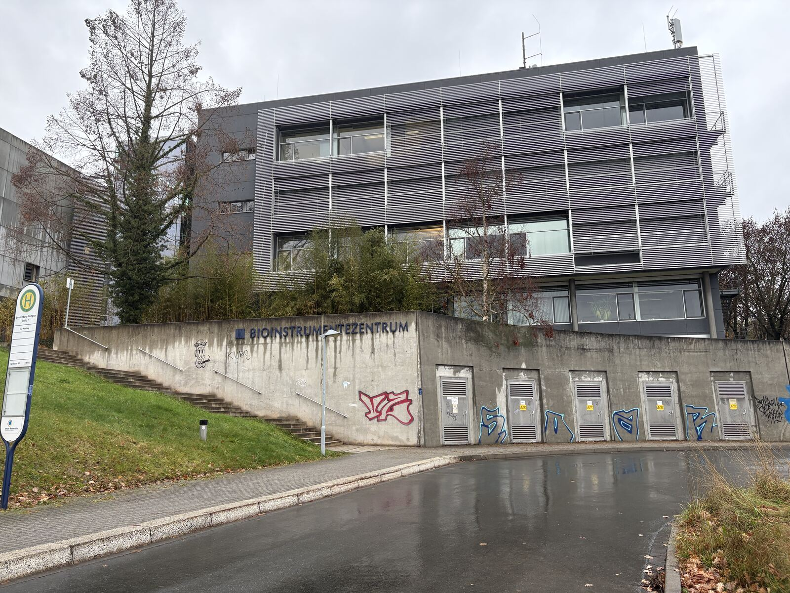

Von der Haltestelle bin ich zu Fuß zum **Max-Planck-Institut für Biogeochemie** gelaufen. Auf dem Weg habe ich ein paar Bilder gemacht. Man kommt an mehreren Instituten vorbei, zum Beispiel am Fraunhofer-Institut für Angewandte Optik und Feinmechanik (IOF), dessen Fassade aus vielen blauen und violetten Feldern besteht.

Ein Wegweiser vor einem der Gebäude zeigt, wie viel Forschung hier auf engem Raum steht: Das Abbe Center of Photonics, die Lichtwerkstatt Jena und das QPhoton Center teilen sich die Anzeige.

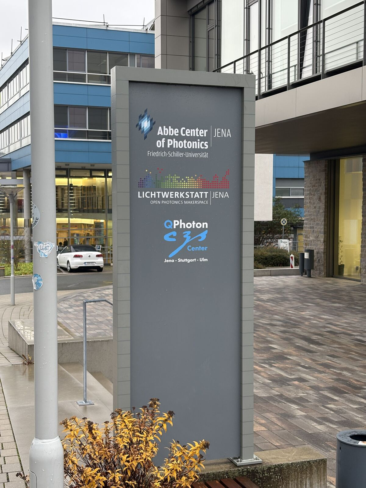

## Der Flora-Incognita-Stand im Max-Planck-Institut

Ich arbeite als studentische Hilfskraft für die TU Ilmenau im **Flora-Incognita-Projekt**. Flora Incognita ist eine App, mit der man Pflanzen per Foto bestimmen kann. An dem Projekt arbeiten zwei Partner zusammen: Die TU Ilmenau kümmert sich um die technische Seite der App, das Max-Planck-Institut für Biogeochemie um die biologische. Zur Langen Nacht gab es deshalb einen gemeinsamen Stand im Institut, und wir haben ihn dort mit aufgebaut. Das hat von etwa 15:30 Uhr bis kurz vor 18:00 Uhr gedauert.

Das erste Bild aus der Halle zeigt den Stand, bevor etwas darauf lag: ein Tisch, zwei Stühle und dahinter ein Informationsposter.

Das Poster auf diesem Tisch war ein Informationsposter zu Flora Incognita. Daneben stand ein zweites Poster von einem Partnerprojekt, das in der App läuft: **PollenNet**. Das Ziel dieses Projekts ist es, mit Beobachtungen von Pflanzen die lokale Pollenbelastung durch Allergiepflanzen vorherzusagen. Auf dem Poster steht dazu das Beispiel Hasel. Die Idee dahinter: Wenn viele Menschen Pflanzen fotografieren und melden, entsteht daraus ein Bild davon, welche Pflanze wo gerade blüht.

Das Flora-Incognita-Poster erklärt das Projekt als Comic. Es trägt den Titel „More than plant identification“, also etwa „Mehr als Pflanzenbestimmung“. Die Botschaft: Die App sagt nicht nur, welche Pflanze man vor sich hat. Die Beobachtungen vieler Nutzerinnen und Nutzer helfen auch der Forschung, weil sie zeigen, wo welche Arten vorkommen.

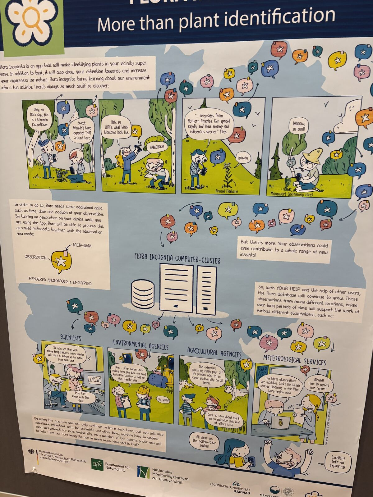

Für die Besucher gab es etwas zum Mitmachen. Ein **Glücksrad** mit dem Flora-Incognita-Logo stand auf dem Tisch, daneben lagen Infokarten und Aufkleber.

In derselben Halle gab es noch weitere Stände. An einer Bastelstation konnte man mit einer Pinzette Perlen in Atom-Vorlagen legen. Jede Perlenfarbe stand für einen Baustein, nämlich Neutronen, Protonen und Elektronen. So lässt sich ausprobieren, wie ein Atom aufgebaut ist und wie sich das Element ändert, wenn man einen Baustein hinzufügt oder wegnimmt.

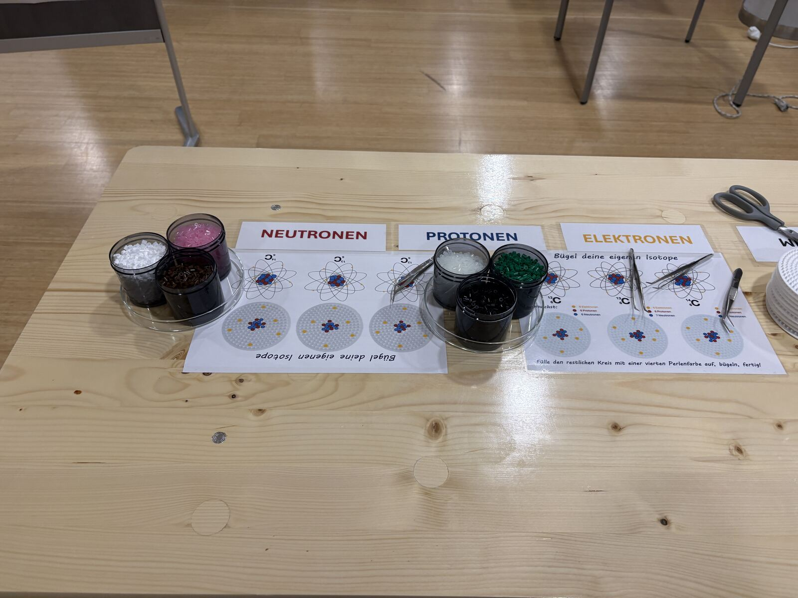

## Der Weg zur Ernst-Abbe-Hochschule

Kurz vor 18:00 Uhr bin ich losgegangen, zur **Ernst-Abbe-Hochschule Jena** (EAH). Der Weg hat etwa eine halbe Stunde gedauert. Inzwischen war es dunkel, und der Campus hatte sich verändert. Gebäude wurden farbig angestrahlt, und am Himmel standen Lichtstrahlen.

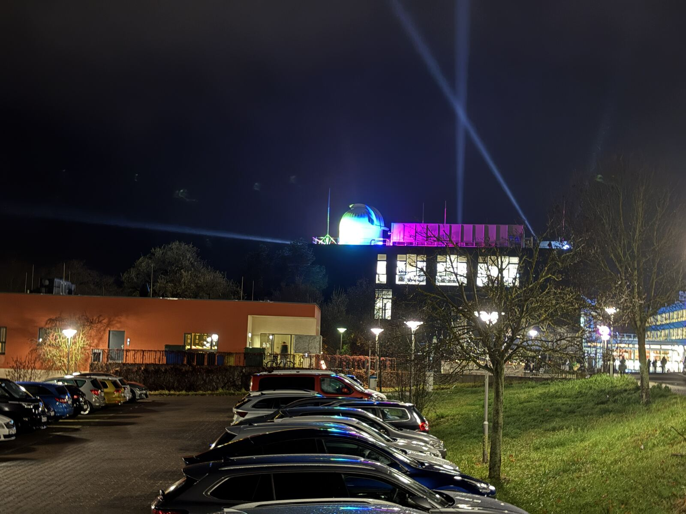

Auch ein Hochhaus auf dem Weg war beleuchtet, in einem warmen Rot mit blauen Streifen.

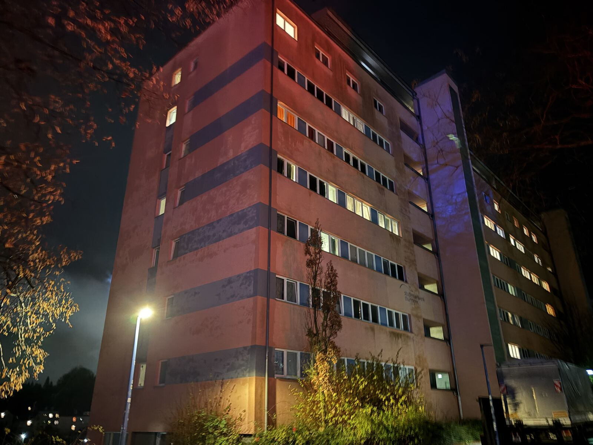

Von dort ging es direkt in den ersten Vortrag.

## „Die Vermessung der Musik“

Der erste Vortrag trug den Titel **„Die Vermessung der Musik“** mit dem Untertitel „Eine mathematische Reise durch die Welt der Klänge“. Er fand von 18:45 bis 19:30 Uhr in Hörsaal 2 der EAH statt.[^2] Auf den Folien steht Prof. Dr. Christopher Schneider vom Fachbereich Grundlagenwissenschaften. Live-Musik mit Gitarren gehörte dazu, und die Töne wurden gleichzeitig mit einer App auf die Leinwand gebracht. So konnte man sehen, was man hört.

Ich fasse hier zusammen, worum es in dem Vortrag ging. Die Folien sind teilweise im Bild zu sehen.

### Schall ist eine Druckwelle

Ein Ton entsteht, wenn etwas schwingt, zum Beispiel eine Gitarrensaite. Die Saite schiebt die Luftteilchen um sich herum an. Dort, wo die Teilchen zusammenrücken, steigt der Luftdruck, das nennt man eine **Verdichtung**. Dort, wo sie auseinanderrücken, sinkt der Druck, das ist eine **Verdünnung**. Beides wechselt sich ab und wandert durch den Raum. Das ist die Schallwelle.

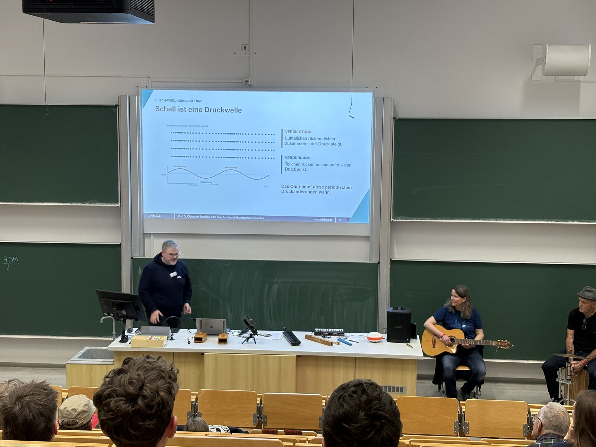

Wichtig ist, dass dabei keine Luft von der Saite zu meinem Ohr strömt. Die Teilchen schwingen nur um ihren Platz hin und her. Was wandert, ist die Druckänderung.

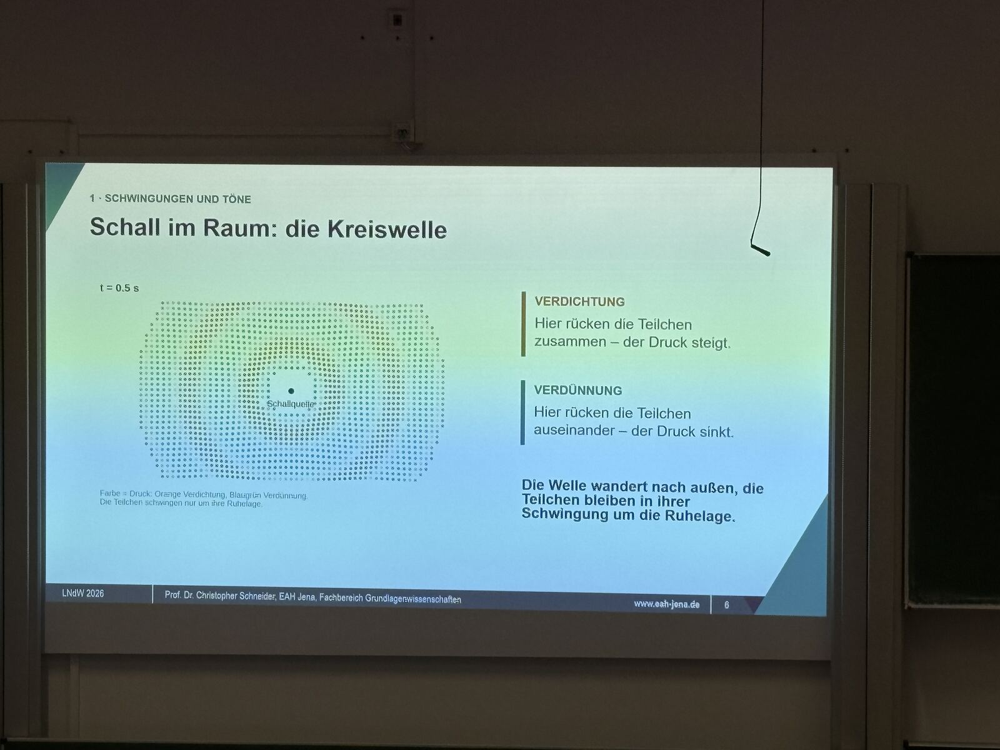

Im Raum breitet sich der Schall in alle Richtungen aus, wie die Ringe, wenn man einen Stein ins Wasser wirft. Auf der Folie steht es so: „Die Welle wandert nach außen, die Teilchen bleiben in ihrer Schwingung um die Ruhelage.“

### Die Tonhöhe ist eine Frequenz

Wie hoch ein Ton klingt, hängt davon ab, wie schnell die Luft schwingt. Diese Zahl nennt man die **Frequenz** $f$, und sie wird in Hertz (Hz) angegeben. 1 Hz bedeutet eine Schwingung pro Sekunde. Der Kammerton a' hat zum Beispiel etwa 440 Hz, die Luft schwingt dabei also rund 440-mal pro Sekunde hin und her.

### Obertöne: Warum Instrumente verschieden klingen

Eine gezupfte Saite schwingt nicht nur als Ganzes. Sie schwingt gleichzeitig auch in zwei Hälften, in drei Dritteln und so weiter. Jede dieser Schwingungen hat eine eigene Frequenz. Man nennt die tiefste Frequenz den **Grundton** $f_0$, die anderen heißen **Obertöne**. Ihre Frequenzen sind ganzzahlige Vielfache des Grundtons:

$$f_n = n \cdot f_0 \qquad n = 1, 2, 3, \dots$$

Auf der Folie waren die ersten Teiltöne so beschrieben: $n = 1$ ist der Grundton, $n = 2$ liegt eine Oktave höher, $n = 3$ eine Oktave plus eine Quinte, $n = 4$ zwei Oktaven höher.

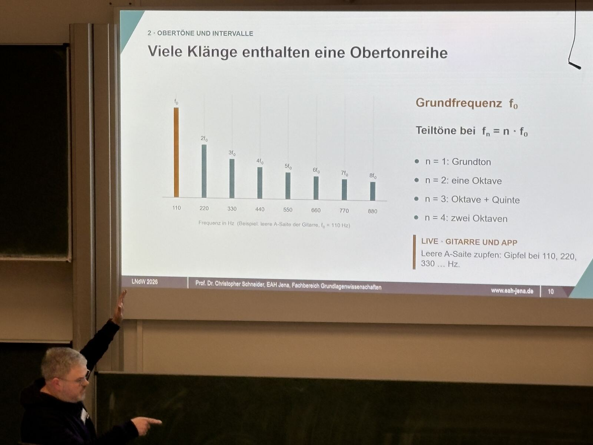

Das wurde live ausprobiert: Die leere A-Saite einer Gitarre hat die Grundfrequenz 110 Hz. Laut Folie zeigt die App dabei Spitzen bei 110, 220 und 330 Hz. Das ist genau die Reihe $f_0$, $2 f_0$, $3 f_0$.

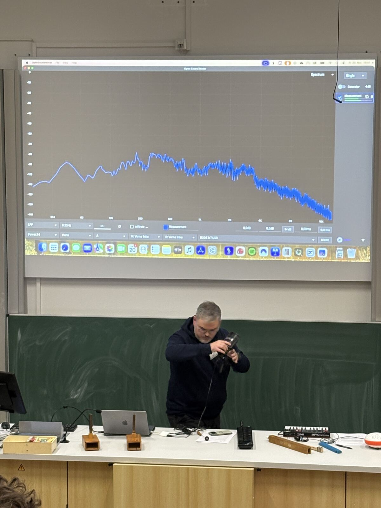

Dass eine Gitarre anders klingt als eine Flöte, obwohl beide denselben Ton spielen, liegt an den Obertönen. Beide haben denselben Grundton, aber die Obertöne sind unterschiedlich stark. Diese Mischung nennt man die **Klangfarbe**. Mit dem Spektrum in der App sieht man sie als Kurve mit Spitzen.

### Intervalle sind Frequenzverhältnisse

Ein **Intervall** ist der Abstand zwischen zwei Tönen. Das Besondere ist, dass die Intervalle, die wir als wohlklingend empfinden, einfachen Zahlenverhältnissen entsprechen. Auf der Folie standen vier:

| Intervall | Frequenzverhältnis |
|---|---|
| Oktave | $2 : 1$ |
| Quinte | $3 : 2$ |
| Quarte | $4 : 3$ |
| Große Terz | $5 : 4$ |

Bei der Oktave schwingt der höhere Ton also doppelt so schnell wie der tiefere. Die Folie zeigt das, indem sie beide Töne über die gleiche Zeitspanne legt: Beim Verhältnis $3 : 2$ passen in dieser Zeit zum Beispiel drei Schwingungen des einen und zwei des anderen. Je einfacher das Verhältnis, desto schneller wiederholt sich das gemeinsame Muster, und desto stimmiger klingt es.

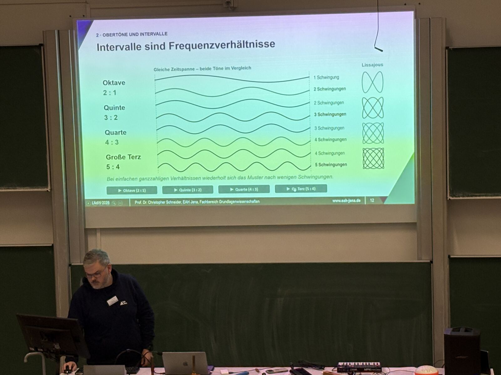

### Schwebungen

Spielt man zwei Töne mit fast gleicher, aber nicht ganz gleicher Frequenz, passiert etwas Hörbares: Die Lautstärke schwillt regelmäßig an und ab. Das nennt man eine **Schwebung**. Sie entsteht, weil sich beide Wellen abwechselnd verstärken und abschwächen. Die Schwebungsfrequenz ist der Unterschied der beiden Frequenzen:

$$\Delta f = |f_1 - f_2|$$

Das Beispiel auf der Folie: Bei 440 Hz und 443 Hz schwillt die Lautstärke dreimal pro Sekunde an und ab, denn $|440 - 443| = 3$. Dazu waren laut Folie zwei Stimmgabeln vorgesehen. Ihr Ton war verstärkt hörbar, und in der App konnte man das Pulsieren sehen.

Daran erkennt man auch, wie man ein Instrument stimmt: Man spielt den Ton neben einem Referenzton und verändert die Saite so lange, bis die Schwebung langsamer wird und verschwindet. Dann stimmen die beiden Frequenzen überein.

### Wie sich ein Orchester einstimmt

Im Orchester läuft das genau so. Die Folie dazu beschreibt vier Schritte: Die Oboe gibt das a' vor, weil sie einen klaren, obertonreichen und stabilen Ton hat. Die Bläser stimmen nach, indem sie ihr Instrument minimal verlängern oder verkürzen, bis nichts mehr schwebt. Die Streicher stimmen erst das A und danach über schwebungsfreie Quinten die übrigen Saiten. Beim Spielen hört man weiter aufeinander. Dazu steht auf der Folie, dass der Kammerton heute meist bei 440 bis 443 Hz liegt, in der historischen Aufführungspraxis dagegen oft bei 415 Hz.

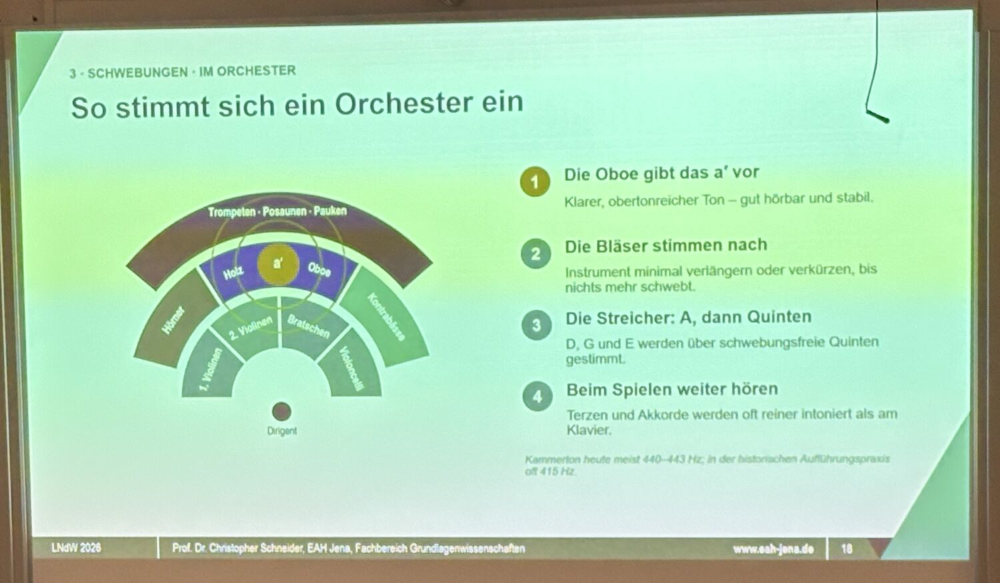

## „Von Mona Lisa bis Monet“

Der zweite Vortrag war eine spontane Entscheidung. Er hieß **„Von Mona Lisa bis Monet: Wie Sehfehler berühmte Gemälde formten“** und lief von 19:30 bis 20:10 Uhr in Hörsaal 4 der EAH.[^3] Laut Programm verbindet er bildende Kunst mit Optometrie, also der Lehre vom Sehen. Es geht darum, wie Augenerkrankungen und Sehfehler das Werk großer Künstler beeinflusst haben könnten. Genannt werden Leonardo da Vinci, Rembrandt und Monet, die „nur Menschen“ gewesen seien, die auch von Krankheiten betroffen waren. Als Beispiele führt das Programm den Grauen Star, die Makuladegeneration und Probleme des beidäugigen Sehens an.

Auf den Folien standen zu den Künstlern Stichwörter, die ich hier nur wiedergebe, ohne sie zu bewerten. Bei der **Mona Lisa** stand das *Holmes-Adie-Syndrom*, dazu ein Bild mit der Überschrift *konsensuelle Lichtreaktion*. Das ist die Reaktion der Pupille auf Licht: Beleuchtet man ein Auge, verengen sich normalerweise beide Pupillen. Beim Holmes-Adie-Syndrom reagiert eine Pupille nur sehr langsam darauf.

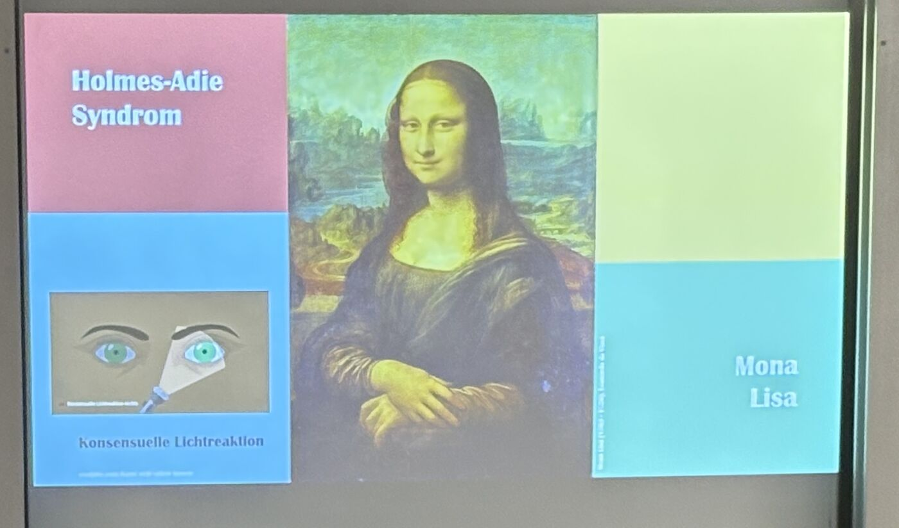

Beim **Abendmahl** von Leonardo da Vinci stand das Thema *monokulare Tiefe* mit dem Stichwort *Linearperspektive*. Mit nur einem Auge sieht man keine räumliche Tiefe über den Abstand der beiden Augen. Man schätzt sie aus Hinweisen im Bild ab, zum Beispiel aus Linien, die auf einen Punkt am Horizont zulaufen. Genau das macht die Linearperspektive.

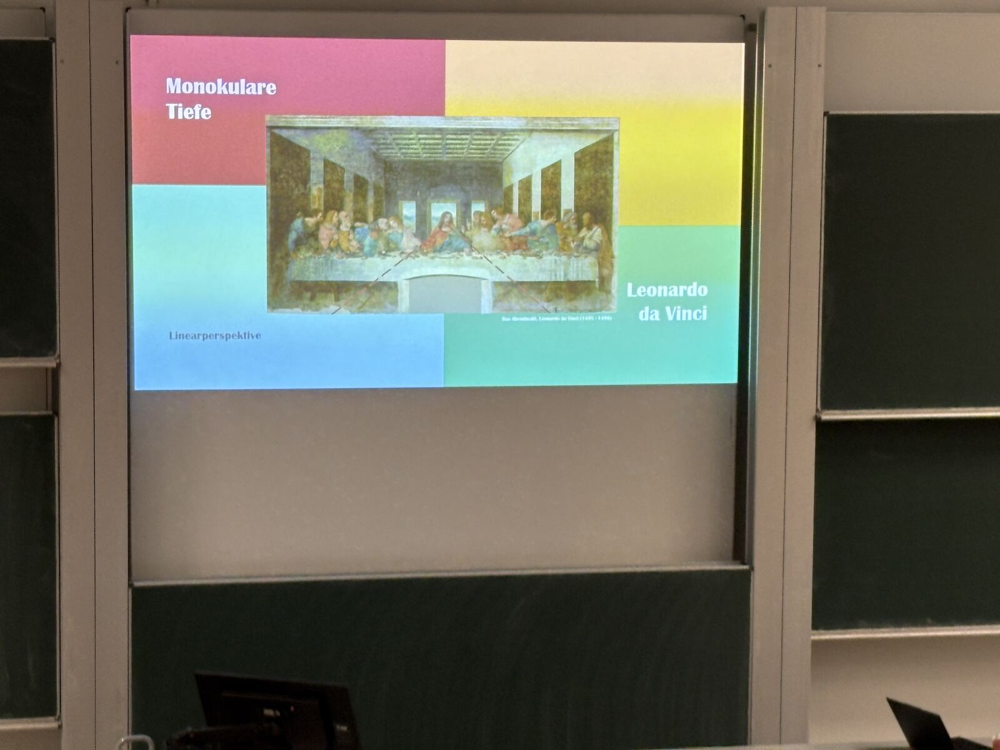

Zu **Claude Monet** (1840 bis 1926, Impressionismus) zeigte die Folie ein Gemälde mit einer Frau mit Sonnenschirm in einem Feld. Laut Programm ging es um die Frage, wie Augenerkrankungen die Malerei beeinflusst haben könnten. Mehr zu Monet will ich hier nicht behaupten, weil ich es nicht mitgeschrieben habe.

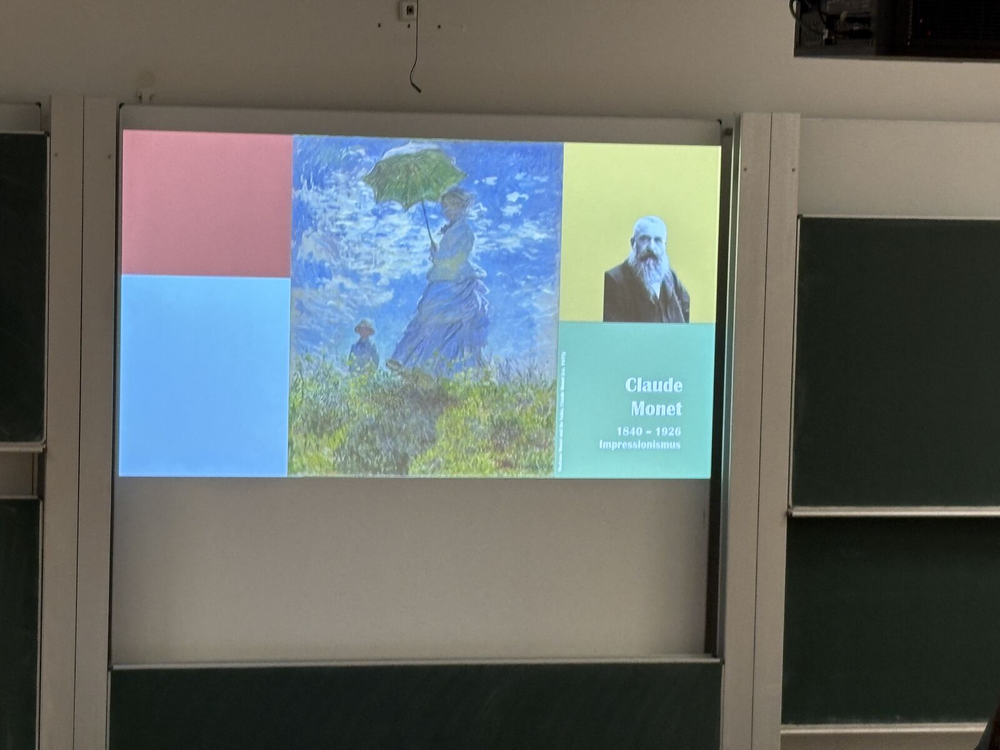

## Wie es weitergeht

Der Abend war damit noch nicht zu Ende. Es ging danach noch an weitere Stationen, unter anderem zu einem Vortrag über den Planeten Merkur und zu den Ausstellungsstücken des Fraunhofer-Instituts. Dazu schreibe ich noch einen weiteren Teil.

[^1]: [Lange Nacht der Wissenschaften Jena, Startseite](https://www.lndw-jena.de/) und [Programmübersicht](https://www.lndw-jena.de/programm) (abgerufen am 22.11.2026)
[^2]: [Die Vermessung der Musik, Programmseite der Langen Nacht der Wissenschaften Jena](https://www.lndw-jena.de/programm/die-vermessung-der-musik) (abgerufen am 22.11.2026)
[^3]: [Von Mona Lisa bis Monet: Wie Sehfehler berühmte Gemälde formten, Programmseite der Langen Nacht der Wissenschaften Jena](https://www.lndw-jena.de/programm/von-mona-lisa-bis-monet-wie-sehfehler-beruehmte-gemaelde-formten) (abgerufen am 22.11.2026)
