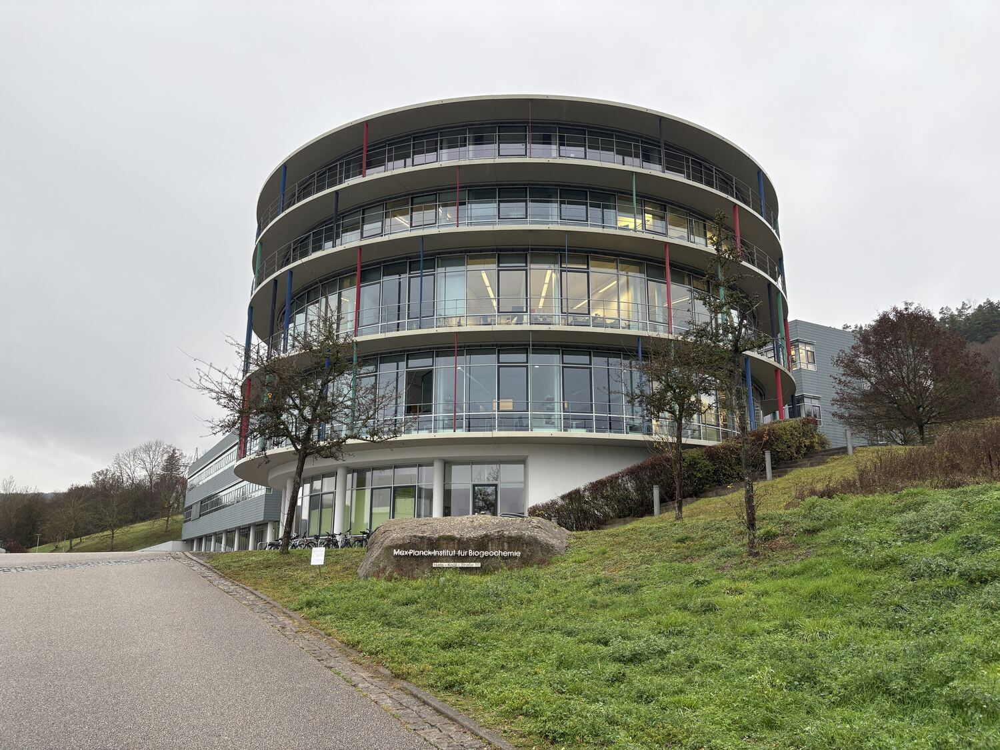
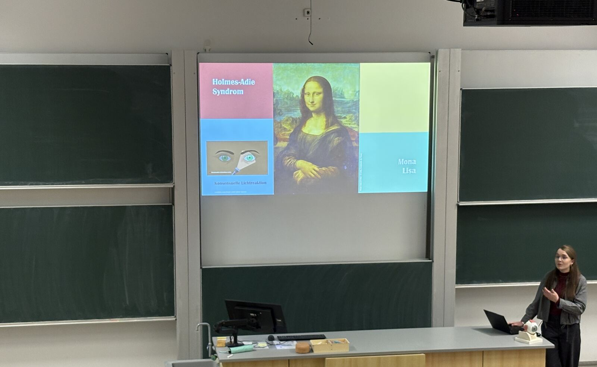
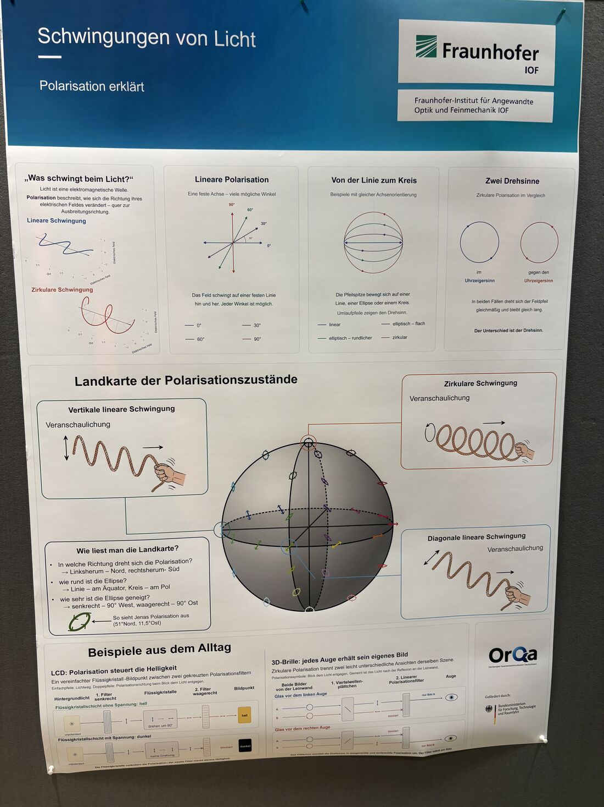
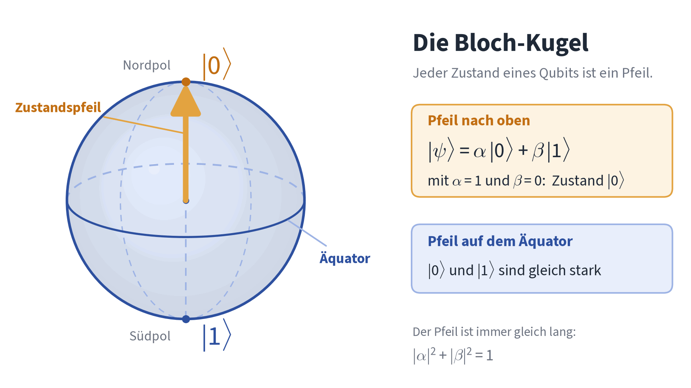
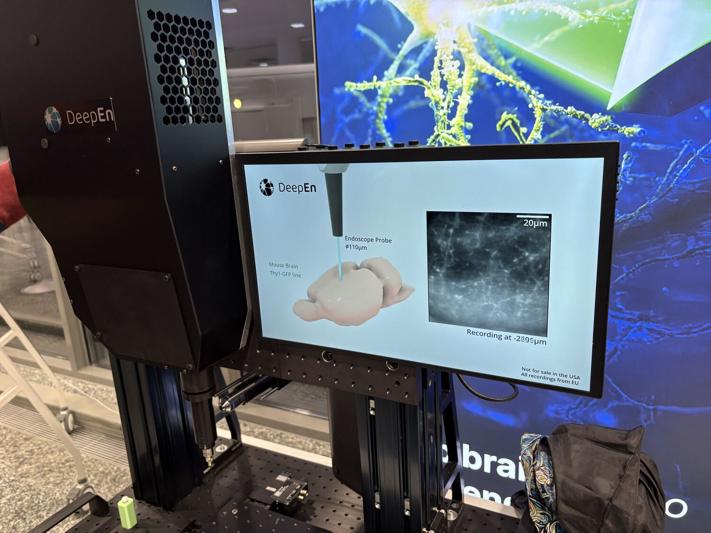
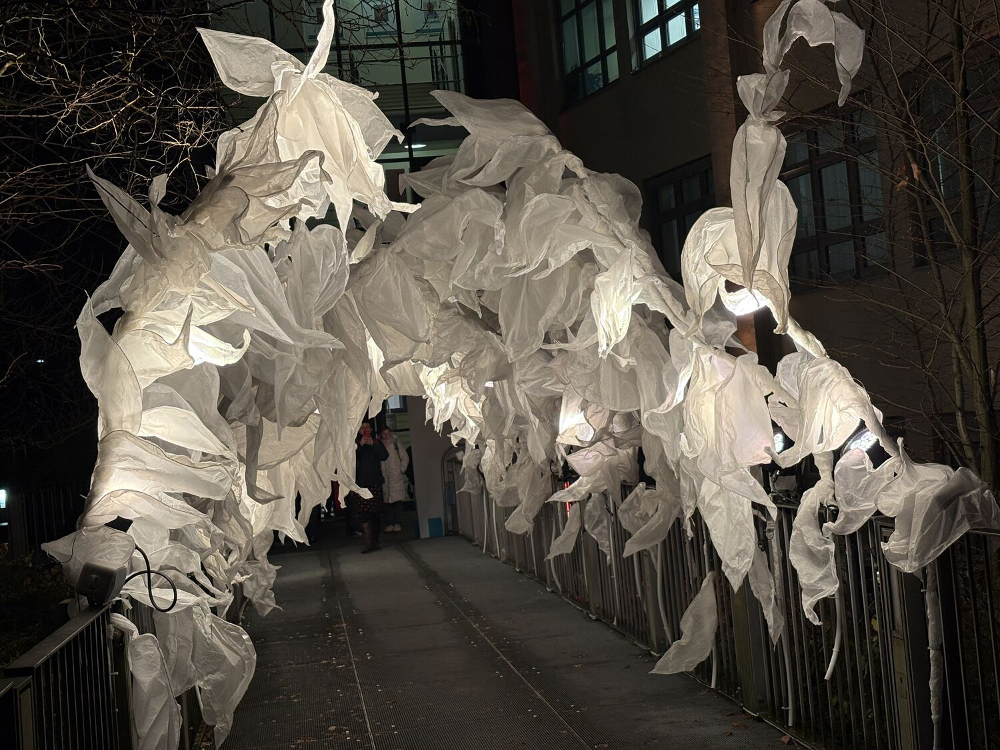
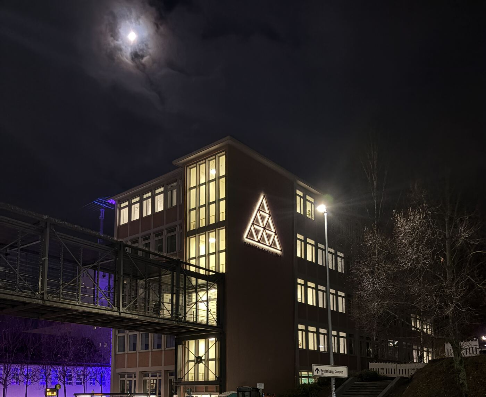

## Worum es geht

Am Freitag, den 20. November 2026, war in Jena die **Lange Nacht der Wissenschaften**. Es war die 10. Ausgabe, und die Ernst-Abbe-Hochschule (EAH) feierte nebenbei ihr 35-jähriges Bestehen.[^17] Von 18 bis 24 Uhr machen an diesem Abend Hochschulen, Institute, Firmen und die Klinik ihre Türen auf. Es gibt Vorträge, Experimente und Ausstellungsstücke zum Anfassen. Über 50 Partner sind dabei, im Programm stehen 543 Einträge, und zwischen den Orten fahren Shuttle-Busse.[^1]

Ich war von etwa 15 Uhr bis nach 23 Uhr unterwegs. Dieser Artikel erzählt den Abend so, wie ich ihn erlebt habe. Weitere Fotos gibt es in der [Galerie](/galerie/lange-nacht-der-wissenschaften-jena-2026/).

## Am Beutenberg Campus

Mein Tag begann um 15:10 Uhr an der Bushaltestelle am **Beutenberg Campus**. Das ist der Wissenschaftsstandort im Westen von Jena, auf dem Max-Planck-Institute, Leibniz-Institute und das Fraunhofer-Institut für Angewandte Optik und Feinmechanik (IOF) dicht nebeneinander stehen. Es war grau und nass, und vom Trubel des Abends war noch nichts zu spüren. Ich war vom Regen schon komplett durchnässt und hatte, ehrlich gesagt, ziemlich schlechte Laune.

Ich wollte zu Fuß zum **Max-Planck-Institut für Biogeochemie** (MPI-BGC) und habe mich dabei komplett verlaufen. Nur dadurch bin ich am Fraunhofer IOF und an der Sternwarte vorbeigekommen, die ich sonst nicht gesehen hätte. Unterwegs habe ich ein paar Bilder gemacht. Jena ist seit über hundert Jahren ein Ort der Optik, und man merkt es auf diesem Campus.

## Der Flora-Incognita-Stand

Ich bin Hiwi im **Flora-Incognita-Projekt** der TU Ilmenau. Flora Incognita ist eine App, mit der man Pflanzen per Foto bestimmen kann. Die TU Ilmenau kümmert sich um die Technik der App, unsere Partner vom MPI-BGC um die Biologie. Weil ich diese Partner auch mal persönlich kennenlernen wollte, habe ich angeboten, beim Aufbau des gemeinsamen Stands zu helfen. Er war zur Langen Nacht im Institut, und wir haben ihn bis kurz vor 18 Uhr aufgebaut.

Das Institut ist ein runder, fünfstöckiger Bau, der Turm auf dem Campus. Vor dem Eingang liegt ein Findling mit der Aufschrift „Max-Planck-Institut für Biogeochemie“. Von außen sieht das Institut deutlich cooler aus als die Gebäude der TU Ilmenau. Die Lobby wirkte auf mich allerdings irgendwie traurig, da ziehe ich den Zuse-Bau unserer Uni vor. Eine Infostation brauchten wir nicht, wir wussten ja, wo wir hinmüssen.

Ich war gegen 15:20 Uhr dort, habe mich aber erst nicht reingetraut und mich in den Regen vor das Haus gesetzt. Kurz vor 16 Uhr bin ich doch hineingegangen, weil ich Angst hatte, mich noch mehr zu erkälten, als ich es ohnehin schon war.

Auf unserem Tisch stand ein Informationsposter zu Flora Incognita. Daneben hing das Poster von **PollenNet**, einem Partnerprojekt in der App. Es will vorhersagen, wie stark die Pollenbelastung durch Allergiepflanzen ist. Dazu hilft es, wenn viele Menschen Pflanzen fotografieren und melden. Das Beispiel auf dem Poster ist die Hasel, die oft schon im Januar blüht. Ein drittes Poster erklärt das Projekt als Comic mit dem Titel „More than plant identification“. Ein Foto der Pflanze sagt der App nicht nur, was es ist, sondern zeigt der Forschung auch, wo welche Art vorkommt. Für die Besucher gab es ein Glücksrad. Man drehte es, und je nach Farbe, auf der es landete, bekam man eine Frage gestellt. Erwachsene hatten vier Themengebiete zur Auswahl, Kinder drei. Erfahrungsgemäß wird das Rad extrem gut angenommen. Fürs Mitmachen gab es verschiedene Preise, dazu Infokarten und Aufkleber.

Direkt neben uns hatte das MPI-BGC einen eigenen Stand. An einer Bastelstation legte man mit der Pinzette Perlen in Atom-Vorlagen, die für Neutronen, Protonen und Elektronen standen. Im MPI-BGC gab es noch weitere interessante Stationen, die ich leider aus Zeitgründen nicht mehr besuchen konnte.

## Der Weg zur Ernst-Abbe-Hochschule

Kurz vor 18 Uhr bin ich mit dem Bus vom Beutenberg Campus zur **Ernst-Abbe-Hochschule** gefahren, das dauerte etwa eine halbe Stunde. Inzwischen war es dunkel, und der Campus sah anders aus: Gebäude waren in Blau, Violett und Rot angestrahlt, und am Himmel standen Lichtstrahlen. Laut Ostthüringer Zeitung gab es eine Lasershow vom Dach des Jenoptik-Hochhauses. Ob meine Strahlen davon stammten, weiß ich nicht.

## „Die Vermessung der Musik“

Mein erster Vortrag hieß **„Die Vermessung der Musik: Eine mathematische Reise durch die Welt der Klänge“**. Er lief von 18:45 bis 19:30 Uhr, laut Programm in Hörsaal 2.[^2] Der Raum war allerdings vorher geändert worden, vermutlich in Hörsaal 4, ganz sicher bin ich nicht. Gesagt hat uns das niemand. Wir sind erst einmal umhergeirrt und kamen am Ende etwa fünf Minuten zu spät durch den Hintereingang herein. Das hätte man wenigstens im Internet hinschreiben können. Gehalten hat ihn Prof. Dr. Christopher Schneider vom Fachbereich Grundlagenwissenschaften der EAH. Ein Professor für Grundlagenwissenschaften klang für mich erst ungewohnt, denn an der TU Ilmenau haben wir Professoren für Mathematik und für Physik. In Jena gibt es dafür einen eigenen Fachbereich, und das finde ich eine nette Besonderheit. Dazu gab es Live-Musik mit Gitarren von **MAETZIG & SELLE**. Die Band spielt laut Programm deutsche „musikalische Drei-Minuten-Dramen“, darunter Titel von Keimzeit, Silly und Gundermann.[^19] Die Musik war für eine geeignete Zielgruppe bestimmt schön. Leider war ich nicht Teil dieser Zielgruppe. Am Anfang und am Ende spielte die Band ein Intro und ein Outro, die vor allem Werbung für sie waren und den Vortrag ein- und ausleiteten. Dazwischen zeigte eine App an passenden Stellen die Töne gleichzeitig auf der Leinwand, so sah man, was man hörte.

Der Vortrag begann mit der Frage, was ein Ton überhaupt ist. Eine schwingende Saite schiebt die Luftteilchen an. Es entstehen Stellen mit höherem und niedrigerem Druck, und diese Druckänderung wandert durch den Raum, nicht die Luft selbst. Wie hoch ein Ton klingt, hängt von der **Frequenz** ab, also davon, wie oft die Luft pro Sekunde hin und her schwingt. Der Kammerton a' hat etwa 440 Hertz.

Spannend wurde es bei den **Obertönen**. Eine gezupfte Saite schwingt nicht nur als Ganzes, sondern gleichzeitig auch in Hälften, Dritteln und so weiter. Ihre Frequenzen sind ganzzahlige Vielfache des Grundtons: $f_n = n \cdot f_0$. Laut Folie zeigte die App bei der leeren A-Saite der Gitarre Spitzen bei 110, 220 und 330 Hertz. Dass eine Gitarre anders klingt als eine Flöte, liegt daran, wie stark die Obertöne jeweils sind. Das nennt man Klangfarbe.

Dann ging es um **Intervalle**. Die Abstände zwischen Tönen, die wir als wohlklingend empfinden, entsprechen einfachen Zahlenverhältnissen: Die Oktave ist $2:1$, die Quinte $3:2$, die Quarte $4:3$ und die große Terz $5:4$. Je einfacher das Verhältnis, desto schneller wiederholt sich das gemeinsame Muster der beiden Töne, und desto stimmiger klingt es.

Zum Schluss kamen die **Schwebungen**. Spielt man zwei Töne mit fast gleicher Frequenz, schwillt die Lautstärke regelmäßig an und ab. Wie oft pro Sekunde, sagt der Unterschied der Frequenzen: $\Delta f = |f_1 - f_2|$. Bei 440 und 443 Hertz sind das drei Mal pro Sekunde. Genau so stimmt man ein Instrument: Man verändert die Saite, bis die Schwebung verschwindet. Im Orchester gibt die Oboe das a' vor, die anderen stimmen nach. Heute liegt der Kammerton meist bei 440 bis 443 Hertz, in der historischen Aufführungspraxis oft bei 415.

Der Vortrag war sauber aufgebaut. Allerdings war mir vieles von dem, was erklärt wurde, schon bekannt, zum Beispiel der Quintenzirkel. Ich hätte mir weniger Praxis und dafür mehr Theorie gewünscht.

## „Von Mona Lisa bis Monet“

Im Anschluss bin ich spontan in einen zweiten Vortrag gegangen: **„Von Mona Lisa bis Monet: Wie Sehfehler berühmte Gemälde formten“**. Er lief von 19:30 bis 20:10 Uhr in Hörsaal 4. Laut Programm verbindet er Kunst mit Optometrie, also der Lehre vom Sehen, und fragt, wie Augenerkrankungen das Werk großer Künstler beeinflusst haben könnten.[^3]

Bei der **Mona Lisa** stand das Holmes-Adie-Syndrom auf der Folie, eine Störung, bei der eine Pupille nur sehr langsam auf Licht reagiert. Beim **Abendmahl** von Leonardo da Vinci ging es um die räumliche Tiefe und die Linearperspektive: Parallele Linien laufen im Bild auf einen Fluchtpunkt zu. Bei **Claude Monet** ging es um den Grauen Star, bei dem sich die Linse trübt und die Farben blasser und gelblicher wirken. Die Vortragende hatte ein Foto mitgebracht, das Monet etwa drei Jahre vor seinem Tod nach der Operation zeigt. Wenn man hineinzoomt, sieht man, dass er eine Brille mit riesigen Gläsern trägt. Es war eine der ersten Brillen dieser Art von Zeiss. Damit konnte er in seinen letzten Lebensjahren wieder besser sehen und weitermalen.

Der letzte Künstler war **Edvard Munch**. Den „Schrei“ hat er laut Vortrag fünfmal angefertigt. Er verarbeitet darin eine nächtliche Panikattacke. Um 1930 bekam Munch, der seit Jahren Bluthochdruck hatte, eine **Netzhautblutung**. Als Beispiel zeigte die Vortragende ein modernes Foto des Augenhintergrunds mit dem blinden Fleck, der Stelle des schärfsten Sehens und vielen Blutgefäßen. Munch zeichnete seine eigene Wahrnehmung: schwarze Flecken, die Gesichtsfeldausfälle. Er beschrieb sie als einen großen dunklen Vogel, der sich langsam vor ihm bewegt und von dem ein leuchtend blauer Strahl ausgeht, der ins Grüne und in einen gelben Ring übergeht. Die Vortragende fand das die poetischste Beschreibung einer Netzhautblutung, die sie kenne. Die Blutungen bildeten sich zurück, und Munch behielt kaum bleibende Sehstörungen.

> **Kurz erklärt: Pupille und Lichtmenge.** Die Pupille regelt, wie viel Licht ins Auge fällt, und zwar über ihre Fläche. Weitet sie sich von 2 auf 8 Millimeter, kommt $(8/2)^2 = 16$ Mal so viel Licht herein.

## Mit dem Bus zum Fraunhofer IOF

Gegen 20:10 Uhr bin ich mit dem Bus zurück zum Beutenberg Campus gefahren und von dort zum **Fraunhofer IOF**. Das Institut baut optische Systeme, auch für Satelliten. Wer meine besonders guten Fähigkeiten bei Experimenten und Messtechniken aus den Grundpraktika der TU Ilmenau kennt, weiß, dass ich bei der Feinmechanik eindeutig richtig bin. Am Eingang war am Abend viel los: Die Glasfassade war violett und blau angestrahlt, und drinnen standen die Besucher an den Ständen.

### Merkur und das Spektrometer MERTIS

Als Erstes war ich in einem Pop-Up-Vortrag über den Planeten **Merkur**. Im Programm heißt er „GALA / MERTIS: Mit Spiegelteleskopen auf dem Weg zu den Planeten Jupiter und Merkur“. Ich war nur kurz im Vortrag um 20:30 Uhr dabei. Deshalb stütze ich mich bei den Inhalten auf meine Fotos der Folien und auf das Programm.[^4]

Auf den Folien standen ein paar Zahlen zu Merkur: 4 880 Kilometer Durchmesser, damit der kleinste Planet des Sonnensystems, 58 Millionen Kilometer von der Sonne entfernt und 88 Tage für einen Umlauf. Dann ging es um die Raumsonde **BepiColombo**, die elf Instrumente trägt. Eines davon ist **MERTIS**, ein abbildendes Spektrometer, das das Fraunhofer IOF mitgebaut hat. Es soll die Oberfläche untersuchen, die Minerale und Elemente bestimmen und das Magnetfeld erforschen.

> **Kurz erklärt: Spektrometer und Dichte.** Ein Spektrometer zerlegt Licht nach Wellenlängen, ähnlich wie ein Prisma. Weil jedes Material Licht anders zurückwirft oder abstrahlt, kann man aus dem Spektrum ablesen, woraus eine Oberfläche besteht. Ein *abbildendes* Spektrometer macht das für jeden Bildpunkt, es entsteht also eine Karte der Minerale. Aus Masse und Durchmesser auf der Folie habe ich außerdem die Dichte von Merkur ausgerechnet: etwa 5,4 Gramm pro Kubikzentimeter, fast so viel wie bei der Erde. Merkur muss also einen riesigen Eisenkern haben.

### JUICE und der Laserhöhenmesser GALA

Der zweite Teil des Vortrags, so verstehe ich den Titel, ging um **JUICE**, die Jupitermission der europäischen Raumfahrtagentur ESA. Die Sonde soll die Eismonde Ganymed, Kallisto und Europa erforschen. An Bord ist das Instrument **GALA**, ein Laserhöhenmesser.[^9][^10] Es schickt Laserpulse zur Oberfläche und misst, wie lange das Licht für Hin- und Rückweg braucht. Daraus ergibt sich der Abstand: $d = c \cdot t / 2$. Aus 500 Kilometern Höhe dauert das gut drei Millisekunden. Für eine Genauigkeit von etwa zehn Zentimetern muss man diese Zeit auf unter eine Nanosekunde genau messen.

Das Fraunhofer IOF hat zusammen mit HENSOLDT Optronics das Spiegelteleskop gebaut, das die zurückkommenden Pulse auffängt. In der Ausstellung stand dazu eine Miniatur. Wozu das Ganze? Ganymed wird von Jupiters Anziehungskraft leicht verformt. Misst GALA, wie stark sich die Eiskruste hebt und senkt, verrät das, ob darunter ein Ozean liegt. Laut DLR wären bei etwa einem Meter Verformung wahrscheinlich kein Ozean da, bei etwa acht Metern müsste einer da sein.

### Abenteuer Weltraum

Danach war ich in der Ausstellung **„Abenteuer Weltraum“** im Carl-Zeiss-Saal. Sie zeigt Optiken des IOF für die Erd- und Weltraumbeobachtung.[^5] In den Vitrinen standen echte Bauteile, zum Beispiel ein mit 3D-Druck für Metall gefertigtes Teleskop für Kleinsatelliten und das Projekt **RAINBOW**, ein Teleskop mit Spektrometer für die moderne Landwirtschaft. Laut Programm sieht der Satellit „in 50 Farben“. Daran lässt sich ablesen, wie gesund Pflanzen auf einem Feld sind, denn gesunde Blätter werfen nahes Infrarot stark zurück.

## Ein Blick ins Quantenlabor

Eine weitere Station war **„Ein Blick ins Quantenlabor“** im Christiaan-Huygens-Raum des IOF. Der Teaser im Programm lautet: „Mit »verzauberten« Lichtteilchen digitale Daten sicher verschicken oder Bilder aus dem Nichts erschaffen!“ Dahinter steckt die **Quantenverschränkung**, die das Institut für ein hochsicheres Datennetz und für schonende Mikroskopie nutzen will. Zum Mitmachen gab es ein Spiel, bei dem man einen Sicherheitstest an einem echten Quantenkommunikationssystem durchführte.[^6]

Wie ein Bild „aus dem Nichts“ entstehen kann, beschreibt das IOF an einem Projekt namens QUANCER, in dem Tumorgewebe mit „nicht-detektiertem Licht“ untersucht werden soll.[^8] Vereinfacht gesagt werden Photonenpaare erzeugt. Ein Photon geht durch die Probe, das andere trifft die Kamera, ohne die Probe je zu sehen. Das Bild entsteht, weil beide Möglichkeiten, wo das Paar entstehen kann, nicht zu unterscheiden sind und sich überlagern. Die Probe verändert dieses Interferenzmuster. Ob das genau der Aufbau war, auf den sich das Programm bezieht, weiß ich nicht.

Dazu hing ein Poster mit dem Titel **„Schwingungen von Licht: Polarisation erklärt“**. Licht ist eine Welle, und die Polarisation sagt, in welche Richtung ihr elektrisches Feld schwingt. Das kann entlang einer Linie sein (linear), auf einem Kreis (zirkular) oder auf einer Ellipse. Die „Landkarte der Polarisationszustände“ in der Mitte ist eine Kugel, auf der jeder Zustand genau einen Punkt hat. Als Alltagsbeispiele nennt das Poster den LCD-Bildschirm und die 3D-Brille im Kino.

> **Kurz erklärt: Verschränkung.** Zwei verschränkte Photonen haben nur gemeinsam einen Zustand. Misst man bei einem das Ergebnis, steht es für das andere fest. Damit kann man trotzdem nichts schneller als Licht schicken, weil das Einzelergebnis zufällig ist. Für abhörsichere Schlüssel nutzt man etwas anderes: Jede Messung stört einen Quantenzustand. Ein Lauscher fällt deshalb auf.

## Im Leibniz-IPHT

Neben dem IOF sitzt das **Leibniz-Institut für Photonische Technologien** (IPHT). Dort war ich ab etwa 21 Uhr bis nach 22 Uhr, wie überall an diesem Abend als Gast. An manchen Stationen durfte man etwas anfassen und ausprobieren.

### Kryostat und Bloch-Kugel

Bei der Führung **„Kalt, kälter, am kältesten“** ging es um Quantentechnologie und supraleitende Quantenbits, die bei sehr tiefen Temperaturen erforscht werden.[^12] Im Glaskasten stand ein **Kryostat**, ein Kühlgerät aus mehreren übereinander hängenden Ebenen aus Kupfer und Gold. Ich glaube, es war ein echtes Gerät, ganz sicher bin ich nicht. Daneben lief ein Quiz: „Auf der Bloch-Kugel zeigt der Zustandspfeil genau nach oben. Welcher Zustand ist das?“ Die Antwort ist $|0\rangle$.

> **Kurz erklärt: Qubit und Bloch-Kugel.** Ein klassisches Bit ist 0 oder 1. Ein Qubit kann zusätzlich in einer Überlagerung sein: $|\psi\rangle = \alpha|0\rangle + \beta|1\rangle$. Die Bloch-Kugel zeigt jeden Zustand als Pfeil. Am Nordpol steht $|0\rangle$, am Südpol $|1\rangle$, und auf dem Äquator sind beide gleich stark. Es ist dieselbe Kugel wie die Poincaré-Kugel auf dem Poster, nur für Licht. Der Kryostat ist so kalt, weil die empfindlichen Quantenzustände sonst von der Wärmebewegung zerstört werden.

Das Schaubild habe ich selbst gezeichnet.

### Das dünnste Endoskop der Welt

Eine Station hieß **„Erleben Sie das dünnste Endoskop der Welt in Aktion!“**. Dort wird eine haardünne Glasfaser zur Kamera, mit „holografischer Endoskopie“, entwickelt vom IPHT und der Firma DeepEn.[^13] Auf dem Bildschirm sah man die Zeichnung eines Mausgehirns und eine Mikroskopaufnahme.

Am Stand wurde erklärt, wofür das gedacht ist: für die Operationstechniken der Zukunft. Statt einer großen Kamera müsste nur eine dünne Glasfaser in den Körper. Das Problem ist, dass es dafür noch kein fertiges Verfahren gibt. Sobald das Kabel knickt, kommt kein sauberes Bild mehr an. In einer Faser läuft das Licht nämlich auf sehr vielen Wegen gleichzeitig, und beim Biegen mischen sich diese Wege anders.

### Weitere Stationen

Es gab noch viel mehr. Ein Messaufbau mit Laser und Glasfaser trug den Aufkleber „Biophotonik“, vermutlich gehörte er zur Ausstellung zur Bakterienerkennung mit Raman-Spektroskopie.[^14] Auch ein Aufbau mit einer zu einem Ring gebogenen Glasfaser stand dort. Im Leibniz-Bau gab es außerdem einen Supraleiter für magnetische Levitation und ein Rasterkraftmikroskop, bei dem eine feine Spitze die Oberfläche abtastet. Zur Levitation führt das Programm einen ähnlichen Eintrag anderer Veranstalter.[^16] Ob es dieselbe Station war, weiß ich nicht.

### Der Name auf dem Karabiner

Im Laserlabor des Leibniz-Baus gab es etwas zum Mitmachen: Wir konnten uns den Namen auf einen **Karabiner** lasern lassen. Es ist ein Schlüsselanhänger und nichts zum Klettern, aus einem günstigen, recht weichen Metall. Eine Frau am Computer fragte uns nach dem Namen und gab ihn in die Software ein. Dann bekamen wir eine **gelbe Schutzbrille** und gingen in eine kleine Box. Per Knopfdruck wurde gelasert, und das ging in **unter einer Sekunde**. Es war ein Laser der Klasse 4.

> **Kurz erklärt: Klasse 4 und warum es so schnell geht.** Laserklassen gehen von 1 (harmlos) bis 4. Klasse 4 beginnt bei mehr als 500 Milliwatt und ist auch bei Streulicht gefährlich, deshalb sitzt so ein Laser meist in einer geschlossenen Box. Zwei kleine, schnell drehbare Spiegel führen den Strahl über das Werkstück. Er kann sich mit mehreren Metern pro Sekunde bewegen. Ein Name aus zusammen etwa 20 Zentimetern Linie braucht bei 2 Metern pro Sekunde nur 0,1 Sekunden. Das Eintippen dauert länger als das Gravieren.

### Das Elektronenmikroskop

Zum Schluss war ich noch bei der Laborführung zum **Elektronenmikroskop**, „Faszination Mikrokosmos“. Das Programm nennt Führungen jede volle Stunde um halb, jeweils mit höchstens sechs Personen. Ich war vermutlich in der Führung um 21:30 Uhr.[^15] Es ging um ein Rasterelektronenmikroskop, das Insekten, Pollen oder Haare bis in den Nanometerbereich abbildet. Eine zweite Methode, EDX, verrät, aus welchen Elementen eine Probe besteht.

> **Kurz erklärt: Elektronen statt Licht.** Ein Lichtmikroskop kann nur Strukturen auflösen, die größer sind als etwa die halbe Wellenlänge des Lichts, also rund 200 Nanometer. Das ist die Abbesche Grenze, benannt nach Ernst Abbe, nach dem auch die Hochschule heißt. Elektronen haben eine viel kleinere Wellenlänge, deshalb sieht man mit ihnen viel feinere Details.

## Zu Fuß zurück

Die Führung am Elektronenmikroskop war erst nach 22:00 Uhr zu Ende. Danach ging es zu Fuß vom Beutenberg Campus zurück zum Ernst-Abbe-Bau. Das waren etwa 20 bis 30 Minuten.

## Eine Lichtinstallation im Hof

Gegen 22:45 Uhr bin ich an einer Lichtinstallation vorbeigekommen. Hinter Haus 2 des EAH-Campus führt eine Brücke zu den Häusern 4 und 6 und zum Studentenwohnheim in Haus 8. Der Hof war zur Langen Nacht gestaltet worden. Eine Installation zum Thema Licht machte aus der Brücke einen leuchtenden Tunnel aus hellen, gefalteten Bahnen. Das Licht kam von innen, und man ging mitten hindurch.

## Heimweg

Ganz am Ende bin ich zur Haltestelle an der Hochschule gegangen, um von dort zum Bahnhof Jena West zu kommen. Auf dem Weg habe ich noch ein letztes Bild gemacht: das Hochschulgebäude mit dem leuchtenden Dreieck, dem Logo der EAH. Auf dem Wegweiser rechts steht „Beutenberg Campus“, dem Ort, an dem mein Tag begonnen hatte.

## Mein Fazit

Am besten haben mir das Quantenlabor und der Leibniz-Bau gefallen. Insgesamt war aber alles cool, und ich habe viele nette Leute kennengelernt. Die Stände im Max-Planck-Institut kannte ich schon vom Aufbau des Flora-Incognita-Stands. Dort habe ich keine Fotos gemacht, sondern sie mir privat angesehen.

Mein größter Kritikpunkt ist, dass es viel zu voll war. Das Programm hatte rund 500 Veranstaltungen, und laut Ostthüringer Zeitung kamen knapp 12 000 Gäste. Bei der Ausgabe 2024 waren es nach Angaben der Carl-Zeiss-Stiftung ebenfalls knapp 12 000.[^18] Mir kam es dieses Mal trotzdem noch voller vor. Deshalb waren tiefgründige Gespräche mit den Forschenden kaum möglich. Dazu kommt, dass vieles sehr populärwissenschaftlich und nicht besonders tiefgehend war. Das passt aber zu so einer Veranstaltung, die ein breites Publikum erreichen will.

[^1]: [Lange Nacht der Wissenschaften Jena, Startseite](https://www.lndw-jena.de/) und [Programmübersicht](https://www.lndw-jena.de/programm) (abgerufen am 22.11.2026)
[^2]: [Die Vermessung der Musik, Programmseite der Langen Nacht der Wissenschaften Jena](https://www.lndw-jena.de/programm/die-vermessung-der-musik) (abgerufen am 22.11.2026)
[^3]: [Von Mona Lisa bis Monet: Wie Sehfehler berühmte Gemälde formten, Programmseite der Langen Nacht der Wissenschaften Jena](https://www.lndw-jena.de/programm/von-mona-lisa-bis-monet-wie-sehfehler-beruehmte-gemaelde-formten) (abgerufen am 22.11.2026)
[^4]: [Pop-Up-Vorträge „Abenteuer Weltraum“, Programmseite der Langen Nacht der Wissenschaften Jena](https://www.lndw-jena.de/programm/pop-vortraege-abenteuer-weltraum) (abgerufen am 22.11.2026)
[^5]: [Abenteuer Weltraum, Programmseite der Langen Nacht der Wissenschaften Jena](https://www.lndw-jena.de/programm/abenteuer-weltraum) (abgerufen am 22.11.2026)
[^6]: [Ein Blick ins Quantenlabor, Programmseite der Langen Nacht der Wissenschaften Jena](https://www.lndw-jena.de/programm/ein-blick-ins-quantenlabor) (abgerufen am 22.11.2026)
[^8]: [Mit Quantenoptik Tumoren auf der Spur, Fraunhofer IOF, 27.04.2023](https://www.iof.fraunhofer.de/de/presse-medien/Aktuelles/quantenbildgebung.html) (abgerufen am 22.11.2026)
[^9]: [Der Höhenmesser GALA, Deutsches Zentrum für Luft- und Raumfahrt (DLR)](https://www.dlr.de/de/forschung-und-transfer/projekte-und-missionen/juice/der-hoehenmesser-gala) (abgerufen am 22.11.2026)
[^10]: [Weltraummission JUICE startet mit Teleskop aus Jena, Pressemitteilung des Fraunhofer IOF vom 05.04.2023](https://www.iof.fraunhofer.de/content/dam/iof/de/documents/Presse/2023/PM-GALA-2023-dt.pdf) (abgerufen am 22.11.2026)
[^12]: [Kalt, kälter, am kältesten: Forschen mit ultratiefen Temperaturen](https://www.lndw-jena.de/programm/kalt-kaelter-am-kaeltesten-forschen-mit-ultratiefen-temperaturen), Programmseite der Langen Nacht der Wissenschaften Jena (abgerufen am 22.11.2026)
[^13]: [Erleben Sie das dünnste Endoskop der Welt in Aktion!](https://www.lndw-jena.de/programm/erleben-sie-das-duennste-endoskop-der-welt-aktion), Programmseite der Langen Nacht der Wissenschaften Jena (abgerufen am 22.11.2026)
[^14]: [Bakterien auf der Spur: Infektionsdiagnostik mit Raman-Spektroskopie](https://www.lndw-jena.de/programm/bakterien-auf-der-spur-infektionsdiagnostik-mit-raman-spektroskopie), Programmseite der Langen Nacht der Wissenschaften Jena (abgerufen am 22.11.2026)
[^15]: [Faszination Mikrokosmos: Entdecke die Welt im Elektronenmikroskop](https://www.lndw-jena.de/programm/faszination-mikrokosmos-entdecke-die-welt-im-elektronenmikroskop), Programmseite der Langen Nacht der Wissenschaften Jena (abgerufen am 22.11.2026)
[^16]: [Magnetschwebebahn: Quantenphysik zum Anfassen](https://www.lndw-jena.de/programm/magnetschwebebahn-quantenphysik-zum-anfassen), Programmseite der Langen Nacht der Wissenschaften Jena (abgerufen am 22.11.2026)
[^17]: [Jena feiert die Wissenschaften: 45 Bilder von der „Langen Nacht“, Ostthüringer Zeitung, 21.11.2026](https://www.otz.de/lokales/jena/article413738492/lndw.html) (abgerufen am 22.11.2026)
[^18]: [Zwölftausend Besucher bei der Langen Nacht der Wissenschaften in Jena, Carl-Zeiss-Stiftung (zur Ausgabe 2024)](https://www.carl-zeiss-stiftung.de/service/aktuelles/news-detail/zwoelftausend-besucher-bei-der-langen-nacht-der-wissenschaften-in-jena) (abgerufen am 22.11.2026)
[^19]: [MAETZIG & SELLE: Kurze Entführung gefällig?, Programmseite der Langen Nacht der Wissenschaften Jena](https://www.lndw-jena.de/programm/maetzig-selle-kurze-entfuehrung-gefaellig) (abgerufen am 22.11.2026)
