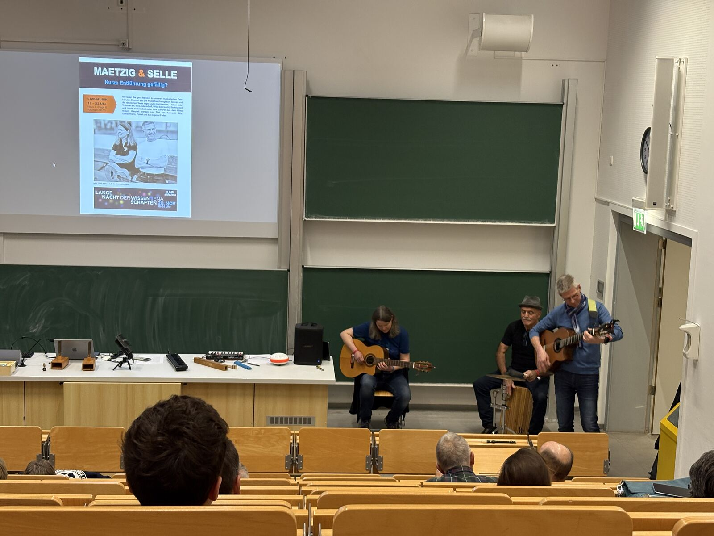
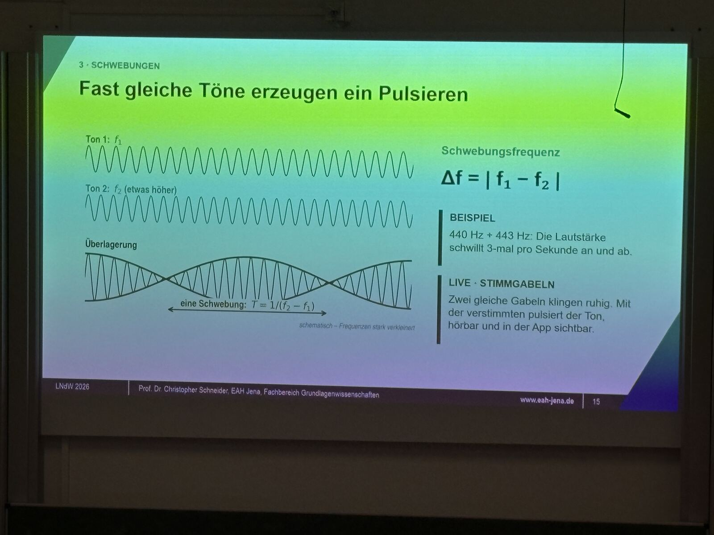
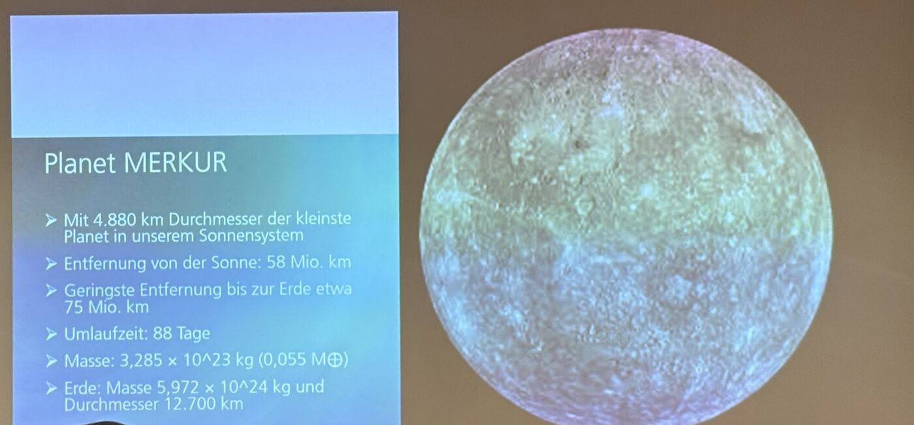
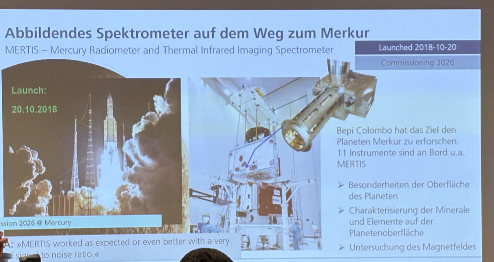
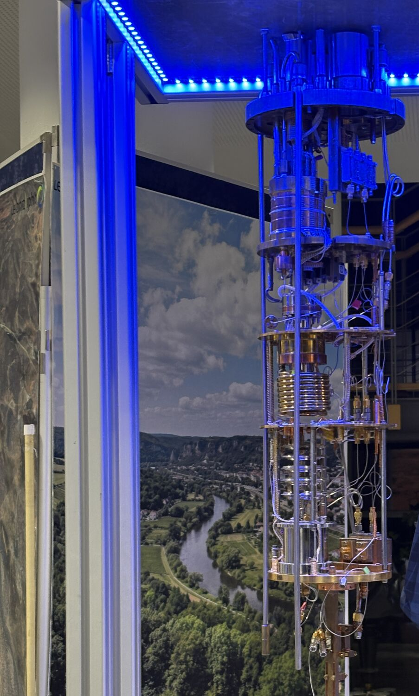

import Callout from '../../../components/Callout.astro';

<Callout type="error">Dieser Artikel ist noch nicht fertig. Der Abend ging nach den hier beschriebenen Vorträgen weiter. Dieser Teil wird noch ergänzt.</Callout>

## Worum es geht

Am Freitag, den 20. November 2026, war in Jena die **Lange Nacht der Wissenschaften**. Von 18 bis 24 Uhr öffnen an diesem Abend Hochschulen, Forschungsinstitute, Firmen und das Universitätsklinikum ihre Türen. Es gibt Vorträge, Experimente und Ausstellungsstücke, und man darf Forschenden Fragen stellen, die man sich sonst vielleicht nicht trauen würde. Laut Veranstalter sind über 50 Partner beteiligt, und zwischen den Orten fahren Shuttle-Busse.[^1] Man braucht eine Eintrittskarte, die für den ganzen Abend und alle Orte gilt. Das Programm ist so dicht, dass man sich vorher entscheiden muss, wohin man geht, denn die Vorträge laufen parallel und dauern jeweils nur 40 bis 45 Minuten.

Ich war an diesem Tag von etwa 15 Uhr bis nach 22 Uhr unterwegs. Dieser Artikel erzählt den Abend in der Reihenfolge, in der ich ihn erlebt habe. Zu den beiden Vorträgen, die ich besucht habe, erkläre ich außerdem ausführlich die Physik und die Wahrnehmung, die dahinterstecken. Das meiste davon ist Hintergrundwissen, das über die Folien hinausgeht. Wo ich etwas ergänze, das nicht aus dem Vortrag stammt, sage ich es dazu.

## Am Beutenberg Campus

Mein erster Halt war die Bushaltestelle am **Beutenberg Campus**. Das ist ein Wissenschaftsstandort im Westen von Jena. Dort stehen mehrere Institute dicht nebeneinander, darunter zwei Max-Planck-Institute (für Biogeochemie und für chemische Ökologie), das Leibniz-Institut für Alternsforschung (FLI) und das Fraunhofer-Institut für Angewandte Optik und Feinmechanik (IOF). Es war ungefähr 15:10 Uhr, also fast drei Stunden vor dem offiziellen Beginn. Es war grau und nass, und von dem Trubel, der am Abend kommen sollte, war noch nichts zu spüren.

Von der Haltestelle bin ich zu Fuß zum **Max-Planck-Institut für Biogeochemie** gelaufen. Der Weg führt am Fraunhofer IOF vorbei, dessen Fassade aus vielen blauen und violetten Feldern besteht. Dahinter stehen die Institute, die sich mit Licht beschäftigen: Das Abbe Center of Photonics, die Lichtwerkstatt Jena und das QPhoton Center teilen sich dort einen Wegweiser. Jena ist seit über hundert Jahren ein Zentrum der Optik, und man merkt es sofort, wenn man über diesen Campus läuft.

## Der Flora-Incognita-Stand im Max-Planck-Institut

Ich arbeite als studentische Hilfskraft für die TU Ilmenau im **Flora-Incognita-Projekt**. Flora Incognita ist eine App, mit der man Pflanzen per Foto bestimmen kann. Man fotografiert eine Pflanze, und die App sagt, um welche Art es sich handelt. Dahinter stecken zwei Partner mit klarer Arbeitsteilung: Die TU Ilmenau kümmert sich um die technische Seite der App, das Max-Planck-Institut für Biogeochemie um die biologische. Zur Langen Nacht gab es deshalb einen gemeinsamen Stand im Institut. Wir haben ihn dort von etwa 15:30 Uhr bis kurz vor 18:00 Uhr mit aufgebaut.

Das erste Bild aus der Halle zeigt den Stand, bevor etwas darauf lag: ein Tisch, zwei Stühle und dahinter ein Informationsposter. Ein Stand besteht am Anfang nur aus einer leeren Fläche. Alles, was Besucher später sehen, muss erst herangetragen, aufgestellt und ausgerichtet werden.

Das Poster auf diesem Tisch war ein Informationsposter zu Flora Incognita. Daneben stand ein zweites Poster, das zu einem Partnerprojekt gehört, das in der App läuft: **PollenNet**. Das Ziel dieses Projekts ist es, mit Beobachtungen von Pflanzen die lokale Pollenbelastung durch Allergiepflanzen vorherzusagen. Auf dem Poster steht dazu das Beispiel Hasel. Die Idee dahinter ist einfach: Viele Menschen, die Pflanzen fotografieren und melden, liefern zusammen ein Bild davon, welche Pflanze wo gerade blüht. Aus diesen Beobachtungen lässt sich abschätzen, wo und wann viele Pollen in der Luft sind. Das ist für Menschen mit Heuschnupfen eine nützliche Information.

Das Flora-Incognita-Poster erklärt das Projekt als Comic. Es trägt den Titel „More than plant identification“, also etwa „Mehr als Pflanzenbestimmung“. Die Botschaft ist, dass die App nicht nur sagt, welche Pflanze man vor sich hat. Die Beobachtungen vieler Nutzerinnen und Nutzer helfen auch der Forschung, weil sie zeigen, wo welche Arten vorkommen. Ein einzelnes Foto ist wenig, aber Tausende Fotos ergeben eine Karte der Pflanzenvielfalt.

Für die Besucher gab es etwas zum Mitmachen. Ein Glücksrad mit dem Flora-Incognita-Logo stand auf dem Tisch, daneben lagen Infokarten und Aufkleber. In derselben Halle gab es noch weitere Stände. An einer Bastelstation konnte man mit einer Pinzette Perlen in Atom-Vorlagen legen. Jede Perlenfarbe stand für einen Baustein, nämlich Neutronen, Protonen und Elektronen. So lässt sich ausprobieren, wie ein Atom aufgebaut ist und wie sich das Element ändert, wenn man einen Baustein hinzufügt oder wegnimmt. Zu dieser Station hing ein Poster mit der Frage „Doch nur Sternenstaub?“.

### Wie erkennt eine App eine Pflanze?

Das ist Hintergrundwissen und stand so nicht auf den Postern. Pflanzenbestimmungs-Apps arbeiten in der Regel mit einem **neuronalen Netz**. Das ist ein mathematisches Modell, das mit sehr vielen Pflanzenfotos trainiert wird, bei denen die Art schon feststeht. Dabei lernt es, welche Merkmale eine Art ausmachen, zum Beispiel die Form der Blätter, die Anordnung der Blüten oder die Farbe. Bei einem neuen Foto gibt das Netz keine einzelne Antwort, sondern eine **Wahrscheinlichkeit** für jede Art, etwa „87 Prozent Gänseblümchen“. Das ist ehrlicher als ein einfaches „Das ist ein Gänseblümchen“. Außerdem hilft es, mehrere Fotos von verschiedenen Pflanzenteilen zu machen, denn eine Blüte allein ist oft nicht eindeutig. Dass die Beobachtungen der Nutzerinnen und Nutzer auch der Forschung dienen, nennt man **Citizen Science**, Bürgerwissenschaft. Wichtig ist dort die Qualität der Daten, und deshalb müssen Fotos und Orte geprüft werden.

### Pollen und Heuschnupfen

Auf dem PollenNet-Poster steht, dass die meisten Allergiepflanzen vom Wind bestäubt werden. Dahinter steckt ein biologischer Grund: Pflanzen, die Insekten anlocken, brauchen auffällige Blüten und Duft. Pflanzen, die ihre Pollen dem Wind überlassen, haben davon keinen Nutzen. Dafür müssen sie riesige Mengen an Pollen freisetzen, damit ein paar davon ihr Ziel erreichen. Genau das macht sie für Allergiker zum Problem. Bei einer **Pollenallergie** hält das Immunsystem bestimmte Eiweiße aus dem Pollen irrtümlich für gefährlich und bildet dagegen Antikörper (IgE). Beim nächsten Kontakt schüttet der Körper Histamin aus, und das löst Niesen, Juckreiz und tränende Augen aus (Hintergrundwissen). Die Hasel blüht sehr früh im Jahr, oft schon im Januar oder Februar, und ist deshalb ein gutes Beispiel für eine Pflanze, deren Blühzeit sich mit dem Klima verschiebt. Das passt zu dem, was auf dem Poster als Motivation steht: Der Klimawandel verändert, wann und wie stark Pflanzen Pollen freisetzen.

### Atome, Isotope und Sternenstaub

Die Bastelstation mit den Perlen zeigt etwas, das man sich leicht merken kann. Ein Atom besteht aus einem Kern aus **Protonen** und **Neutronen** und einer Hülle aus **Elektronen**. Wie viele Protonen der Kern hat, legt fest, um welches Element es sich handelt. Sechs Protonen bedeuten Kohlenstoff, acht bedeuten Sauerstoff. In einem neutralen Atom gibt es genauso viele Elektronen wie Protonen. Die Zahl der Neutronen kann dagegen schwanken. Atome desselben Elements mit verschieden vielen Neutronen heißen **Isotope**. Kohlenstoff gibt es zum Beispiel als $^{12}\text{C}$ (sechs Neutronen), $^{13}\text{C}$ (sieben Neutronen) und $^{14}\text{C}$ (acht Neutronen). Die ersten beiden sind stabil, das dritte zerfällt langsam und wird für die Altersbestimmung benutzt. Auf einem der Poster stand „Stabile Isotope: kleine Unterschiede, große Bedeutung“. Das passt zu einem Institut für Biogeochemie, denn das Verhältnis stabiler Isotope verrät zum Beispiel, woher ein Stoff stammt und welche Wege er in einem Ökosystem genommen hat (Hintergrundwissen).

Die Frage „Doch nur Sternenstaub?“ hat eine einfache Antwort: ja, im Grunde schon. Wasserstoff und Helium sind kurz nach dem Urknall entstanden. Fast alle schwereren Elemente, die in uns stecken, wurden später in Sternen erzeugt, in denen leichte Kerne zu schwereren verschmelzen. Noch schwerere Elemente entstehen bei Sternexplosionen und bei der Verschmelzung von Neutronensternen. Das Eisen in unserem Blut und der Kohlenstoff in unserer DNA stammen also aus Sternen.

## Der Weg zur Ernst-Abbe-Hochschule

Kurz vor 18:00 Uhr bin ich losgegangen, zur **Ernst-Abbe-Hochschule Jena** (EAH). Der Weg hat etwa eine halbe Stunde gedauert. Inzwischen war es dunkel, und der Campus hatte sich verändert. Gebäude wurden in Blau, Violett und Rot angestrahlt, und am Himmel standen Lichtstrahlen, die man schon von Weitem sah. Zur Langen Nacht gehört auch diese Inszenierung: Die Orte, an denen tagsüber geforscht und gelehrt wird, sehen an diesem Abend ganz anders aus.

Von dort ging es direkt in den ersten Vortrag.

## „Die Vermessung der Musik“

Der erste Vortrag trug den Titel **„Die Vermessung der Musik“** mit dem Untertitel „Eine mathematische Reise durch die Welt der Klänge“. Er fand von 18:45 bis 19:30 Uhr in Hörsaal 2 der EAH statt.[^2] Auf den Folien steht Prof. Dr. Christopher Schneider vom Fachbereich Grundlagenwissenschaften. Live-Musik mit Gitarren gehörte dazu, und die Töne wurden gleichzeitig mit einer App auf die Leinwand gebracht. So konnte man sehen, was man hört.

Ich fasse hier zusammen, worum es ging, und erkläre die Physik dazu etwas genauer, als es in 45 Minuten möglich ist. Was ich ergänze, kennzeichne ich im Text.

### Schall ist eine Druckwelle

Ein Ton entsteht, wenn etwas schwingt, zum Beispiel eine Gitarrensaite. Die Saite schiebt die Luftteilchen in ihrer Umgebung an. Dort, wo die Teilchen zusammenrücken, steigt der Luftdruck. Das nennt man eine **Verdichtung**. Dort, wo sie auseinanderrücken, sinkt der Druck, das ist eine **Verdünnung**. Beides wechselt sich ab und wandert durch den Raum. Das ist die Schallwelle.

Wichtig ist, dass dabei keine Luft von der Saite zu meinem Ohr strömt. Die Teilchen schwingen nur um ihren Platz hin und her. Was wandert, ist die Druckänderung. Auf der Folie zur Kreiswelle stand es so: „Die Welle wandert nach außen, die Teilchen bleiben in ihrer Schwingung um die Ruhelage.“ Im Raum breitet sich der Schall in alle Richtungen aus, wie die Ringe, wenn man einen Stein ins Wasser wirft.

Wie schnell die Welle wandert, hängt vom Medium ab. In Luft bei 20 Grad Celsius sind es etwa 343 Meter pro Sekunde. Das ist eine Zahl, die man in Büchern nachlesen kann, sie stand nicht auf den Folien. Mit ihr lässt sich die **Wellenlänge** $\lambda$ ausrechnen, also der Abstand zwischen zwei Verdichtungen:

$$\lambda = \frac{c}{f}$$

Dabei ist $c$ die Schallgeschwindigkeit und $f$ die Frequenz. Ein Ton von 110 Hz hat damit eine Wellenlänge von etwa $343 / 110 \approx 3{,}1$ Metern, ein Ton von 440 Hz von etwa $0{,}78$ Metern. Tiefe Töne sind also im Raum sehr lang gestreckt. Deshalb hört man einen Bass auch noch durch die Wand, während hohe Töne viel leichter abgeschirmt werden.

### Die Tonhöhe ist eine Frequenz

Wie hoch ein Ton klingt, hängt davon ab, wie schnell die Luft schwingt. Diese Zahl ist die **Frequenz** $f$, und sie wird in Hertz (Hz) angegeben. 1 Hz bedeutet eine Schwingung pro Sekunde. Der Kammerton a' hat etwa 440 Hz, die Luft schwingt dabei also rund 440-mal pro Sekunde hin und her. Der Mensch kann ungefähr zwischen 20 Hz und 20 000 Hz hören, und mit dem Alter wird der obere Bereich kleiner.

### Obertöne: Warum Instrumente verschieden klingen

Eine gezupfte Saite schwingt nicht nur als Ganzes. Sie schwingt gleichzeitig auch in zwei Hälften, in drei Dritteln und so weiter. Jede dieser Schwingungen hat eine eigene Frequenz. Die tiefste ist der **Grundton** $f_0$, die anderen heißen **Obertöne**. Ihre Frequenzen sind ganzzahlige Vielfache des Grundtons:

$$f_n = n \cdot f_0 \qquad n = 1, 2, 3, \dots$$

Auf der Folie waren die ersten Teiltöne so beschrieben: $n = 1$ ist der Grundton, $n = 2$ liegt eine Oktave höher, $n = 3$ eine Oktave plus eine Quinte, $n = 4$ zwei Oktaven höher.

Das sollte live gezeigt werden. Die leere A-Saite einer Gitarre hat die Grundfrequenz 110 Hz. Laut Folie zeigt die App beim Zupfen Spitzen bei 110, 220 und 330 Hz. Das ist genau die Reihe $f_0$, $2 f_0$, $3 f_0$. Die Kurve, die man dabei sieht, nennt man ein **Spektrum**: Sie zeigt, wie stark jede Frequenz im Klang vorkommt.

Dass eine Gitarre anders klingt als eine Flöte, obwohl beide denselben Ton spielen, liegt an diesen Obertönen. Beide haben denselben Grundton, aber die Obertöne sind unterschiedlich stark. Diese Mischung ist die **Klangfarbe**. Dahinter steht ein Gedanke aus der Mathematik, den man **Fourier-Zerlegung** nennt (das ist Hintergrundwissen und stand nicht auf den Folien): Jede periodische Schwingung lässt sich aus reinen Sinusschwingungen zusammensetzen. Die App macht diese Zerlegung in Echtzeit und zeigt das Ergebnis als Spektrum.

### Intervalle sind Frequenzverhältnisse

Ein **Intervall** ist der Abstand zwischen zwei Tönen. Das Besondere ist, dass die Intervalle, die wir als wohlklingend empfinden, einfachen Zahlenverhältnissen entsprechen. Auf der Folie standen vier:

| Intervall | Frequenzverhältnis |
|---|---|
| Oktave | $2 : 1$ |
| Quinte | $3 : 2$ |
| Quarte | $4 : 3$ |
| Große Terz | $5 : 4$ |

Bei der Oktave schwingt der höhere Ton also doppelt so schnell wie der tiefere. Die Folie zeigt das, indem sie beide Töne über die gleiche Zeitspanne legt. Beim Verhältnis $3 : 2$ passen in dieser Zeit zum Beispiel drei Schwingungen des einen und zwei des anderen, danach beginnt das Muster von vorn. Je einfacher das Verhältnis, desto schneller wiederholt sich das gemeinsame Muster, und desto stimmiger klingt es. Die Folie zeigt dazu kleine Muster aus gekreuzten Linien. Das sind sogenannte Lissajous-Figuren, die entstehen, wenn man zwei Schwingungen gegeneinander aufträgt. Je einfacher das Verhältnis ist, desto einfacher sieht die Figur aus.

Eine Anmerkung dazu, die nicht aus dem Vortrag stammt: Ein Klavier ist nicht auf diese reinen Verhältnisse gestimmt. Dort sind die zwölf Halbtöne einer Oktave gleich groß, jeder Halbton ist um den Faktor $2^{1/12} \approx 1{,}0595$ höher als der vorherige. Dadurch liegt die Quinte bei $2^{7/12} \approx 1{,}4983$ statt bei $1{,}5$, und die große Terz bei $2^{4/12} \approx 1{,}2599$ statt bei $1{,}25$. Der Unterschied ist klein, und dafür kann man auf einem Klavier in allen Tonarten spielen.

### Schwebungen

Spielt man zwei Töne mit fast gleicher, aber nicht ganz gleicher Frequenz, passiert etwas Hörbares: Die Lautstärke schwillt regelmäßig an und ab. Das nennt man eine **Schwebung**. Sie entsteht, weil sich beide Wellen abwechselnd verstärken und abschwächen. Wenn die Wellenberge zusammenfallen, wird es laut. Wenn ein Berg auf ein Tal trifft, löschen sie sich aus, und es wird leise. Die Schwebungsfrequenz ist der Unterschied der beiden Frequenzen:

$$\Delta f = |f_1 - f_2|$$

Das Beispiel auf der Folie: Bei 440 Hz und 443 Hz schwillt die Lautstärke dreimal pro Sekunde an und ab, denn $|440 - 443| = 3$. Dazu waren laut Folie zwei Stimmgabeln vorgesehen. Ihr Ton war verstärkt hörbar, und in der App konnte man das Pulsieren sehen.

Warum das so ist, lässt sich mit einer Formel aus der Trigonometrie zeigen (auch das ist Hintergrundwissen). Zwei Sinusschwingungen mit den Frequenzen $f_1$ und $f_2$ ergeben zusammen eine Schwingung mit der mittleren Frequenz $\tfrac{f_1 + f_2}{2}$, deren Höhe sich mit $\cos(\pi (f_1 - f_2) t)$ ändert. Im Beispiel hört man also einen Ton von $441{,}5$ Hz, der dreimal pro Sekunde laut und leise wird.

Daran erkennt man auch, wie man ein Instrument stimmt. Man spielt den Ton neben einem Referenzton und verändert die Saite so lange, bis die Schwebung langsamer wird und verschwindet. Dann stimmen die beiden Frequenzen überein.

### Wie sich ein Orchester einstimmt

Im Orchester läuft das genau so ab. Die Folie dazu beschreibt vier Schritte. Die Oboe gibt das a' vor, weil sie einen klaren, obertonreichen und stabilen Ton hat. Die Bläser stimmen nach, indem sie ihr Instrument minimal verlängern oder verkürzen, bis nichts mehr schwebt. Die Streicher stimmen erst das A und danach über schwebungsfreie Quinten die übrigen Saiten. Beim Spielen hört man weiter aufeinander, denn Terzen und Akkorde werden oft reiner intoniert als am Klavier. Zum Kammerton steht auf der Folie, dass er heute meist bei 440 bis 443 Hz liegt, in der historischen Aufführungspraxis dagegen oft bei 415 Hz. Das ist ungefähr ein Halbton tiefer.

## „Von Mona Lisa bis Monet“

Der zweite Vortrag war eine spontane Entscheidung. Er hieß **„Von Mona Lisa bis Monet: Wie Sehfehler berühmte Gemälde formten“** und lief von 19:30 bis 20:10 Uhr in Hörsaal 4 der EAH.[^3] Laut Programm verbindet er bildende Kunst mit Optometrie, also der Lehre vom Sehen. Es geht darum, wie Augenerkrankungen und Sehfehler das Werk großer Künstler beeinflusst haben könnten. Genannt werden Leonardo da Vinci, Rembrandt und Monet, die „nur Menschen“ gewesen seien, die auch von Krankheiten betroffen waren. Als Beispiele führt das Programm den Grauen Star, die Makuladegeneration und Probleme des beidäugigen Sehens an.

Ich gebe hier wieder, was auf den Folien stand, und erkläre die Begriffe dazu. Ob die Thesen über die Künstler stimmen, kann ich nicht beurteilen. Ich gebe sie deshalb so wieder, wie sie vorgetragen wurden.

### Mona Lisa und die Pupille

Bei der **Mona Lisa** stand auf der Folie das *Holmes-Adie-Syndrom*, dazu ein Bild mit der Überschrift *konsensuelle Lichtreaktion*. Das ist die Reaktion der Pupille auf Licht. Fällt Licht in ein Auge, verengt sich die Pupille. Das passiert über einen Reflex, der nicht vom Willen abhängt. Er verläuft so, dass sich auch die Pupille des anderen Auges verengt, selbst wenn dort kein Licht ankommt. Diese Reaktion des nicht beleuchteten Auges heißt konsensuell. Beim Holmes-Adie-Syndrom reagiert eine Pupille nur sehr langsam auf Licht. Wie das mit dem berühmten Gemälde zusammenhängen soll, habe ich nicht mitgeschrieben. Die Pupille regelt, wie viel Licht ins Auge fällt, und zwar über ihre Fläche. Sie kann sich von etwa 2 bis 8 Millimetern Durchmesser verändern, die Lichtmenge ändert sich dabei mit dem Quadrat des Durchmessers, also um den Faktor $(8/2)^2 = 16$ (Hintergrundwissen).

### Das Abendmahl und die räumliche Tiefe

Beim **Abendmahl** von Leonardo da Vinci stand auf der Folie das Thema *monokulare Tiefe* mit dem Stichwort *Linearperspektive*. Das Wort monokular heißt „mit einem Auge“. Normalerweise sehen wir Tiefe vor allem dadurch, dass die beiden Augen etwas unterschiedliche Bilder bekommen. Das Gehirn rechnet aus dem Unterschied den Abstand aus. Man nennt das Stereosehen. Wer nur mit einem Auge sieht oder bei wem das Zusammenspiel der beiden Augen gestört ist, muss die Tiefe anders abschätzen, nämlich aus Hinweisen im Bild. Dazu gehören die Größe von Dingen, Überdeckungen, Schatten und eben die Linearperspektive: Parallele Linien, etwa die Kanten eines Raumes, laufen im Bild auf einen Punkt am Horizont zu, den **Fluchtpunkt**. Das Abendmahl ist ein bekanntes Beispiel für ein Bild, das mit diesem Fluchtpunkt arbeitet, und die Linien der Wände und der Decke laufen dort in der Mitte zusammen. Der Grund ist einfach: Ein Gegenstand der Höhe $h$ im Abstand $d$ erscheint unter dem Sehwinkel $\alpha \approx h / d$. Je weiter weg, desto kleiner wirkt er, und genau diese Regel baut die Linearperspektive in ein Bild ein (Hintergrundwissen). Das Stereosehen funktioniert dagegen nur im Nahbereich, denn der Abstand der Augen von etwa 6,5 Zentimetern reicht nur bei Entfernungen von einigen Metern bis wenigen Dutzend Metern für einen merklichen Unterschied der beiden Bilder.

### Monet und der Graue Star

Zu **Claude Monet** (1840 bis 1926, Impressionismus) zeigte die Folie ein Gemälde mit einer Frau mit Sonnenschirm in einem Feld. Monet litt im Alter am **Grauen Star**. Dabei trübt sich die Linse im Auge ein. Das Licht wird gestreut, die Farben wirken blasser und gelblicher, und feine Details sind schlechter zu erkennen. Das Programm nennt den Grauen Star ausdrücklich als Beispiel. Dass die Farben dabei verschoben wirken, hat einen Grund (Hintergrundwissen): Die getrübte Linse vergilbt, und gelbe Gläser schlucken kurzwelliges, blaues Licht stärker als langwelliges. Die Welt erscheint dadurch wärmer und bräunlicher, und das Streulicht in der Linse blendet zusätzlich.

Dazu hatte die Vortragende ein Foto mitgebracht, das Monet in seinem Garten in Frankreich zeigt. Es ist ungefähr drei Jahre vor seinem Tod entstanden, auf jeden Fall nach seiner Operation. Wenn man in das Bild hineinzoomt, fällt auf, dass er eine Brille trägt, und zwar mit riesigen Gläsern. Das liegt laut Vortrag daran, dass sehr hohe Stärken in die Gläser eingebaut wurden. Monet hatte damals eine der ersten Brillen dieser Art von Zeiss auf der Nase. Damit konnte er in seinen letzten Lebensjahren wieder besser sehen und weiter malen. Dass Zeiss in Jena sitzt, passt zu dem Ort, an dem der Vortrag stattfand.

### Edvard Munch und die Netzhautblutung

Der letzte Künstler im Vortrag war **Edvard Munch**, der norwegische Maler des „Schrei“. Die Vortragende fragte das Publikum, ob jemand ahnt, von wem die Rede ist. Munch war darin meisterhaft, Emotionen und zwischenmenschliche Beziehungen darzustellen. Den „Schrei“ hat er laut Vortrag fünfmal angefertigt, viermal als Gemälde und einmal als Lithografie. Die Lithografie hatte die Vortragende vor einiger Zeit in den Kunstsammlungen in Chemnitz angeschaut. In dem Bild verarbeitet Munch eine nächtliche Panikattacke, er hat also seine eigene Gefühlswelt in Kunst umgesetzt. Aus heutiger Sicht sei das nichts anderes als Achtsamkeit.

Um 1930 ging es Munch schlecht. Er hatte seit vielen Jahren Bluthochdruck und bekam in dieser Zeit eine **Netzhautblutung**. Die Netzhaut ist die innerste Schicht des Auges, sie kleidet es von innen aus. Zur Erklärung zeigte die Vortragende moderne Fotos vom Augenhintergrund, sogenannte Fundusaufnahmen. Man erkennt darauf:

- die **Papille**, einen großen hellen Fleck am Rand. Dort tritt der Sehnerv aus dem Auge aus, und dort gibt es keine Sehzellen. Sie ist deshalb unser **blinder Fleck**.
- die **Fovea**, eine kleine Mulde genau in der Mitte. Sie ist die Stelle des schärfsten Sehens, und nur mit ihr erkennen wir etwas in unserer Umgebung wirklich scharf.
- viele **Blutgefäße**. Sie können aus verschiedenen Gründen einbluten, die Blutungen waren auf einem der Bilder im unteren Bereich zu sehen.

Munch hatte höchstwahrscheinlich viele solcher Blutungen in der Netzhaut. In dieser Situation fing er an, seine eigene Wahrnehmung zu malen. Auffällig sind die schwarzen Punkte, die er um die Mitte seines Bildes herum zeichnet. Das sind **Gesichtsfeldausfälle**, also Stellen im Blickfeld, an denen man nichts sieht, weil die Netzhaut dort gestört ist. Er zeichnete in einem Bild genau ein, wo er noch etwas sehen konnte und wo nicht. Und weil er Künstler war, fand er auch Worte dafür. Seine Gesichtsfeldausfälle beschrieb er als einen großen dunklen Vogel. In seiner Beschreibung heißt es sinngemäß, dass sich ein großer dunkler Vogel langsam vor ihm bewegte, ein Vogel mit dunkelbraunen Federn, von dem ein leuchtend blauer Strahl ausging, der ins Grüne überging, um sich schließlich in einen gelben Ring zu verwandeln, der seine Position veränderte. Alles, was er mit seinen Farben beschrieb, begann sich zu bewegen. Die Vortragende fand das die poetischste Beschreibung einer Netzhautblutung, die sie je gelesen habe.

Der Vortrag ging gut aus: Munch konnte damals behandelt werden. Die Blutungen bildeten sich wieder zurück, und er behielt relativ wenige bleibende Sehstörungen.

Zum Aufbau der Netzhaut noch etwas Hintergrundwissen: Sie hat ungefähr 120 Millionen **Stäbchen**, die für das Sehen bei wenig Licht zuständig sind und keine Farben unterscheiden, und etwa 6 Millionen **Zapfen** für Farbe und scharfes Sehen. In der Fovea, die nur etwa 1,5 Millimeter groß ist, sitzen fast nur Zapfen, dicht gepackt. Deshalb sehen wir nur in einem kleinen Bereich in der Mitte wirklich scharf. Am blinden Fleck fehlen die Sehzellen ganz, weil dort der Sehnerv austritt. Normalerweise merken wir davon nichts, weil das Gehirn die Lücke auffüllt. Bei einer Netzhautblutung kommen weitere Lücken dazu. Dann fehlen an diesen Stellen Informationen, und das Gehirn kann sie nicht mehr gut ergänzen. Munch hat diese Ausfälle als dunkle Flecken gemalt.

### Drei Botschaften zum Mitnehmen

Zum Schluss gab die Vortragende dem Publikum drei Botschaften mit:

1. **Passen Sie gut auf Ihre Augen auf.** Die Augen seien in vielen Fällen der Spiegel des Körpers. Seit mehreren Jahren untersuchen Forschende zum Beispiel, ob sich in der Netzhaut und im Sehprozess frühe Anzeichen für Erkrankungen wie Alzheimer finden lassen.
2. **Gehen Sie öfter ins Museum.** Anfang des Jahres sei ein Paper erschienen, nach dem Museumsbesuche das Leben verlängern.
3. **Machen Sie im Museum keine Selfies.** Es gebe nur eine Ausnahme, nämlich wenn ein echtes Brennglas hinter einem liege.

Zum Schluss empfahl die Vortragende, direkt in Hörsaal 3 zu gehen, wo gleich ein Kunstquiz unter dem Motto „Ist das Kunst oder Kunstwissenschaft?“ begann. Das Transkript, aus dem ich dieses Kapitel gebaut habe, ist an einigen Stellen ungenau. Namen und Zahlen aus dem Vortrag sollte man deshalb bei Bedarf nachprüfen.

## Mit dem Bus zurück zum Beutenberg Campus

Gegen 20:10 Uhr sind wir von der EAH mit dem Bus zurück zum Beutenberg Campus gefahren. Die Lange Nacht hat dafür Shuttle-Busse zwischen den Orten.[^1] Dort sind wir zum **Fraunhofer IOF** gegangen. Das Institut forscht an optischen Systemen und baut sie auch, zum Beispiel für Satelliten. Am Eingang war an diesem Abend einiges los: Die Glasfassade war violett und blau angestrahlt, und drinnen standen viele Besucher an den Ständen.

Das IOF hat an diesem Abend ein großes Programm. Wir haben uns davon nur einen Teil angesehen, und von manchem habe ich kein Bild mehr. Was ich beschreibe, stammt aus meinen Fotos und aus dem Programm der Veranstaltung.

## Merkur und das Spektrometer MERTIS

Zuerst waren wir im Vortrag über den Planeten **Merkur**. Er gehörte zu den Pop-Up-Vorträgen der Ausstellung „Abenteuer Weltraum“. Das Programm nennt für 18:30, 20:30 und 22:30 Uhr einen Vortrag mit dem Titel „GALA / MERTIS: Mit Spiegelteleskopen auf dem Weg zu den Planeten Jupiter und Merkur“.[^4] Wir waren im Vortrag um 20:30 Uhr. Die Pop-Up-Vorträge laufen halbstündlich und sind kurz.

Der Vortrag begann mit ein paar Zahlen zum Planeten. Die Folie dazu nannte:

- Durchmesser von 4880 Kilometern, damit ist Merkur der kleinste Planet im Sonnensystem
- Entfernung von der Sonne: 58 Millionen Kilometer
- geringste Entfernung zur Erde: etwa 75 Millionen Kilometer
- Umlaufzeit: 88 Tage
- Masse: $3{,}285 \cdot 10^{23}$ Kilogramm, das sind 0,055 Erdmassen

Der Vergleich mit der Erde stand auch auf der Folie: Sie hat eine Masse von $5{,}972 \cdot 10^{24}$ Kilogramm und einen Durchmesser von 12 700 Kilometern. Merkur hat also nur etwa 38 Prozent des Durchmessers der Erde. Er braucht für einen Umlauf um die Sonne nur 88 Tage, weil er der Sonne am nächsten ist und sich dort am schnellsten bewegt.

### Merkur nachgerechnet

Aus den Zahlen auf der Folie lässt sich einiges ausrechnen. Das ist meine eigene Rechnung und stand nicht im Vortrag. Mit der Masse $M = 3{,}285 \cdot 10^{23}$ Kilogramm und dem Radius $r = 2440$ Kilometern (dem halben Durchmesser) ergibt sich die mittlere Dichte:

$$\rho = \frac{M}{\tfrac{4}{3}\pi r^3} \approx \frac{3{,}285 \cdot 10^{23}\,\text{kg}}{6{,}09 \cdot 10^{19}\,\text{m}^3} \approx 5{,}4 \cdot 10^{3}\,\frac{\text{kg}}{\text{m}^3}$$

Das sind $5{,}4$ Gramm pro Kubikzentimeter, fast so viel wie bei der Erde mit $5{,}5$. Dabei ist Merkur viel kleiner, und die Erde wird durch ihre eigene Schwerkraft stärker zusammengedrückt. Merkur muss deshalb im Verhältnis noch mehr Eisen enthalten. Tatsächlich besteht sein Inneres zu einem großen Teil aus einem riesigen Eisenkern (Hintergrundwissen). Dazu passt, dass die Mission auch das Magnetfeld des Planeten untersuchen soll.

Dazu ein paar Zahlen zum Licht: Es braucht von der Sonne zu Merkur rund $58 \cdot 10^9\,\text{m} / (3 \cdot 10^8\,\text{m/s}) \approx 193$ Sekunden, also etwas mehr als drei Minuten. Von Merkur zur Erde sind es bei der geringsten Entfernung von 75 Millionen Kilometern etwa 250 Sekunden, rund vier Minuten.

Zwei weitere bekannte Eigenschaften (Hintergrundwissen): Merkur dreht sich in einem festen Verhältnis zu seinem Umlauf, in zwei Umläufen um die Sonne dreht er sich dreimal um sich selbst. Dadurch dauert ein Sonnentag auf Merkur etwa 176 Erdentage, doppelt so lang wie sein Jahr. Auf der Tagseite wird es etwa 430 Grad Celsius heiß, auf der Nachtseite fällt die Temperatur auf etwa minus 180 Grad, weil es fast keine Atmosphäre gibt, die die Wärme hält.

### Die Raumsonde BepiColombo

Danach ging es um die Raumsonde **BepiColombo**. Sie hat das Ziel, den Merkur zu erforschen, und trägt laut Folie elf Instrumente. Eines davon ist **MERTIS**, ein „abbildendes Spektrometer“. Der Name steht für *Mercury Radiometer and Thermal Infrared Imaging Spectrometer*. Die Sonde ist am 20. Oktober 2018 gestartet. Auf der Folie steht außerdem, dass im Jahr 2026 die Inbetriebnahme am Merkur ansteht. Das Instrument wurde vom Deutschen Zentrum für Luft- und Raumfahrt (DLR) mit OHB und dem Fraunhofer IOF gebaut, deren Logos auf der Folie stehen.

Als Ziele für MERTIS nannte die Folie drei Dinge: die Besonderheiten der Oberfläche des Planeten, die Charakterisierung der Minerale und Elemente auf der Oberfläche und die Untersuchung des Magnetfeldes. Unten auf der Folie stand ein Zitat zum Instrument: „MERTIS worked as expected or even better with a very good signal to noise ratio.“ Das heißt, MERTIS habe wie erwartet funktioniert oder sogar besser, und das Signal sei deutlich stärker als das Rauschen gewesen.

### Was ist ein abbildendes Spektrometer?

Ein Spektrometer zerlegt Licht nach seiner Wellenlänge, ähnlich wie ein Prisma das Sonnenlicht in Regenbogenfarben aufspaltet. Das ist die Idee dahinter, und sie ist nützlich, weil jeder Stoff Licht auf eine eigene Art zurückwirft oder abstrahlt. Aus dem Spektrum kann man deshalb ablesen, woraus eine Oberfläche besteht. Ein **abbildendes** Spektrometer macht das nicht nur für einen Punkt, sondern für jeden Bildpunkt eines Fotos. Man erhält dann ein Bild, in dem jeder Punkt sein eigenes Spektrum hat, und kann so eine Karte der Minerale zeichnen. Das gilt für MERTIS, das laut Name im thermischen Infrarot misst, also in Wärmestrahlung. Das ist Hintergrundwissen und stand so nicht auf den Folien.

### Warum misst MERTIS im Wärmebereich?

Jeder Körper strahlt Wärme ab, und die Farbe dieser Strahlung hängt von seiner Temperatur ab. Das beschreibt das **Wiensche Verschiebungsgesetz** (Hintergrundwissen):

$$\lambda_{\max} = \frac{b}{T} \qquad b \approx 2898\,\mu\text{m} \cdot \text{K}$$

Dabei ist $T$ die Temperatur in Kelvin und $\lambda_{\max}$ die Wellenlänge, bei der die Strahlung am stärksten ist. Die Tagseite von Merkur hat etwa 700 Kelvin, damit liegt das Maximum bei etwa $4{,}1$ Mikrometern. Bei Raumtemperatur (300 Kelvin) wären es etwa $9{,}7$ Mikrometer. Beides liegt im **Infrarot**, also außerhalb dessen, was wir sehen können. Aus der Wärmestrahlung kann man zum einen die Temperatur der Oberfläche ablesen. Zum anderen verrät das Spektrum, aus welchen Mineralen sie besteht, denn verschiedene Minerale schlucken und senden Infrarotlicht in verschiedenen Bereichen. Deshalb heißt das Instrument „Radiometer und thermisches Infrarot-Spektrometer“.

### JUICE und der Laserhöhenmesser GALA

Laut Titel hatte der Vortrag noch einen zweiten Teil. Neben MERTIS ging es um **JUICE**, die Jupitermission der europäischen Raumfahrtagentur ESA. Der Name steht für *Jupiter Icy Moons Explorer*, auf Deutsch etwa „Jupiter-Eismonde-Erkunder“. Die Raumsonde soll den Jupiter und seine Eismonde Ganymed, Kallisto und Europa genauer untersuchen. Sie ist im April 2023 gestartet und hat zehn wissenschaftliche Instrumente an Bord. Eines davon ist **GALA**, das *Ganymede Laser Altimeter*.[^9][^10]

Ein Laser-Altimeter ist ein Höhenmesser, der mit Laserlicht arbeitet. Er schickt kurze Laserpulse zur Oberfläche und misst, wie lange das Licht für den Hin- und Rückweg braucht. Daraus ergibt sich der Abstand:

$$d = \frac{c \cdot t}{2}$$

Dabei ist $c$ die Lichtgeschwindigkeit und $t$ die gemessene Laufzeit. Der Faktor $2$ steht da, weil das Licht die Strecke zweimal zurücklegt. Das ist eine eigene Rechnung und stand nicht im Vortrag. Aus einer Höhe von 500 Kilometern, so hoch soll die Sonde laut DLR um Ganymed kreisen, braucht ein Puls rund $2 \cdot 500\,000\,\text{m} / (3 \cdot 10^{8}\,\text{m/s}) \approx 3{,}3$ Millisekunden. Damit man die Höhe auf etwa zehn Zentimeter genau bestimmen kann, muss die Zeit auf weniger als eine Nanosekunde genau gemessen werden. Das schreibt auch das DLR. In einer Nanosekunde legt das Licht nämlich 30 Zentimeter zurück, hin und zurück also 15 Zentimeter Höhenunterschied.

Das Fraunhofer IOF hat zusammen mit der Firma HENSOLDT Optronics die Empfangseinheit von GALA entwickelt. Dazu gehört ein spezielles **Spiegelteleskop**, das die vom Mond zurückgeworfenen Laserpulse auffängt. Es ist eine hochgenaue Metalloptik. Das Teleskop hat laut DLR einen Durchmesser von 25 Zentimetern. In der Ausstellung stand dazu eine Miniatur in einer Vitrine, die ich oben abgebildet habe. Das Licht, das das Teleskop auffängt, wird von einer Lawinen-Fotodiode gemessen, einem Sensor, der auch sehr schwache Lichtblitze registriert. Die Pulse haben eine Wellenlänge von 1064 Nanometern im nahen Infrarot und kommen 30 bis 50 Mal pro Sekunde. GALA wiegt 25 Kilogramm und braucht 50 Watt.

Was soll damit herauskommen? Das erste Ziel ist eine genaue Karte der Oberfläche von Ganymed. Die Sonde soll in der Zeit um den Jahreswechsel 2034/35 mehrere hundert Millionen Laufzeitmessungen machen. Das zweite Ziel ist eine Frage, die viele interessiert: Gibt es unter dem Eis einen Ozean? Der Mond wird durch die Anziehungskraft des Jupiters ständig leicht verformt, das nennt man **Gezeiten**, wie bei den Ozeanen auf der Erde. Wenn die Eiskruste auf einem tiefen Ozean schwimmt, lässt sie sich leichter verformen, als wenn sie bis ins Innere fest ist. Das DLR nennt dazu Zahlen. Bei einer Verformung von höchstens etwa einem Meter ist wahrscheinlich kein Ozean vorhanden, bei etwa acht Metern müsste einer da sein. Ein Ozean könnte nach dieser Rechnung 100 Kilometer oder mehr unter der Oberfläche liegen. Das Fraunhofer IOF schreibt dazu, dass GALA unter Umständen sogar die Existenz von Wasser nachweisen könnte. GALA wird laut Pressemitteilung das erste Laser-Altimeter sein, das in etwa einer Milliarde Kilometern Entfernung von der Erde arbeitet.

## Die Ausstellung „Abenteuer Weltraum“

Nach dem Vortrag haben wir uns die Ausstellung **„Abenteuer Weltraum“** im Carl-Zeiss-Saal des IOF angesehen. Der Untertitel lautet „Von fernen Planeten bis zur nachhaltigen Landwirtschaft: Erd- und Weltraumbeobachtung mit Optiken des Fraunhofer IOF“.[^5] Die Ausstellung zeigt optische Technologien, die im Weltraum eingesetzt werden und aus großer Entfernung Daten über die Erde liefern.

In den Vitrinen standen echte Bauteile aus Forschungsprojekten. Auf den Schildern stand, was man vor sich hat. Eines zeigt ein **Teleskop für Kleinsatelliten**, das mit additiver Fertigung hergestellt wurde, also im Prinzip mit einem 3D-Druck für Metall.

Ein anderes Schild gehört zum Projekt **RAINBOW**. Dort steht „Teleskop und abbildendes Spektrometer für die moderne Landwirtschaft“, und als Partner ist Airbus Defence and Space genannt. Laut Programm ist Rainbow ein Satellit, der „in 50 Farben“ sieht. Der Gedanke dahinter ist derselbe wie bei MERTIS, nur schaut der Satellit zur Erde und nicht zum Merkur. Aus den Farben des zurückgeworfenen Lichts lässt sich zum Beispiel ablesen, wie gesund Pflanzen auf einem Feld sind. So kommt die Weltraumforschung zur nachhaltigen Landwirtschaft.

Daneben standen weitere Exponate, zum Beispiel ein vergoldeter Spiegel mit einer goldenen Halterung und ein großes Prisma in einer schwarzen Halterung. Zu diesen beiden habe ich das Schild nicht lesbar fotografiert, und ich möchte nicht raten, wofür sie gebaut wurden.

### Pflanzen aus dem All sehen

Wie kann ein Satellit sehen, wie es Pflanzen auf einem Feld geht? Das ist Hintergrundwissen, und der Grund steckt im Blatt. Der grüne Farbstoff **Chlorophyll** schluckt rotes und blaues Licht für die Fotosynthese. Nahes Infrarot wird dagegen von gesunden Blättern stark zurückgeworfen. Wenn eine Pflanze gestresst ist, etwa durch Trockenheit oder Nährstoffmangel, ändert sich dieses Verhältnis. Ein häufig benutzter Wert dafür ist der **Vegetationsindex** (NDVI):

$$\text{NDVI} = \frac{R_{\text{NIR}} - R_{\text{rot}}}{R_{\text{NIR}} + R_{\text{rot}}}$$

Dabei ist $R$ der Anteil des Lichts, der im nahen Infrarot (NIR) oder im Roten zurückgeworfen wird. Je grüner und gesünder die Pflanzen, desto näher liegt der Wert bei $1$. Ein Satellit, der in 50 Farben misst, kann solche Unterschiede viel genauer auflösen als eine normale Kamera. So kann er zum Beispiel erkennen, wo ein Feld mehr Wasser oder Dünger braucht.

Das Teleskop für Kleinsatelliten wurde mit additiver Fertigung hergestellt. Dabei wird ein Bauteil Schicht für Schicht aufgebaut, statt es aus einem Block herauszufräsen. Das spart Material und Gewicht, und beides ist im Weltraum wichtig, weil jedes Kilogramm beim Start Geld kostet.

## Ein Blick ins Quantenlabor

Eine weitere Station war **„Ein Blick ins Quantenlabor“**. Sie fand im Christiaan-Huygens-Raum des IOF statt.[^6] Der Teaser im Programm lautet: „Mit »verzauberten« Lichtteilchen digitale Daten sicher verschicken oder Bilder aus dem Nichts erschaffen!“ Dahinter steckt die **Quantenverschränkung**. Forschende des IOF nutzen sie, um ein hochsicheres Datennetz der Zukunft zu entwickeln. In der Medizin sollen Quantentechnologien Mikroskopaufnahmen ermöglichen, ohne die Proben zu verändern oder zu beschädigen. Zum Mitmachen gab es ein interaktives Spiel zum Projekt O-PEN, bei dem man einen Sicherheitstest an einem echten Quantenkommunikationssystem durchführen konnte.

Wie ein Bild „aus dem Nichts“ entstehen kann, zeigt ein Projekt des IOF, über das das Institut 2023 berichtet hat. Es heißt QUANCER und will Tumorgewebe mit „Quantenmikroskopie mit nicht-detektiertem Licht“ untersuchen.[^8] Dabei werden Paare von miteinander verbundenen, also korrelierten Photonen erzeugt. Das eine Photon geht durch die Gewebeprobe, das andere wird mit einer Kamera erfasst, ohne die Probe je gesehen zu haben. Durch die Verschränkung wird die Information, die das erste Photon an der Probe aufgenommen hat, auf das zweite übertragen. Die beiden Photonen können unterschiedliche Wellenlängen haben. Das eine liest im mittleren Infrarot Informationen aus der Probe, weil sich dort Stoffe chemisch gut unterscheiden lassen. Das andere liegt im sichtbaren Bereich und kann von einer handelsüblichen, rauscharmen Kamera gelesen werden. Ob das genau der Aufbau war, auf den sich das Programm bezieht, weiß ich nicht. Es ist ein Beispiel für die Richtung, in die das Quantenlabor forscht.

### Verschränkung und abhörsichere Schlüssel

Hier die Physik dahinter, als Hintergrundwissen. Zwei Photonen können so **verschränkt** sein, dass sie nur gemeinsam einen Zustand haben, zum Beispiel

$$|\Psi\rangle = \tfrac{1}{\sqrt{2}}\bigl(|H\rangle_A|H\rangle_B + |V\rangle_A|V\rangle_B\bigr)$$

Dabei steht $H$ für horizontal und $V$ für vertikal polarisiert. Keines der beiden Photonen hat für sich eine bestimmte Polarisation. Misst man bei Photon $A$ das Ergebnis $H$, hat auch Photon $B$ garantiert $H$, egal wie weit es entfernt ist. Damit lassen sich keine Nachrichten schneller als das Licht schicken, denn das Einzelergebnis ist zufällig und lässt sich nicht steuern.

Für die Datensicherheit nutzt man etwas anderes: Eine Messung stört einen Quantenzustand. Beim Quantenschlüsselaustausch (zum Beispiel nach dem Verfahren BB84) schickt der Sender Photonen mit zufällig gewählten Polarisationen. Wer sie abfängt und misst, muss raten, in welcher Basis er messen soll, und liegt dabei oft falsch. Wenn ein Lauscher alle Photonen abfängt und neu sendet, entstehen im Schlüssel in etwa **25 Prozent Fehler**. Sender und Empfänger vergleichen einen Teil ihrer Daten, und eine hohe Fehlerrate verrät den Lauscher. Das meint das Programm, wenn es sagt, dass „Abhörversuche erkannt werden können“.

### Schwingungen von Licht

Dazu hing ein Poster mit dem Titel **„Schwingungen von Licht: Polarisation erklärt“**. Es trägt das Logo des IOF und das des Projekts OrQa, gefördert vom Bundesministerium für Forschung, Technologie und Raumfahrt. Auf dem Poster steht, was dahintersteckt.

Licht ist eine elektromagnetische Welle. Die **Polarisation** beschreibt, in welche Richtung das elektrische Feld dieser Welle schwingt, und zwar quer zur Ausbreitungsrichtung. Es gibt mehrere Möglichkeiten:

- **Lineare Polarisation:** Das Feld schwingt entlang einer festen Linie hin und her. Jeder Winkel ist möglich, auf dem Poster sind $0^\circ$, $30^\circ$, $60^\circ$ und $90^\circ$ eingezeichnet.
- **Zirkulare Polarisation:** Die Spitze des Feldpfeils bewegt sich auf einem Kreis. Der Pfeil bleibt dabei gleich lang und dreht sich gleichmäßig, entweder im Uhrzeigersinn oder dagegen. Der Unterschied zwischen den beiden ist der Drehsinn.
- **Elliptische Polarisation:** Dazwischen liegen alle Formen, bei denen die Spitze eine Ellipse beschreibt.

In der Mitte des Posters steht die „Landkarte der Polarisationszustände“. Das ist eine Kugel, auf der jeder mögliche Polarisationszustand genau einen Punkt hat. Die Poster-Anleitung zum Lesen der Karte geht so:

- **In welche Richtung dreht sich die Polarisation?** Linksherum liegt im Norden, rechtsherum im Süden.
- **Wie rund ist die Ellipse?** An den Polen ist sie ein Kreis, am Äquator eine Linie.
- **Wie sehr ist die Ellipse geneigt?** Senkrecht liegt bei 90 Grad West, waagerecht bei 90 Grad Ost.

Zur Veranschaulichung steht auf dem Poster, wie Jenas Polarisation aussieht, nämlich am Punkt $51^\circ$ Nord und $11{,}5^\circ$ Ost, den Koordinaten der Stadt. Jena hat auf dieser Karte also einen eigenen Punkt, der angibt, wie eine bestimmte Polarisation aussieht.

Dass dieselbe Kugel auch bei Quantencomputern auftaucht, ist Hintergrundwissen und stand nicht auf dem Poster. In der Physik heißt sie **Poincaré-Kugel**. Mathematisch ist sie dasselbe wie die **Bloch-Kugel**, mit der man den Zustand eines Quantenbits beschreibt. Ein Photon mit seiner Polarisation ist deshalb ein beliebtes Quantenbit. Gut möglich, dass die Kugel auf dem Poster deshalb in einem Projekt zur Quantenkommunikation auftaucht, das habe ich aber nicht bestätigt.

Unten auf dem Poster stehen zwei Beispiele aus dem Alltag, in denen die Polarisation eine Rolle spielt. Bei einem **LCD-Bildschirm** steuert die Polarisation die Helligkeit eines Bildpunkts: Ein Flüssigkristall liegt zwischen zwei gekreuzten Polarisationsfiltern, und je nachdem, ob eine Spannung anliegt, dreht er das Licht oder nicht. Bei der **3D-Brille** im Kino bekommt jedes Auge mit zirkular polarisiertem Licht sein eigenes Bild, weil jedes Brillenglas nur eine der beiden Drehrichtungen durchlässt.

### Photonische Chips

Ein weiteres Exponat zeigte einen Chip auf einem dunklen Wafer. Das Schild trägt die Aufschrift **„Photonic Integrated Circuits (PIC)“**: Es handelt sich um einen einzelnen Chip von einem LNOI-Multi-Projekt-Wafer, auf dem sich grundlegende aktive und passive Bauteile integrieren lassen. Daneben stand ein Schild mit dem Titel „4-mode LNOI interferometer“.

LNOI steht für *Lithium Niobate on Insulator*, also Lithiumniobat auf einer isolierenden Schicht (Hintergrundwissen). Lithiumniobat ist ein Kristall, mit dem sich Licht gut steuern lässt. Er hat einen elektrooptischen Effekt: Legt man eine elektrische Spannung an, ändert sich sein Brechungsindex, und damit kann man die Phase des Lichts gezielt steuern. Ein **photonischer integrierter Schaltkreis** macht mit Licht, was ein elektronischer Chip mit Strom macht. Statt Leiterbahnen gibt es winzige Wellenleiter, die das Licht auf dem Chip führen, aufteilen und wieder zusammenführen. Ein Interferometer ist ein Bauteil, in dem sich zwei Lichtwege überlagern. Es ist deshalb die Grundlage für viele Experimente mit Quantenlicht.

Was in einem Interferometer passiert, lässt sich mit einer einfachen Formel beschreiben (Hintergrundwissen). Teilt man einen Lichtstrahl auf zwei Wege auf und führt sie wieder zusammen, hängt die Helligkeit am Ausgang vom Unterschied der Phasen ab:

$$I_{\text{aus}} = I_{\text{ein}} \cdot \cos^2\!\left(\frac{\Delta\varphi}{2}\right)$$

Bei $\Delta\varphi = 0$ kommt alles Licht an, bei $\Delta\varphi = \pi$ löscht es sich aus. In Lithiumniobat lässt sich $\Delta\varphi$ mit einer Spannung einstellen, und so wird aus dem Chip ein Schalter für Licht. Mit mehreren solcher Bausteine und vier Wegen (vier Moden) lassen sich schon recht komplizierte Schaltungen aufbauen.

## Optische Kommunikation

Zur **Optischen Kommunikation** hatte das IOF an diesem Abend zwei kurze Vorträge angeboten, um 19:30 und um 20:00 Uhr.[^7] Wir waren erst später dort, die Vorträge waren schon vorbei. Wir haben noch eine Gesprächsrunde mitbekommen, und an der Wand liefen Lichtstrahlen. Bilder habe ich davon nicht mehr, deshalb beschreibe ich den Inhalt nach dem Programm. Laut Programm können Lasersignale Daten „sehr schnell, sicher und zuverlässig“ übertragen, und diese optische Kommunikation sei eine Grundlage für das Internet der Zukunft. Im zweiten Vortrag ging es um Quantenschlüssel, die von einem Flugzeug zu einer Bodenstation geschickt werden. Bei dieser Verschlüsselung werden die Schlüssel so übertragen, dass Abhörversuche erkannt werden können. Das passt zum Quantenlabor: Dort wird die Technik erforscht, hier geht es darum, wie sie in die Praxis kommt.

Warum nimmt man für schnelle Datenübertragung Licht statt Funk? Das ist Hintergrundwissen. Wie viele Daten ein Signal transportieren kann, hängt von der Frequenz der Trägerwelle ab. Licht aus dem Telekommunikationsbereich (Wellenlänge 1550 Nanometer) hat eine Frequenz von $f = c / \lambda \approx 3 \cdot 10^{8} / (1{,}55 \cdot 10^{-6}) \approx 1{,}9 \cdot 10^{14}$ Hertz, also etwa 190 Terahertz. Das ist tausendmal höher als bei Funkwellen. Dazu kommt, dass sich ein Laserstrahl viel weniger aufweitet als eine Funkwelle. Er bleibt über weite Strecken gebündelt, und deshalb kann man ihn auch zwischen einem Flugzeug und einer Bodenstation einsetzen. Dafür muss man ihn sehr genau ausrichten und gegen Turbulenzen in der Luft schützen.

## Im Leibniz-IPHT

Neben dem IOF, in der Albert-Einstein-Straße 9, sitzt das **Leibniz-Institut für Photonische Technologien** (IPHT). Dort war ich ab etwa 21:00 Uhr, bis nach 22:00 Uhr. Wie überall an diesem Abend war ich als Gast da. An manchen Stationen durfte man etwas anfassen und ausprobieren. Das Institut hat laut Programm viele Stationen, die meisten im Foyer, und die Angebote reichen von Glasfasern über Quantenmagnetometer und Bakterienerkennung bis zu einer Comic-Ecke für Kinder.[^11] Ich habe mir davon nur einen Teil angesehen.

### Kryostat und Bloch-Kugel

Eine Station hieß **„Kalt, kälter, am kältesten: Forschen mit ultratiefen Temperaturen“**. Laut Programm war es eine Führung, die halbstündlich zwischen 18:30 und 22:30 Uhr lief und einen Blick hinter sonst geschlossene Labortüren versprach. Es ging um Quantentechnologien und den „Supercomputer der Zukunft“. Im Mittelpunkt stehen dabei supraleitende Quantenbits, die bei sehr tiefen Temperaturen erforscht werden.[^12]

Mein Foto zeigt einen Aufbau, der genau dazu passt: ein Kryostat, ein Kühlgerät, das aus mehreren übereinander hängenden Ebenen aus Kupfer und Gold besteht, durch die viele dünne Leitungen laufen. Er stand in einem beleuchteten Glaskasten, im Hintergrund war ein Landschaftsbild zu sehen. Dass es sich um ein Modell oder ein echtes Gerät handelt, weiß ich nicht.

Warum so ein Gerät? Das ist Hintergrundwissen und stand nicht auf den Schildern. Supraleitende Quantenbits sind winzige Stromkreise, die erst bei Temperaturen nahe dem absoluten Nullpunkt (typischerweise einige Tausendstel Kelvin) funktionieren. Dort verschwindet der elektrische Widerstand, und die empfindlichen Quantenzustände werden nicht von der Wärmebewegung der Atome zerstört. Der Kryostat kühlt in Stufen, nach unten wird es immer kälter. Die tiefste Ebene ist die kälteste.

Neben dem Kryostat stand ein Bildschirm mit einem **Quiz**. Die Frage lautete: „Auf der Bloch-Kugel zeigt der Zustandspfeil genau nach oben. Welcher Zustand ist das?“ Zur Wahl standen vier Antworten: „Beides gleichzeitig“, $|1\rangle$, „Keiner, die Kugel ist Dekoration“ und $|0\rangle$.

Die Antwort ist $|0\rangle$. Das lässt sich so erklären: Ein klassisches Bit ist entweder 0 oder 1. Ein **Quantenbit** (Qubit) kann zusätzlich in einer Überlagerung beider Zustände sein:

$$|\psi\rangle = \alpha\,|0\rangle + \beta\,|1\rangle \qquad |\alpha|^2 + |\beta|^2 = 1$$

Die **Bloch-Kugel** zeigt jeden möglichen Zustand eines Qubits als Pfeil auf einer Kugel. Der Nordpol steht nach der üblichen Festlegung für $|0\rangle$ und der Südpol für $|1\rangle$. Alle Punkte dazwischen sind Überlagerungen, und auf dem Äquator sind beide Zustände gleich stark vertreten. Ein Pfeil, der genau nach oben zeigt, ist also der Zustand $|0\rangle$. „Beides gleichzeitig“ wäre ein Pfeil auf dem Äquator. Und „Dekoration“ ist die Kugel nicht, denn sie ist die vollständige Landkarte der Zustände. Das ist dieselbe Kugel wie die Poincaré-Kugel auf dem Poster im Quantenlabor, nur dass dort die Polarisation von Licht abgebildet wird.

Das Schaubild habe ich selbst gezeichnet.

### Das dünnste Endoskop der Welt

Eine weitere Station trug den Titel **„Erleben Sie das dünnste Endoskop der Welt in Aktion!“**. Laut Programm wird dabei eine „haardünne Glasfaser“ zur Kamera oder zum Mikroskop. Gezeigt wird eine „holografische Endoskopie“, die Forscher des IPHT zusammen mit der DeepEn GmbH entwickelt haben. Zellen werden mit einer einzigen optischen Faser abgebildet. Gedacht ist das für die Neurowissenschaft, später auch für Diagnostik und Therapie, und man konnte mit dem DeepEn-Team sprechen.[^13]

Auf meinem Foto sieht man das Gerät mit dem DeepEn-Logo. Auf dem Bildschirm ist die Zeichnung eines Mausgehirns mit einer Endoskopsonde zu sehen, daneben eine Mikroskopaufnahme mit einem Maßstab von 20 Mikrometern.

Wie kann eine Glasfaser ein Mikroskop sein? Auch das ist Hintergrundwissen, stark vereinfacht. Eine Glasfaser leitet Licht normalerweise nur von einem Ende zum anderen. In einer Faser mit vielen Moden, einer **Multimodefaser**, läuft das Licht auf vielen Wegen gleichzeitig. Ein Bild, das man hineinschickt, kommt deshalb zunächst durcheinandergewirbelt am anderen Ende an. Formt man das Licht am Anfang aber passend, mit einer Technik, die an Holografie erinnert, kann man es am Ende der Faser zu einem scharfen Punkt bündeln. Diesen Punkt bewegt man dann über die Probe und setzt aus den Messwerten ein Bild zusammen. So wird eine Faser, die kaum dicker ist als ein Haar, zu einer Kamera im Körperinneren.

### Raman und Glasfasern

Eine Station zeigte, wie man mit Licht Bakterien erkennen kann: **„Bakterien auf der Spur: Infektionsdiagnostik mit Raman-Spektroskopie“**. Die Ausstellung zeigte laut Programm das „kompakte Point-of-Care-Raman-System“ des IPHT und verschiedene Generationen des RamanBioAssays, vom ersten Forschungsansatz bis zum kompakten Gerät. Die Bakterien werden am „molekularen Fingerabdruck“ erkannt.[^14] Ich vermute, dass der Messaufbau mit Laser und Glasfaser auf meinem Foto 90 zu dieser Ausstellung gehört. Darauf stehen die Logos des IPHT und der Aufkleber „Biophotonik“. Sicher bin ich nicht.

Das Prinzip der Raman-Spektroskopie ist (wieder Hintergrundwissen) einfach zu erklären: Man bestrahlt eine Probe mit Laserlicht. Der größte Teil des Lichts wird unverändert zurückgeworfen, aber ein kleiner Teil kommt mit einer leicht anderen Farbe zurück. Die Verschiebung hängt davon ab, wie die Moleküle in der Probe schwingen. Jede Art von Molekül hat ihr eigenes Muster, und aus diesem Muster lässt sich ablesen, um welche Bakterien es sich handelt.

Außerdem habe ich einen Aufbau fotografiert, bei dem Licht durch eine dünne Glasfaser läuft, die zu einem Ring gebogen ist. Welcher Programmpunkt das war, kann ich nicht sicher sagen. Das IPHT bot unter anderem einen Stand zur Herstellung von Glasfasern an, der unter anderem zeigt, warum Licht in einer Faser transportiert werden kann.[^11] Der Grund ist die **Totalreflexion** (Hintergrundwissen): Der Kern der Faser besteht aus einem Glas mit höherem Brechungsindex als der Mantel. Trifft das Licht flach auf die Grenze, wird es vollständig zurückgeworfen und bleibt im Kern, auch wenn die Faser gebogen ist.

### Das Elektronenmikroskop

Zum Schluss war ich noch bei der Laborführung zum **Elektronenmikroskop**. Sie hieß **„Faszination Mikrokosmos: Entdecke die Welt im Elektronenmikroskop“**. Das Programm nennt Führungen um 18:30, 19:30, 20:30, 21:30 und 22:30 Uhr, jeweils mit höchstens sechs Personen, Treffpunkt an der Treppe im Foyer. Mein Foto ist von 21:36 Uhr, ich war also vermutlich in der Führung um 21:30 Uhr.[^15]

Es ging um ein **Rasterelektronenmikroskop** (REM). Laut Programm gab es Live-Aufnahmen von Insekten, Pollen, Haaren und Materialien bis in den Nanometerbereich. Zusätzlich gibt es die energiedispersive Röntgenspektroskopie (EDX), mit der man herausfindet, aus welchen Elementen eine Probe besteht. Man konnte sogar eigenen Schmuck oder eine Münze mitbringen und analysieren lassen.

Warum nimmt man Elektronen statt Licht? Das ist Hintergrundwissen. Ein Lichtmikroskop kann Strukturen nur bis zu einer Grenze auflösen, die ungefähr bei der halben Wellenlänge des Lichts liegt. Das ist die **Abbesche Auflösungsgrenze**, benannt nach Ernst Abbe, dessen Namen auch die Hochschule trägt:

$$d \approx \frac{\lambda}{2 \cdot n \sin \alpha}$$

Dabei ist $\lambda$ die Wellenlänge des Lichts und $n \sin \alpha$ die sogenannte numerische Apertur des Objektivs. Sichtbares Licht hat Wellenlängen von etwa 400 bis 700 Nanometern, deshalb ist bei etwa 200 Nanometern Schluss. Elektronen haben im Mikroskop eine viel kleinere Wellenlänge. Dadurch kann man damit viel feinere Details sehen. Beim REM fährt ein feiner Elektronenstrahl Punkt für Punkt über die Probe, und aus den dabei freigesetzten Elektronen setzt der Rechner das Bild zusammen. Für die EDX-Analyse regt der Strahl die Atome der Probe zur Röntgenstrahlung an. Die Energie dieser Strahlung ist für jedes Element typisch.

### Der Name auf dem Karabiner

Eine Station fehlt noch, auch wenn ich dazu kein Bild habe: Im Laserlabor des Leibniz-Baus konnten wir uns unseren Namen auf einen **Karabinerhaken** lasern lassen. Es ist ein Schlüsselanhänger und nichts zum Klettern, aus einem günstigen, recht weichen Metall. Er sah aus wie die üblichen Schlüsselanhänger dieser Art: ein D-förmiger Haken mit Schnapper und Schlüsselring. Eine Frau am Computer hat uns nach dem Namen gefragt und ihn in die Software eingegeben. Danach haben wir eine **gelbe Schutzbrille** bekommen und sind in eine kleine Box gegangen. Dort wurde per Knopfdruck gelasert, und das Ganze ging in **unter einer Sekunde**. Es war ein Laser der **Klasse 4**. Dazu finde ich im Programm der Langen Nacht keinen eigenen Eintrag, ich beschreibe es deshalb so, wie ich es erlebt habe. Die Erklärungen dazu sind Hintergrundwissen, ich weiß nicht, welchen Laser das Labor genau benutzt hat.

**Was bedeutet Klasse 4?** Laser werden nach der Gefahr eingeteilt, die von ihnen ausgeht (Norm DIN EN 60825-1). Die Klassen reichen von 1, ungefährlich, bis 4. Ein Laserpointer liegt bei Klasse 2 mit höchstens einem Milliwatt. Klasse 4 beginnt bei einer Dauerleistung von mehr als 500 Milliwatt. Solche Laser sind schon bei Streulicht gefährlich, weil sie die Augen und die Haut schädigen und Material entzünden können. Deshalb wird so ein Laser in der Praxis eingehaust. Steckt er in einer geschlossenen Box, aus der kein gefährliches Licht entweichen kann, gilt das ganze Gerät oft als deutlich ungefährlicher. Das passt zu der kleinen Box, in der wir standen. Warum wir trotzdem eine Brille bekamen, weiß ich nicht. Vermutlich war es eine zusätzliche Sicherheit.

**Warum eine gelbe Brille?** Eine Laserschutzbrille ist immer auf eine bestimmte **Wellenlänge** abgestimmt. Sie schluckt das Licht dieses Lasers, und die Farbe des Glases hängt davon ab, welches Licht es durchlässt. Gelbe bis orange Gläser schlucken vor allem kurzwelliges Licht, also Blau, Violett und UV. Brillen für Infrarotlaser sehen dagegen oft grünlich oder bläulich aus. Aus der Brillenfarbe allein lässt sich die Wellenlänge des Lasers nicht sicher bestimmen. Sie spricht aber eher für einen Laser im sichtbaren oder ultravioletten Bereich als für einen im Infrarot.

**Wie kommt ein Name auf Metall?** Ein Laser kann sein Licht auf einen winzigen Fleck bündeln. Die Leistung pro Fläche, die **Intensität**, ist dann enorm. Ein Rechenbeispiel mit angenommenen Werten: Ein Laser mit 20 Watt, der auf einen Fleck mit 50 Mikrometern Durchmesser gebündelt wird, erreicht

$$I = \frac{P}{\pi r^2} = \frac{20\,\text{W}}{\pi \cdot (25 \cdot 10^{-6}\,\text{m})^2} \approx 1 \cdot 10^{10}\,\frac{\text{W}}{\text{m}^2}$$

Das sind etwa eine Million Watt pro Quadratzentimeter. Bei einem gepulsten Laser ist die Spitzenleistung während eines Pulses noch viel höher. An dem getroffenen Punkt heizt sich das Material in Sekundenbruchteilen so stark auf, dass es **verdampft** (Ablation), schmilzt oder seine Oberfläche chemisch verändert. Weiches, billiges Metall braucht dafür weniger Energie als ein harter Stahl. Solche Schlüsselanhänger bestehen meistens aus **eloxiertem Aluminium**. Dabei wird die Oberfläche künstlich mit einer dünnen Oxidschicht überzogen, die nur wenige Mikrometer dick ist. Sie macht das Aluminium härter und lässt sich einfärben, deshalb gibt es die Haken in vielen Farben. Genau diese Schicht trägt der Laser ab. Darunter kommt das blanke, silbrig glänzende Aluminium zum Vorschein, und die Schrift sieht dadurch hell aus. Das ist eine Vermutung nach dem Bild, wie solche Karabiner aussehen. Wie meine Gravur genau aussah und welcher Effekt sie erzeugt hat, weiß ich nicht mehr.

**Warum geht es in unter einer Sekunde?** Der Strahl wird über zwei kleine, schnell drehbare Spiegel (Galvanometer-Scanner) über das Werkstück geführt. Der Laserpunkt kann sich dadurch mit mehreren Metern pro Sekunde bewegen, ohne dass etwas Schweres bewegt werden muss. Auch dazu ein Rechenbeispiel mit angenommenen Werten: Besteht ein Name aus Linien mit insgesamt etwa 20 Zentimetern Länge und fährt der Strahl mit 2 Metern pro Sekunde, dauert das

$$t = \frac{s}{v} = \frac{0{,}2\,\text{m}}{2\,\text{m/s}} = 0{,}1\,\text{s}$$

Das ist also nur ein Zehntel einer Sekunde. Die Bahn, die der Laser fährt, entspricht einem Schriftzug, den die Software aus dem eingegebenen Namen berechnet hat. Das Eintippen dauert damit viel länger als das Gravieren selbst.

**Wie fest ist so ein Karabiner?** Weil er nur ein Schlüsselanhänger ist, ist er so weich, dass man ihn mit etwas Kraft verbiegen kann, wenn man es darauf anlegt. Das lässt sich mit einer Eigenschaft von Metallen erklären (Hintergrundwissen). Wirkt eine kleine Kraft, verformt sich das Metall nur **elastisch** und federt danach zurück, wie eine Feder. Ab einer bestimmten Spannung, der **Streckgrenze**, verformt es sich **plastisch**, und es bleibt verbogen. Bei weichem, billigem Metall liegt diese Grenze niedrig. Bei einem echten Kletterkarabiner aus einer hochfesten Aluminiumlegierung liegt sie so hoch, dass er Kräfte von mehr als zwanzig Kilonewton aushält. Ein Schlüsselanhänger ist also zum Anhängen gedacht und nicht zum Sichern. Außerdem raten Hersteller davon ab, echte Kletterkarabiner nachträglich zu gravieren. Kerben und Hitze können die Festigkeit herabsetzen, und das darf bei Sicherungsmaterial nicht passieren.

## Zu Fuß zurück

Die Laborführung war erst nach 22:00 Uhr zu Ende. Danach ging es zu Fuß vom Beutenberg Campus zurück zum Ernst-Abbe-Bau. Das waren etwa 20 bis 30 Minuten.

## Eine Lichtinstallation im Hof

Gegen 22:45 Uhr bin ich an einer Lichtinstallation vorbeigekommen. Hinter Haus 2 des EAH-Campus führt eine Brücke zu den Häusern 4 und 6 und zum Studentenwohnheim in Haus 8. Der Hof dort war zur Langen Nacht gestaltet worden: Eine Lichtinstallation zum Thema Licht verwandelte die Brücke in einen leuchtenden Tunnel aus hellen, gefalteten Bahnen. Das Licht kam von innen, und man ging mitten hindurch.

Dass solche Bahnen von innen weich leuchten, hat einen physikalischen Grund (Hintergrundwissen). Papier und ähnliche Stoffe bestehen aus vielen kleinen Fasern, an denen das Licht ständig gestreut wird. Das Licht tritt deshalb nicht gerichtet aus, sondern in alle Richtungen. Die Fläche wirkt dadurch wie eine gleichmäßig leuchtende Lichtquelle, und man sieht die Lampe dahinter nicht mehr. Dieselbe Streuung ist der Grund, warum Wolken weiß aussehen.

## Wie es weitergeht

Der Abend war damit noch nicht zu Ende. Es gab an diesem Abend mehr, als in diesen Artikel passt. Zu weiteren Stationen habe ich noch Fotos, über die ich noch schreibe.

[^1]: [Lange Nacht der Wissenschaften Jena, Startseite](https://www.lndw-jena.de/) und [Programmübersicht](https://www.lndw-jena.de/programm) (abgerufen am 22.11.2026)
[^2]: [Die Vermessung der Musik, Programmseite der Langen Nacht der Wissenschaften Jena](https://www.lndw-jena.de/programm/die-vermessung-der-musik) (abgerufen am 22.11.2026)
[^3]: [Von Mona Lisa bis Monet: Wie Sehfehler berühmte Gemälde formten, Programmseite der Langen Nacht der Wissenschaften Jena](https://www.lndw-jena.de/programm/von-mona-lisa-bis-monet-wie-sehfehler-beruehmte-gemaelde-formten) (abgerufen am 22.11.2026)
[^4]: [Pop-Up-Vorträge „Abenteuer Weltraum“, Programmseite der Langen Nacht der Wissenschaften Jena](https://www.lndw-jena.de/programm/pop-vortraege-abenteuer-weltraum) (abgerufen am 22.11.2026)
[^5]: [Abenteuer Weltraum, Programmseite der Langen Nacht der Wissenschaften Jena](https://www.lndw-jena.de/programm/abenteuer-weltraum) (abgerufen am 22.11.2026)
[^6]: [Ein Blick ins Quantenlabor, Programmseite der Langen Nacht der Wissenschaften Jena](https://www.lndw-jena.de/programm/ein-blick-ins-quantenlabor) (abgerufen am 22.11.2026)
[^7]: [Optische Kommunikation für morgen](https://www.lndw-jena.de/programm/optische-kommunikation-fuer-morgen-forschung-europa-und-das-fraunhofer-iof) und [Geheime Schlüssel aus der Luft](https://www.lndw-jena.de/programm/geheime-schluessel-aus-der-luft-quantenkommunikation-zwischen-flugzeug-und-bodenstation), Programmseiten der Langen Nacht der Wissenschaften Jena (abgerufen am 22.11.2026)
[^8]: [Mit Quantenoptik Tumoren auf der Spur, Fraunhofer IOF, 27.04.2023](https://www.iof.fraunhofer.de/de/presse-medien/Aktuelles/quantenbildgebung.html) (abgerufen am 22.11.2026)
[^9]: [Der Höhenmesser GALA, Deutsches Zentrum für Luft- und Raumfahrt (DLR)](https://www.dlr.de/de/forschung-und-transfer/projekte-und-missionen/juice/der-hoehenmesser-gala) (abgerufen am 22.11.2026)
[^10]: [Weltraummission JUICE startet mit Teleskop aus Jena, Pressemitteilung des Fraunhofer IOF vom 05.04.2023](https://www.iof.fraunhofer.de/content/dam/iof/de/documents/Presse/2023/PM-GALA-2023-dt.pdf) (abgerufen am 22.11.2026)
[^11]: [Leibniz-IPHT, Stationen auf dem Programm der Langen Nacht der Wissenschaften Jena, zum Beispiel „Hautnah erleben, wie am Leibniz-IPHT optische Spezialfasern hergestellt werden“](https://www.lndw-jena.de/programm/hautnah-erleben-wie-am-leibniz-ipht-optische-spezialfasern-fuer-laser-sensoren-oder) (abgerufen am 22.11.2026)
[^12]: [Kalt, kälter, am kältesten: Forschen mit ultratiefen Temperaturen](https://www.lndw-jena.de/programm/kalt-kaelter-am-kaeltesten-forschen-mit-ultratiefen-temperaturen), Programmseite der Langen Nacht der Wissenschaften Jena (abgerufen am 22.11.2026)
[^13]: [Erleben Sie das dünnste Endoskop der Welt in Aktion!](https://www.lndw-jena.de/programm/erleben-sie-das-duennste-endoskop-der-welt-aktion), Programmseite der Langen Nacht der Wissenschaften Jena (abgerufen am 22.11.2026)
[^14]: [Bakterien auf der Spur: Infektionsdiagnostik mit Raman-Spektroskopie](https://www.lndw-jena.de/programm/bakterien-auf-der-spur-infektionsdiagnostik-mit-raman-spektroskopie), Programmseite der Langen Nacht der Wissenschaften Jena (abgerufen am 22.11.2026)
[^15]: [Faszination Mikrokosmos: Entdecke die Welt im Elektronenmikroskop](https://www.lndw-jena.de/programm/faszination-mikrokosmos-entdecke-die-welt-im-elektronenmikroskop), Programmseite der Langen Nacht der Wissenschaften Jena (abgerufen am 22.11.2026)
