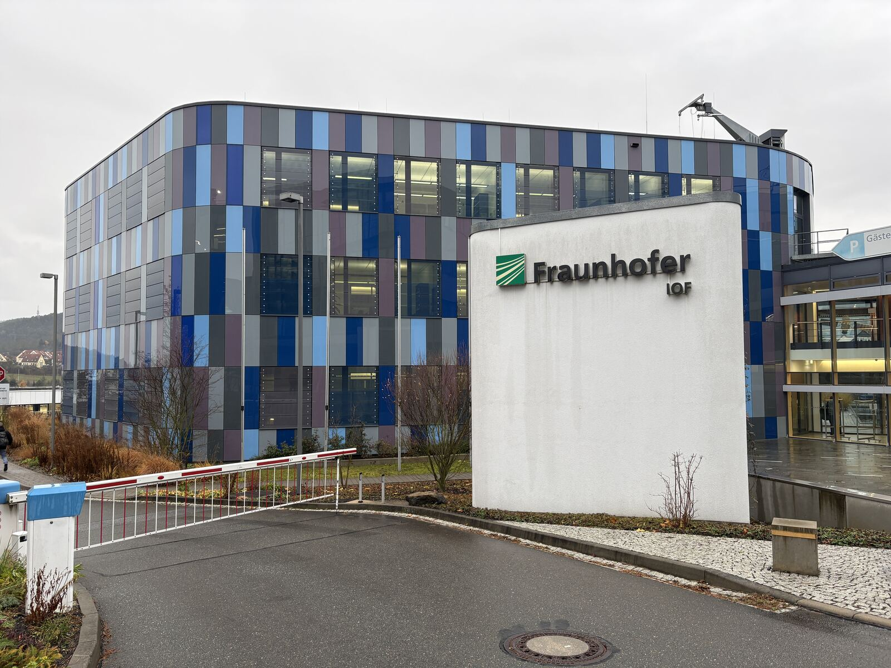
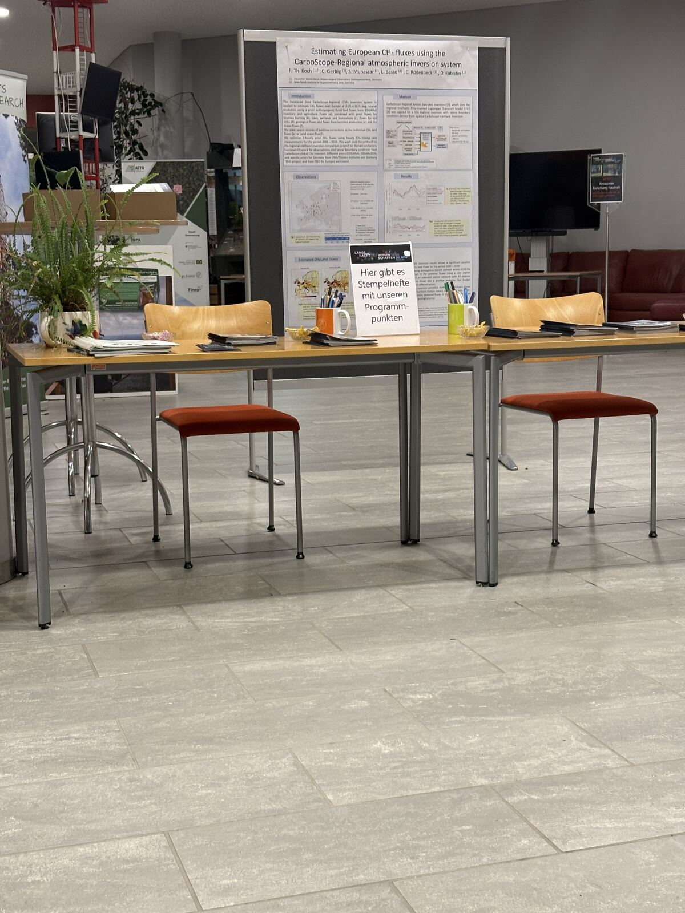

import Callout from '../../../components/Callout.astro';

<Callout type="error">Dieser Artikel ist noch nicht fertig. Der Abend ging nach den hier beschriebenen Vorträgen weiter. Dieser Teil wird noch ergänzt.</Callout>

## Worum es geht

Am Freitag, den 20. November 2026, war in Jena die **Lange Nacht der Wissenschaften**. Von 18 bis 24 Uhr öffnen an diesem Abend Hochschulen, Forschungsinstitute, Firmen und das Universitätsklinikum ihre Türen. Es gibt Vorträge, Experimente und Ausstellungsstücke, und man darf Forschenden Fragen stellen, die man sich sonst vielleicht nicht trauen würde. Laut Veranstalter sind über 50 Partner beteiligt, und zwischen den Orten fahren Shuttle-Busse.[^1] Man braucht eine Eintrittskarte, die für den ganzen Abend und alle Orte gilt. Das Programm ist so dicht, dass man sich vorher entscheiden muss, wohin man geht, denn die Vorträge laufen parallel und dauern jeweils nur 40 bis 45 Minuten.

Ich war an diesem Tag von etwa 15 Uhr bis nach 22 Uhr unterwegs. Dieser Artikel erzählt den Abend in der Reihenfolge, in der ich ihn erlebt habe. Zu den beiden Vorträgen, die ich besucht habe, erkläre ich außerdem ausführlich die Physik und die Wahrnehmung, die dahinterstecken. Das meiste davon ist Hintergrundwissen, das über die Folien hinausgeht. Wo ich etwas ergänze, das nicht aus dem Vortrag stammt, sage ich es dazu.

## Am Beutenberg Campus

Mein erster Halt war die Bushaltestelle am **Beutenberg Campus**. Das ist ein Wissenschaftsstandort im Westen von Jena. Dort stehen mehrere Institute dicht nebeneinander, darunter zwei Max-Planck-Institute (für Biogeochemie und für chemische Ökologie), das Leibniz-Institut für Alternsforschung (FLI) und das Fraunhofer-Institut für Angewandte Optik und Feinmechanik (IOF). Es war ungefähr 15:10 Uhr, also fast drei Stunden vor dem offiziellen Beginn. Es war grau und nass, und von dem Trubel, der am Abend kommen sollte, war noch nichts zu spüren.

Von der Haltestelle bin ich zu Fuß zum **Max-Planck-Institut für Biogeochemie** gelaufen. Der Weg führt am Fraunhofer IOF vorbei, dessen Fassade aus vielen blauen und violetten Feldern besteht. Dahinter stehen die Institute, die sich mit Licht beschäftigen: Das Abbe Center of Photonics, die Lichtwerkstatt Jena und das QPhoton Center teilen sich dort einen Wegweiser. Jena ist seit über hundert Jahren ein Zentrum der Optik, und man merkt es sofort, wenn man über diesen Campus läuft.

## Der Flora-Incognita-Stand im Max-Planck-Institut

Ich arbeite als studentische Hilfskraft für die TU Ilmenau im **Flora-Incognita-Projekt**. Flora Incognita ist eine App, mit der man Pflanzen per Foto bestimmen kann. Man fotografiert eine Pflanze, und die App sagt, um welche Art es sich handelt. Dahinter stecken zwei Partner mit klarer Arbeitsteilung: Die TU Ilmenau kümmert sich um die technische Seite der App, das Max-Planck-Institut für Biogeochemie um die biologische. Zur Langen Nacht gab es deshalb einen gemeinsamen Stand im Institut. Wir haben ihn dort von etwa 15:30 Uhr bis kurz vor 18:00 Uhr mit aufgebaut.

Das erste Bild aus der Halle zeigt den Stand, bevor etwas darauf lag: ein Tisch, zwei Stühle und dahinter ein Informationsposter. Ein Stand besteht am Anfang nur aus einer leeren Fläche. Alles, was Besucher später sehen, muss erst herangetragen, aufgestellt und ausgerichtet werden.

Das Poster auf diesem Tisch war ein Informationsposter zu Flora Incognita. Daneben stand ein zweites Poster, das zu einem Partnerprojekt gehört, das in der App läuft: **PollenNet**. Das Ziel dieses Projekts ist es, mit Beobachtungen von Pflanzen die lokale Pollenbelastung durch Allergiepflanzen vorherzusagen. Auf dem Poster steht dazu das Beispiel Hasel. Die Idee dahinter ist einfach: Viele Menschen, die Pflanzen fotografieren und melden, liefern zusammen ein Bild davon, welche Pflanze wo gerade blüht. Aus diesen Beobachtungen lässt sich abschätzen, wo und wann viele Pollen in der Luft sind. Das ist für Menschen mit Heuschnupfen eine nützliche Information.

Das Flora-Incognita-Poster erklärt das Projekt als Comic. Es trägt den Titel „More than plant identification“, also etwa „Mehr als Pflanzenbestimmung“. Die Botschaft ist, dass die App nicht nur sagt, welche Pflanze man vor sich hat. Die Beobachtungen vieler Nutzerinnen und Nutzer helfen auch der Forschung, weil sie zeigen, wo welche Arten vorkommen. Ein einzelnes Foto ist wenig, aber Tausende Fotos ergeben eine Karte der Pflanzenvielfalt.

Für die Besucher gab es etwas zum Mitmachen. Ein Glücksrad mit dem Flora-Incognita-Logo stand auf dem Tisch, daneben lagen Infokarten und Aufkleber. In derselben Halle gab es noch weitere Stände. An einer Bastelstation konnte man mit einer Pinzette Perlen in Atom-Vorlagen legen. Jede Perlenfarbe stand für einen Baustein, nämlich Neutronen, Protonen und Elektronen. So lässt sich ausprobieren, wie ein Atom aufgebaut ist und wie sich das Element ändert, wenn man einen Baustein hinzufügt oder wegnimmt. Zu dieser Station hing ein Poster mit der Frage „Doch nur Sternenstaub?“.

## Der Weg zur Ernst-Abbe-Hochschule

Kurz vor 18:00 Uhr bin ich losgegangen, zur **Ernst-Abbe-Hochschule Jena** (EAH). Der Weg hat etwa eine halbe Stunde gedauert. Inzwischen war es dunkel, und der Campus hatte sich verändert. Gebäude wurden in Blau, Violett und Rot angestrahlt, und am Himmel standen Lichtstrahlen, die man schon von Weitem sah. Zur Langen Nacht gehört auch diese Inszenierung: Die Orte, an denen tagsüber geforscht und gelehrt wird, sehen an diesem Abend ganz anders aus.

Von dort ging es direkt in den ersten Vortrag.

## „Die Vermessung der Musik“

Der erste Vortrag trug den Titel **„Die Vermessung der Musik“** mit dem Untertitel „Eine mathematische Reise durch die Welt der Klänge“. Er fand von 18:45 bis 19:30 Uhr in Hörsaal 2 der EAH statt.[^2] Auf den Folien steht Prof. Dr. Christopher Schneider vom Fachbereich Grundlagenwissenschaften. Live-Musik mit Gitarren gehörte dazu, und die Töne wurden gleichzeitig mit einer App auf die Leinwand gebracht. So konnte man sehen, was man hört.

Ich fasse hier zusammen, worum es ging, und erkläre die Physik dazu etwas genauer, als es in 45 Minuten möglich ist. Was ich ergänze, kennzeichne ich im Text.

### Schall ist eine Druckwelle

Ein Ton entsteht, wenn etwas schwingt, zum Beispiel eine Gitarrensaite. Die Saite schiebt die Luftteilchen in ihrer Umgebung an. Dort, wo die Teilchen zusammenrücken, steigt der Luftdruck. Das nennt man eine **Verdichtung**. Dort, wo sie auseinanderrücken, sinkt der Druck, das ist eine **Verdünnung**. Beides wechselt sich ab und wandert durch den Raum. Das ist die Schallwelle.

Wichtig ist, dass dabei keine Luft von der Saite zu meinem Ohr strömt. Die Teilchen schwingen nur um ihren Platz hin und her. Was wandert, ist die Druckänderung. Auf der Folie zur Kreiswelle stand es so: „Die Welle wandert nach außen, die Teilchen bleiben in ihrer Schwingung um die Ruhelage.“ Im Raum breitet sich der Schall in alle Richtungen aus, wie die Ringe, wenn man einen Stein ins Wasser wirft.

Wie schnell die Welle wandert, hängt vom Medium ab. In Luft bei 20 Grad Celsius sind es etwa 343 Meter pro Sekunde. Das ist eine Zahl, die man in Büchern nachlesen kann, sie stand nicht auf den Folien. Mit ihr lässt sich die **Wellenlänge** $\lambda$ ausrechnen, also der Abstand zwischen zwei Verdichtungen:

$$\lambda = \frac{c}{f}$$

Dabei ist $c$ die Schallgeschwindigkeit und $f$ die Frequenz. Ein Ton von 110 Hz hat damit eine Wellenlänge von etwa $343 / 110 \approx 3{,}1$ Metern, ein Ton von 440 Hz von etwa $0{,}78$ Metern. Tiefe Töne sind also im Raum sehr lang gestreckt. Deshalb hört man einen Bass auch noch durch die Wand, während hohe Töne viel leichter abgeschirmt werden.

### Die Tonhöhe ist eine Frequenz

Wie hoch ein Ton klingt, hängt davon ab, wie schnell die Luft schwingt. Diese Zahl ist die **Frequenz** $f$, und sie wird in Hertz (Hz) angegeben. 1 Hz bedeutet eine Schwingung pro Sekunde. Der Kammerton a' hat etwa 440 Hz, die Luft schwingt dabei also rund 440-mal pro Sekunde hin und her. Der Mensch kann ungefähr zwischen 20 Hz und 20 000 Hz hören, und mit dem Alter wird der obere Bereich kleiner.

### Obertöne: Warum Instrumente verschieden klingen

Eine gezupfte Saite schwingt nicht nur als Ganzes. Sie schwingt gleichzeitig auch in zwei Hälften, in drei Dritteln und so weiter. Jede dieser Schwingungen hat eine eigene Frequenz. Die tiefste ist der **Grundton** $f_0$, die anderen heißen **Obertöne**. Ihre Frequenzen sind ganzzahlige Vielfache des Grundtons:

$$f_n = n \cdot f_0 \qquad n = 1, 2, 3, \dots$$

Auf der Folie waren die ersten Teiltöne so beschrieben: $n = 1$ ist der Grundton, $n = 2$ liegt eine Oktave höher, $n = 3$ eine Oktave plus eine Quinte, $n = 4$ zwei Oktaven höher.

Das sollte live gezeigt werden. Die leere A-Saite einer Gitarre hat die Grundfrequenz 110 Hz. Laut Folie zeigt die App beim Zupfen Spitzen bei 110, 220 und 330 Hz. Das ist genau die Reihe $f_0$, $2 f_0$, $3 f_0$. Die Kurve, die man dabei sieht, nennt man ein **Spektrum**: Sie zeigt, wie stark jede Frequenz im Klang vorkommt.

Dass eine Gitarre anders klingt als eine Flöte, obwohl beide denselben Ton spielen, liegt an diesen Obertönen. Beide haben denselben Grundton, aber die Obertöne sind unterschiedlich stark. Diese Mischung ist die **Klangfarbe**. Dahinter steht ein Gedanke aus der Mathematik, den man **Fourier-Zerlegung** nennt (das ist Hintergrundwissen und stand nicht auf den Folien): Jede periodische Schwingung lässt sich aus reinen Sinusschwingungen zusammensetzen. Die App macht diese Zerlegung in Echtzeit und zeigt das Ergebnis als Spektrum.

### Intervalle sind Frequenzverhältnisse

Ein **Intervall** ist der Abstand zwischen zwei Tönen. Das Besondere ist, dass die Intervalle, die wir als wohlklingend empfinden, einfachen Zahlenverhältnissen entsprechen. Auf der Folie standen vier:

| Intervall | Frequenzverhältnis |
|---|---|
| Oktave | $2 : 1$ |
| Quinte | $3 : 2$ |
| Quarte | $4 : 3$ |
| Große Terz | $5 : 4$ |

Bei der Oktave schwingt der höhere Ton also doppelt so schnell wie der tiefere. Die Folie zeigt das, indem sie beide Töne über die gleiche Zeitspanne legt. Beim Verhältnis $3 : 2$ passen in dieser Zeit zum Beispiel drei Schwingungen des einen und zwei des anderen, danach beginnt das Muster von vorn. Je einfacher das Verhältnis, desto schneller wiederholt sich das gemeinsame Muster, und desto stimmiger klingt es. Die Folie zeigt dazu kleine Muster aus gekreuzten Linien. Das sind sogenannte Lissajous-Figuren, die entstehen, wenn man zwei Schwingungen gegeneinander aufträgt. Je einfacher das Verhältnis ist, desto einfacher sieht die Figur aus.

Eine Anmerkung dazu, die nicht aus dem Vortrag stammt: Ein Klavier ist nicht auf diese reinen Verhältnisse gestimmt. Dort sind die zwölf Halbtöne einer Oktave gleich groß, jeder Halbton ist um den Faktor $2^{1/12} \approx 1{,}0595$ höher als der vorherige. Dadurch liegt die Quinte bei $2^{7/12} \approx 1{,}4983$ statt bei $1{,}5$, und die große Terz bei $2^{4/12} \approx 1{,}2599$ statt bei $1{,}25$. Der Unterschied ist klein, und dafür kann man auf einem Klavier in allen Tonarten spielen.

### Schwebungen

Spielt man zwei Töne mit fast gleicher, aber nicht ganz gleicher Frequenz, passiert etwas Hörbares: Die Lautstärke schwillt regelmäßig an und ab. Das nennt man eine **Schwebung**. Sie entsteht, weil sich beide Wellen abwechselnd verstärken und abschwächen. Wenn die Wellenberge zusammenfallen, wird es laut. Wenn ein Berg auf ein Tal trifft, löschen sie sich aus, und es wird leise. Die Schwebungsfrequenz ist der Unterschied der beiden Frequenzen:

$$\Delta f = |f_1 - f_2|$$

Das Beispiel auf der Folie: Bei 440 Hz und 443 Hz schwillt die Lautstärke dreimal pro Sekunde an und ab, denn $|440 - 443| = 3$. Dazu waren laut Folie zwei Stimmgabeln vorgesehen. Ihr Ton war verstärkt hörbar, und in der App konnte man das Pulsieren sehen.

Warum das so ist, lässt sich mit einer Formel aus der Trigonometrie zeigen (auch das ist Hintergrundwissen). Zwei Sinusschwingungen mit den Frequenzen $f_1$ und $f_2$ ergeben zusammen eine Schwingung mit der mittleren Frequenz $\tfrac{f_1 + f_2}{2}$, deren Höhe sich mit $\cos(\pi (f_1 - f_2) t)$ ändert. Im Beispiel hört man also einen Ton von $441{,}5$ Hz, der dreimal pro Sekunde laut und leise wird.

Daran erkennt man auch, wie man ein Instrument stimmt. Man spielt den Ton neben einem Referenzton und verändert die Saite so lange, bis die Schwebung langsamer wird und verschwindet. Dann stimmen die beiden Frequenzen überein.

### Wie sich ein Orchester einstimmt

Im Orchester läuft das genau so ab. Die Folie dazu beschreibt vier Schritte. Die Oboe gibt das a' vor, weil sie einen klaren, obertonreichen und stabilen Ton hat. Die Bläser stimmen nach, indem sie ihr Instrument minimal verlängern oder verkürzen, bis nichts mehr schwebt. Die Streicher stimmen erst das A und danach über schwebungsfreie Quinten die übrigen Saiten. Beim Spielen hört man weiter aufeinander, denn Terzen und Akkorde werden oft reiner intoniert als am Klavier. Zum Kammerton steht auf der Folie, dass er heute meist bei 440 bis 443 Hz liegt, in der historischen Aufführungspraxis dagegen oft bei 415 Hz. Das ist ungefähr ein Halbton tiefer.

## „Von Mona Lisa bis Monet“

Der zweite Vortrag war eine spontane Entscheidung. Er hieß **„Von Mona Lisa bis Monet: Wie Sehfehler berühmte Gemälde formten“** und lief von 19:30 bis 20:10 Uhr in Hörsaal 4 der EAH.[^3] Laut Programm verbindet er bildende Kunst mit Optometrie, also der Lehre vom Sehen. Es geht darum, wie Augenerkrankungen und Sehfehler das Werk großer Künstler beeinflusst haben könnten. Genannt werden Leonardo da Vinci, Rembrandt und Monet, die „nur Menschen“ gewesen seien, die auch von Krankheiten betroffen waren. Als Beispiele führt das Programm den Grauen Star, die Makuladegeneration und Probleme des beidäugigen Sehens an.

Ich gebe hier wieder, was auf den Folien stand, und erkläre die Begriffe dazu. Ob die Thesen über die Künstler stimmen, kann ich nicht beurteilen. Ich gebe sie deshalb so wieder, wie sie vorgetragen wurden.

### Mona Lisa und die Pupille

Bei der **Mona Lisa** stand auf der Folie das *Holmes-Adie-Syndrom*, dazu ein Bild mit der Überschrift *konsensuelle Lichtreaktion*. Das ist die Reaktion der Pupille auf Licht. Fällt Licht in ein Auge, verengt sich die Pupille. Das passiert über einen Reflex, der nicht vom Willen abhängt. Er verläuft so, dass sich auch die Pupille des anderen Auges verengt, selbst wenn dort kein Licht ankommt. Diese Reaktion des nicht beleuchteten Auges heißt konsensuell. Beim Holmes-Adie-Syndrom reagiert eine Pupille nur sehr langsam auf Licht. Wie das mit dem berühmten Gemälde zusammenhängen soll, habe ich nicht mitgeschrieben.

### Das Abendmahl und die räumliche Tiefe

Beim **Abendmahl** von Leonardo da Vinci stand auf der Folie das Thema *monokulare Tiefe* mit dem Stichwort *Linearperspektive*. Das Wort monokular heißt „mit einem Auge“. Normalerweise sehen wir Tiefe vor allem dadurch, dass die beiden Augen etwas unterschiedliche Bilder bekommen. Das Gehirn rechnet aus dem Unterschied den Abstand aus. Man nennt das Stereosehen. Wer nur mit einem Auge sieht oder bei wem das Zusammenspiel der beiden Augen gestört ist, muss die Tiefe anders abschätzen, nämlich aus Hinweisen im Bild. Dazu gehören die Größe von Dingen, Überdeckungen, Schatten und eben die Linearperspektive: Parallele Linien, etwa die Kanten eines Raumes, laufen im Bild auf einen Punkt am Horizont zu, den **Fluchtpunkt**. Das Abendmahl ist ein bekanntes Beispiel für ein Bild, das mit diesem Fluchtpunkt arbeitet, und die Linien der Wände und der Decke laufen dort in der Mitte zusammen.

### Monet und der Graue Star

Zu **Claude Monet** (1840 bis 1926, Impressionismus) zeigte die Folie ein Gemälde mit einer Frau mit Sonnenschirm in einem Feld. Monet litt im Alter am **Grauen Star**. Dabei trübt sich die Linse im Auge ein. Das Licht wird gestreut, die Farben wirken blasser und gelblicher, und feine Details sind schlechter zu erkennen. Das Programm nennt den Grauen Star ausdrücklich als Beispiel.

Dazu hatte die Vortragende ein Foto mitgebracht, das Monet in seinem Garten in Frankreich zeigt. Es ist ungefähr drei Jahre vor seinem Tod entstanden, auf jeden Fall nach seiner Operation. Wenn man in das Bild hineinzoomt, fällt auf, dass er eine Brille trägt, und zwar mit riesigen Gläsern. Das liegt laut Vortrag daran, dass sehr hohe Stärken in die Gläser eingebaut wurden. Monet hatte damals eine der ersten Brillen dieser Art von Zeiss auf der Nase. Damit konnte er in seinen letzten Lebensjahren wieder besser sehen und weiter malen. Dass Zeiss in Jena sitzt, passt zu dem Ort, an dem der Vortrag stattfand.

### Edvard Munch und die Netzhautblutung

Der letzte Künstler im Vortrag war **Edvard Munch**, der norwegische Maler des „Schrei“. Die Vortragende fragte das Publikum, ob jemand ahnt, von wem die Rede ist. Munch war darin meisterhaft, Emotionen und zwischenmenschliche Beziehungen darzustellen. Den „Schrei“ hat er laut Vortrag fünfmal angefertigt, viermal als Gemälde und einmal als Lithografie. Die Lithografie hatte die Vortragende vor einiger Zeit in den Kunstsammlungen in Chemnitz angeschaut. In dem Bild verarbeitet Munch eine nächtliche Panikattacke, er hat also seine eigene Gefühlswelt in Kunst umgesetzt. Aus heutiger Sicht sei das nichts anderes als Achtsamkeit.

Um 1930 ging es Munch schlecht. Er hatte seit vielen Jahren Bluthochdruck und bekam in dieser Zeit eine **Netzhautblutung**. Die Netzhaut ist die innerste Schicht des Auges, sie kleidet es von innen aus. Zur Erklärung zeigte die Vortragende moderne Fotos vom Augenhintergrund, sogenannte Fundusaufnahmen. Man erkennt darauf:

- die **Papille**, einen großen hellen Fleck am Rand. Dort tritt der Sehnerv aus dem Auge aus, und dort gibt es keine Sehzellen. Sie ist deshalb unser **blinder Fleck**.
- die **Fovea**, eine kleine Mulde genau in der Mitte. Sie ist die Stelle des schärfsten Sehens, und nur mit ihr erkennen wir etwas in unserer Umgebung wirklich scharf.
- viele **Blutgefäße**. Sie können aus verschiedenen Gründen einbluten, die Blutungen waren auf einem der Bilder im unteren Bereich zu sehen.

Munch hatte höchstwahrscheinlich viele solcher Blutungen in der Netzhaut. In dieser Situation fing er an, seine eigene Wahrnehmung zu malen. Auffällig sind die schwarzen Punkte, die er um die Mitte seines Bildes herum zeichnet. Das sind **Gesichtsfeldausfälle**, also Stellen im Blickfeld, an denen man nichts sieht, weil die Netzhaut dort gestört ist. Er zeichnete in einem Bild genau ein, wo er noch etwas sehen konnte und wo nicht. Und weil er Künstler war, fand er auch Worte dafür. Seine Gesichtsfeldausfälle beschrieb er als einen großen dunklen Vogel. In seiner Beschreibung heißt es sinngemäß, dass sich ein großer dunkler Vogel langsam vor ihm bewegte, ein Vogel mit dunkelbraunen Federn, von dem ein leuchtend blauer Strahl ausging, der ins Grüne überging, um sich schließlich in einen gelben Ring zu verwandeln, der seine Position veränderte. Alles, was er mit seinen Farben beschrieb, begann sich zu bewegen. Die Vortragende fand das die poetischste Beschreibung einer Netzhautblutung, die sie je gelesen habe.

Der Vortrag ging gut aus: Munch konnte damals behandelt werden. Die Blutungen bildeten sich wieder zurück, und er behielt relativ wenige bleibende Sehstörungen.

### Drei Botschaften zum Mitnehmen

Zum Schluss gab die Vortragende dem Publikum drei Botschaften mit:

1. **Passen Sie gut auf Ihre Augen auf.** Die Augen seien in vielen Fällen der Spiegel des Körpers. Seit mehreren Jahren untersuchen Forschende zum Beispiel, ob sich in der Netzhaut und im Sehprozess frühe Anzeichen für Erkrankungen wie Alzheimer finden lassen.
2. **Gehen Sie öfter ins Museum.** Anfang des Jahres sei ein Paper erschienen, nach dem Museumsbesuche das Leben verlängern.
3. **Machen Sie im Museum keine Selfies.** Es gebe nur eine Ausnahme, nämlich wenn ein echtes Brennglas hinter einem liege.

Zum Schluss empfahl die Vortragende, direkt in Hörsaal 3 zu gehen, wo gleich ein Kunstquiz unter dem Motto „Ist das Kunst oder Kunstwissenschaft?“ begann. Das Transkript, aus dem ich dieses Kapitel gebaut habe, ist an einigen Stellen ungenau. Namen und Zahlen aus dem Vortrag sollte man deshalb bei Bedarf nachprüfen.

## Wie es weitergeht

Der Abend war damit noch nicht zu Ende. Es ging danach noch an weitere Stationen, unter anderem zu einem Vortrag über den Planeten Merkur und zu den Ausstellungsstücken des Fraunhofer-Instituts. Dazu schreibe ich noch einen weiteren Teil.

[^1]: [Lange Nacht der Wissenschaften Jena, Startseite](https://www.lndw-jena.de/) und [Programmübersicht](https://www.lndw-jena.de/programm) (abgerufen am 22.11.2026)
[^2]: [Die Vermessung der Musik, Programmseite der Langen Nacht der Wissenschaften Jena](https://www.lndw-jena.de/programm/die-vermessung-der-musik) (abgerufen am 22.11.2026)
[^3]: [Von Mona Lisa bis Monet: Wie Sehfehler berühmte Gemälde formten, Programmseite der Langen Nacht der Wissenschaften Jena](https://www.lndw-jena.de/programm/von-mona-lisa-bis-monet-wie-sehfehler-beruehmte-gemaelde-formten) (abgerufen am 22.11.2026)
