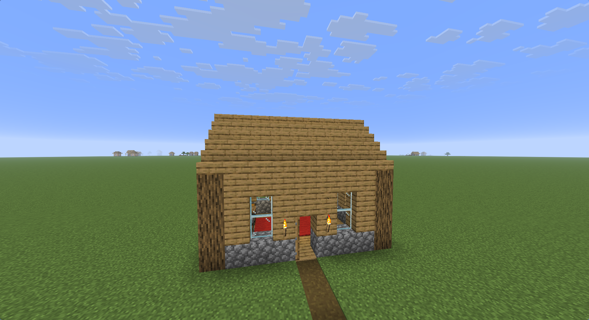
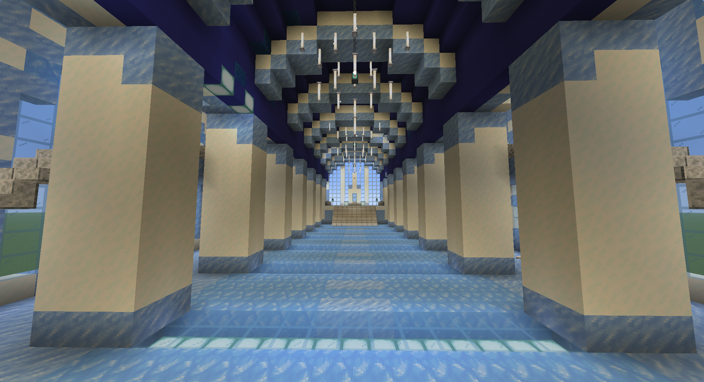
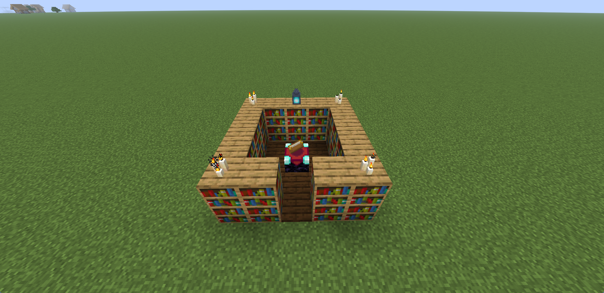

import Callout from '../../../components/Callout.astro';

<Callout type="info">Alles hier ist für die Java Edition 26.3 geschrieben. Bei anderen Versionen ändern sich Blocknamen und eine Zahl in einer Datei. Dazu komme ich unten.</Callout>

Ich wollte wissen, ob man einer KI ein Foto von einem Bauwerk geben kann und am Ende steht das Ding in meiner Minecraft-Welt. Es geht, mit Einschränkungen. Los ging es mit einem ganz normalen Spielerhaus, und das stand schon beim ersten Versuch. Danach habe ich zwei Bilder ausgesucht, die deutlich schwerer sind: einen schwebenden Eisturm auf einer Felsinsel und einen Eispalast mit Kronleuchtern und Thron.





Vorweg das Wichtigste: Die KI sieht mein Spiel nicht. Sie schreibt Textdateien mit Befehlen, ich lege sie in meine Welt und führe sie aus. Ob das Ergebnis gut aussieht, sehe nur ich. Das Prinzip dahinter ist aber so einfach, dass man es auch ohne KI benutzen kann. Das möchte ich hier erklären, und als Beispiel nehme ich etwas Kleines: eine Verzauberungsecke.

## Was ein Datapack ist

Ein Datapack ist ein Ordner in der Welt, in dem Textdateien mit Befehlen liegen. Diese Dateien enden auf `.mcfunction`. In jeder Zeile steht ein Befehl, so wie du ihn im Chat eintippen würdest, nur ohne den Schrägstrich am Anfang. Alles hinter einem `#` ist ein Kommentar.

Zum Bauen reichen im Grunde zwei Befehle. `fill` füllt einen Quader mit einem Block, `setblock` setzt einen einzelnen. Die Koordinaten schreibt man mit einer Tilde, zum Beispiel `~3 ~0 ~-2`. Das heißt: drei Blöcke nach Osten, gleiche Höhe, zwei Blöcke nach Norden, gemessen von der Stelle, an der du gerade stehst. Deshalb baut dieselbe Datei an jeder Stelle der Welt.

## Die Verzauberungsecke

Die Ecke ist klein und hat eine Regel, die sich gut in Befehle übersetzen lässt. Ein Verzauberungstisch bekommt seine Stärke von Bücherregalen. Für die höchste Stufe braucht man 15 davon, sie müssen genau zwei Blöcke vom Tisch entfernt stehen, und dazwischen darf nur Luft sein. Das ergibt einen Ring um den Tisch.

Das ist die Datei `verzauberungsecke.mcfunction`:

```text
# Enchanting corner, 5 x 5 blocks.
# Stand on the north-west corner. The build grows east (+x) and south (+z).

# Clear the space and lay the floor
fill ~0 ~0 ~0 ~4 ~3 ~4 air
fill ~0 ~-1 ~0 ~4 ~-1 ~4 dark_oak_planks

# Two layers of bookshelves as a ring, the middle stays free
fill ~0 ~0 ~0 ~4 ~1 ~0 bookshelf
fill ~0 ~0 ~4 ~4 ~1 ~4 bookshelf
fill ~0 ~0 ~0 ~0 ~1 ~4 bookshelf
fill ~4 ~0 ~0 ~4 ~1 ~4 bookshelf

# Entrance on the south side
fill ~2 ~0 ~4 ~2 ~1 ~4 air

# The enchanting table in the middle
setblock ~2 ~0 ~2 enchanting_table

# Light and decoration on the shelves
setblock ~0 ~2 ~0 candle[candles=3,lit=true]
setblock ~4 ~2 ~0 candle[candles=3,lit=true]
setblock ~0 ~2 ~4 candle[candles=3,lit=true]
setblock ~4 ~2 ~4 candle[candles=3,lit=true]
setblock ~2 ~2 ~0 soul_lantern
```

Zuerst wird der Platz leergeräumt und ein Boden gelegt, damit kein Baum oder Hügel im Weg steht. Dann bauen vier `fill`-Befehle die Wände, zwei Blöcke hoch. Zusammen ergeben sie einen Ring, in dem innen 3 mal 3 Blöcke frei bleiben. Ein weiterer `fill` mit `air` schlägt auf der Südseite eine Tür hinein, und der Tisch kommt genau in die Mitte, zwei Blöcke von jeder Wand entfernt. Kerzen und Laterne setze ich ganz zum Schluss, weil sie auf den Regalen stehen und die Regale dafür schon da sein müssen.

Mit zwei Lagen sind es 30 Regale. Für die höchste Stufe würde eine Lage schon reichen.

Eine zweite Datei, `verzauberungsecke_entfernen.mcfunction`, räumt alles wieder weg:

```text
fill ~0 ~-1 ~0 ~4 ~3 ~4 air
```

## In die Welt packen

Das Datapack ist ein Ordner mit einer festen Struktur. Er liegt im Ordner deiner Welt unter `saves`. Den findest du unter Windows in `%appdata%\.minecraft`, unter Linux in `~/.minecraft`.

```text
saves/<Weltname>/datapacks/beispiel_pack/
├── pack.mcmeta
└── data/
    └── beispiel/
        └── function/
            ├── verzauberungsecke.mcfunction
            └── verzauberungsecke_entfernen.mcfunction
```

Auf die Namen kommt es an. `beispiel` ist der Namensraum, so heißt er später im Befehl, und der Ordner `function` muss in der Einzahl geschrieben sein.

Die Datei `pack.mcmeta` sagt dem Spiel, für welche Version das Datapack gedacht ist:

```json
{
  "pack": {
    "description": "Example: enchanting corner",
    "min_format": 121,
    "max_format": 121
  }
}
```

Die 121 gehört zu Minecraft 26.3 und ändert sich mit der Version. Du findest die Zahl in der Datei `version.json` im Spiel-Archiv, also in `versions/26.3/26.3.jar` (ein ganz normales Zip-Archiv), unter `pack_version` im Wert `data_major`. Passt sie nicht zur Spielversion, meldet das Spiel das Datapack als nicht passend.

## Ausführen

Du brauchst eine Welt, in der Cheats erlaubt sind. Dann stellst du dich auf ebenen Boden, an die Nordwest-Ecke der späteren Ecke, und gibst im Chat zwei Befehle ein. Der erste lädt alle Datapacks neu, damit das Spiel deins findet, der zweite baut:

```text
/reload
/function beispiel:verzauberungsecke
```

Mit `/function beispiel:verzauberungsecke_entfernen` räumst du die Ecke wieder weg. Der Boden darunter kommt dabei nicht zurück, es bleibt einfach Luft. Bei größeren Bauwerken lohnt sich deshalb vorher eine Sicherungskopie der Welt.

Steht im Chat `Unknown function`, stimmt der Name oder der Ordner nicht. Das ist mir selbst ein paarmal passiert, weil ich mich bei den Namen vertippt hatte. Mit `/datapack list` siehst du, ob dein Datapack überhaupt geladen ist.



## Wenn es größer wird

Der Eisturm hat etwa 5.300 Blöcke. Die Befehle dafür schreibt niemand von Hand, also lässt man ein kleines Programm sie erzeugen. Ich nehme dafür Python. Hier ein Turm mit rundem Grundriss:

```python
import math

radius = 5
height = 12
rows = {}
for x in range(-radius, radius + 1):
    for z in range(-radius, radius + 1):
        if radius - 1 < math.hypot(x, z) <= radius:
            rows.setdefault(z, []).append(x)

commands = []
for z, xs in sorted(rows.items()):
    start = end = xs[0]
    for x in xs[1:] + [None]:
        if x is not None and x == end + 1:
            end = x
            continue
        commands.append(f"fill ~{start} ~0 ~{z} ~{end} ~{height} ~{z} stone_bricks")
        start = end = x

with open("round_tower.mcfunction", "w") as file:
    file.write("\n".join(commands) + "\n")
print(len(commands), "commands")
```

Das Programm geht jede Position in einem Quadrat durch und merkt sich die, die auf dem Kreisring liegen. Danach fasst es Blöcke, die in einer Reihe nebeneinander liegen, zu einem einzigen `fill` zusammen, und zwar gleich in der ganzen Höhe des Turms. Der Ring hat 32 Säulen und kommt mit 20 Befehlen aus. Die Datei legst du genauso in den Ordner `function` wie die Verzauberungsecke.

Beim Eisturm wurden aus den 5.300 Blöcken etwa 4.300 Befehle, beim Eispalast sind es gut 13.600 Blöcke in rund 5.300 Befehlen. Das Zusammenfassen spart also viel, hilft aber weniger, wenn viele verschiedene Blöcke gemischt sind. Die großen Bauwerke habe ich auf mehrere Dateien verteilt, die eine Hauptdatei nacheinander aufruft.

## Worauf man achten muss

- Blocknamen ändern sich mit der Version. In 26.3 heißt die Kette zum Beispiel `iron_chain`, früher hieß sie `chain`. Die KI hat die Namen deshalb vor dem Bauen mit der Liste im Spiel-Archiv abgeglichen. Ein falscher Name oder ein ungültiger Befehl führt dazu, dass das Spiel die ganze Funktion nicht lädt. Den Grund findest du dann in `.minecraft/logs/latest.log`.
- Alles, was irgendwo dranhängt, setzt man zuletzt: Laternen, Kerzen, Ketten, Leitern und Schnee. Sonst fallen sie ab, weil noch kein Block da ist, an dem sie halten.
- `fill` und `setblock` funktionieren nur in Bereichen, die gerade geladen sind. Bei sehr großen Bauwerken solltest du dich in die Nähe stellen.
- Ein einzelner `fill` darf höchstens 32.768 Blöcke haben. Größere Flächen teilt man in mehrere Befehle auf.
- Für das Gelände gibt es kein Rückgängig. Die Entfernen-Funktion macht Luft, sie stellt die alte Landschaft nicht wieder her.

## Was dabei herauskommt

Die KI nimmt mir die Fleißarbeit ab, also das Rechnen mit Koordinaten und das Zusammenfassen tausender Blöcke. Was gut aussieht, entscheide ich, und dann sage ich ihr, was sich ändern soll. Aus einem Foto wird dabei keine Kopie, sondern ein Bauwerk, das dem Bild ähnelt. Ornamente an den Säulen oder spiegelnde Böden fehlen.

Wer mehr Kontrolle will, schreibt die Befehle selbst, so wie bei der Verzauberungsecke. Das ist weniger kompliziert, als es aussieht: Man braucht nur `fill`, `setblock` und etwas Geduld mit den Koordinaten.

Wenn du lieber mit Plugins arbeitest, schau dir auch mein [Wayfinder](/posts/wayfinder/) an.
