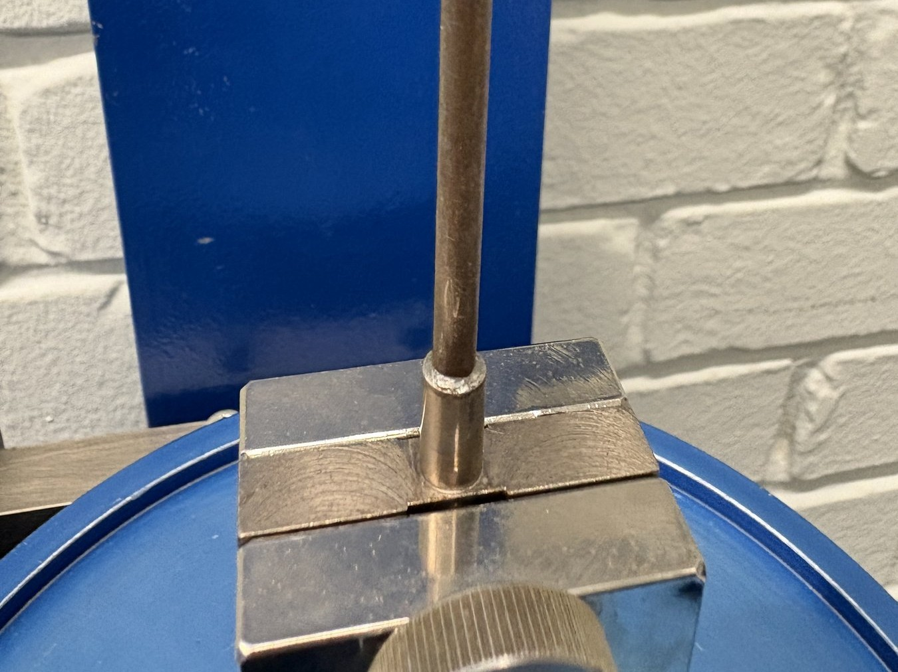
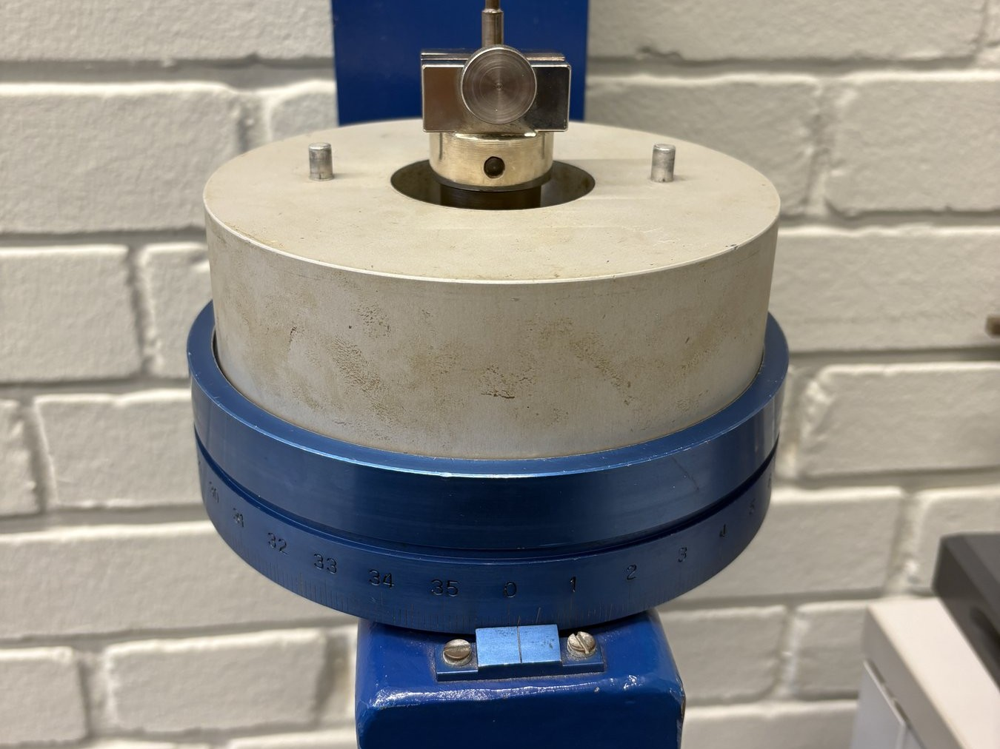

import Callout from '../../../components/Callout.astro';

<Callout type="info">Dieser Artikel ist kein Protokoll. Ich erzähle hier, worum es im Versuch ging und was dabei herauskam. Die Zahlen sind meine eigenen Messwerte vom 2. November 2026.</Callout>

Im [Grundpraktikum der Physik](https://www.tu-ilmenau.de/universitaet/fakultaeten/fakultaet-mathematik-und-naturwissenschaften/profil/institute-und-fachgebiete/institut-fuer-physik/profil/physikalisches-grundpraktikum) stand diese Woche der Versuch M7 an, der Torsionsmodul. Dabei bekommt man zwei dünne Metallstäbe und soll herausfinden, wie schwer sie sich verdrehen lassen. Dazu gibt es eine Kennzahl, den Torsionsmodul $G$, auch Schubmodul genannt. Je größer er ist, desto steifer ist das Material gegen Verdrehen.

Das Spannende daran: Man soll ihn auf zwei ganz verschiedene Arten bestimmen und am Ende schauen, ob dasselbe herauskommt.

### Was ist der Torsionsmodul?

Wenn man einen Körper schert, gleiten seine Schichten gegeneinander. Bei kleinen Verformungen gilt das Hookesche Gesetz

$$
\tau = G \cdot \gamma
$$

mit der Schubspannung $\tau$ und dem Scherwinkel $\gamma$. Der Faktor $G$ ist der Torsionsmodul. Verdreht man einen Stab, wird er genau so geschert. Deshalb ist der Torsionsmodul derselbe Wert wie der Schubmodul.

Für einen Stab mit Länge $l$ und Durchmesser $d$ gilt: Um ihn um den Winkel $\varphi$ zu verdrehen, braucht man das Drehmoment

$$
M = D \cdot \varphi \qquad \text{mit} \qquad D = \frac{\pi \cdot G \cdot d^4}{32 \cdot l}
$$

$D$ heißt Direktionsmoment und beschreibt die Steifigkeit des ganzen Stabes. Der Durchmesser geht mit der vierten Potenz ein. Das wird später noch wichtig.

### Der Aufbau

Oben ist ein Stab (etwa 0,9 m lang) eingespannt. Unten sitzt eine Kreisscheibe mit einer Winkelskala. Am Rand der Scheibe liegt eine Schnur, an die man Massestücke hängen kann.

Es gab zwei Stäbe, die beide goldbraun aussahen. Welches Material sie haben, stand nirgends. Das sollte man am Ende aus dem Torsionsmodul abschätzen.

### Methode 1: statisch

Die statische Methode ist die einfache. Man hängt nacheinander Gewichte an die Schnur. Sie ziehen am Rand der Scheibe und erzeugen das Drehmoment

$$
M = m_\text{ges} \cdot g \cdot R_S
$$

mit dem Scheibenradius $R_S = 88{,}0\ \text{mm}$. Nach jedem Gewicht liest man den Winkel an der Skala ab. Mehr als 45° sollte man nicht gehen, sonst verformt sich der Stab bleibend.

Trägt man $M$ über $\varphi$ auf, liegen die Punkte auf einer Geraden. Ihre Steigung ist das Direktionsmoment $D$, und daraus folgt

$$
G = \frac{32 \cdot S \cdot l}{\pi \cdot d^4}
$$

Bei Stab 1 kamen pro 100 g etwa 2,3° dazu, bei Stab 2 etwa 5,3°. Stab 1 ist also deutlich steifer. Die Steigungen waren $2{,}169\ \text{N m/rad}$ und $0{,}937\ \text{N m/rad}$.

### Methode 2: dynamisch

Die dynamische Methode ist raffinierter. Der Stab mit der Scheibe schwingt wie ein Pendel hin und her. Für die Periodendauer gilt

$$
T = 2\pi \sqrt{\frac{J}{D}}
$$

mit dem Trägheitsmoment $J$ der Scheibe. Das kennt man aber nicht. Der Trick: Man misst ein zweites Mal, diesmal mit einem Hohlzylinder auf der Scheibe. Dessen Trägheitsmoment lässt sich aus Masse und Maßen ausrechnen. Mit den Periodendauern $T_1$ (ohne) und $T_2$ (mit Hohlzylinder) fällt das unbekannte $J$ der Scheibe aus der Rechnung heraus:

$$
D = \frac{4\pi^2 J^*}{T_2^2 - T_1^2}
$$

Ich finde diesen Gedanken schön. Man muss etwas Unbekanntes nicht messen, wenn man dasselbe Experiment einmal mit und einmal ohne eine bekannte Zugabe macht und die beiden voneinander abzieht.

Die Zeit habe ich auf zwei Wegen genommen: von Hand mit der Stoppuhr für 50 Schwingungen und mit der Handy-App PhysPract, die die Periode direkt anzeigt.

### Ergebnisse

| Stab | statisch | dynamisch (PhysPract-App) | dynamisch (Stoppuhr) |
|------|----------|----------------------|----------------------|
| 1 | $50{,}0 \pm 1{,}4$ GPa | $47{,}6 \pm 7{,}6$ GPa | $27{,}5 \pm 4{,}5$ GPa |
| 2 | $59{,}9 \pm 1{,}6$ GPa | $50{,}4 \pm 5{,}1$ GPa | $28{,}5 \pm 6{,}7$ GPa |

Statik und PhysPract-App stimmen im Rahmen der Messunsicherheiten vergleichsweise gut überein. Die Auswertung der Stoppuhrmessung weicht dagegen deutlich ab: Ihre Perioden waren fast doppelt so lang wie die der App (1,05 s gegenüber 0,48 s bei Stab 1). Eine eindeutige Ursache ließ sich im Nachgang nicht bestimmen. Bei einer manuellen Messung über 50 Schwingungen kommen unter anderem die Abgrenzung einer vollständigen Periode, die Reaktionszeit und die Zählweise als systematische Einflüsse infrage. Für die weitere Einordnung werden deshalb die Werte der PhysPract-App herangezogen.

Zur Kontrolle gibt es eine Probe: Das Direktionsmoment kennt man aus der Statik. Damit kann man ausrechnen, wie groß $T_2^2 - T_1^2$ sein müsste. Die PhysPract-App liegt beim 1,05- bzw. 1,19-Fachen davon, die Stoppuhr beim 1,82- bzw. 2,10-Fachen. Das passt zur Einschätzung.

### Welches Metall ist das?

Der Vergleich mit Tabellenwerten ergibt für Stab 1 ungefähr Kupfer (45 GPa) und für Stab 2 ungefähr Eisen (63 bis 66 GPa). Sicher ist das nicht. Gegen Eisen spricht die goldbraune Farbe, möglich wäre eine Beschichtung. Ich habe das Material nicht geprüft, es ist eine Annahme.

### Messunsicherheiten und offene Fragen

Die Auswertung zeigt mehrere Stellen, an denen die Auflösung der Messgeräte und die vorhandene Dokumentation das Ergebnis begrenzen:

- **Durchmesser von Stab 1:** Im Heft sind 4,46 mm dokumentiert; zugleich stand eine alternative Lesart von 3,46 mm im Raum. Wegen der vierten Potenz wäre $G$ mit dem kleineren Wert 2,8-mal so groß, also etwa 138 GPa. Das passt zu keinem der infrage kommenden Metalle. Außerdem ist Stab 1 in der Statik 2,3-mal steifer als Stab 2. Mit 4,46 mm Durchmesser ist das bei ähnlichem Material plausibel, mit 3,46 mm nicht. Da keine Kontrollmessung mehr möglich war, basiert die Auswertung auf dem dokumentierten Wert von 4,46 mm; die offene Frage bleibt ausdrücklich vermerkt.
- **Hohlzylinder:** Für die Wandstärke sind im Heft zwei Werte vermerkt (5,39 und 5,89 cm). Auch die Massenangabe lässt sich anhand der Notizen nicht eindeutig zwischen 2472,3 g und 2742,3 g unterscheiden. Beide Abweichungen beeinflussen das Ergebnis um ungefähr 10 %.
- **Winkel:** Die Skala lässt sich nur auf ganze Grad ablesen. Deshalb liegen die Punkte nicht perfekt auf der Geraden.

Die abgezeichneten Rohwerte wurden unverändert übernommen. Offene Punkte werden als Unsicherheiten ausgewiesen, statt die Zahlen nachträglich an ein erwartetes Ergebnis anzupassen.

### Was ich mitnehme

Die vierte Potenz beim Durchmesser ist gnadenlos. Bereits eine Abweichung von einem Zehntelmillimeter bei einem 3,5 mm dicken Stab verändert das Ergebnis um mehr als 10 %. Auch eine manuelle Periodenmessung über viele Schwingungen ist empfindlicher gegenüber systematischen Einflüssen, als es zunächst scheint.

Den Quellcode für Auswertung und Diagramme gibt es in einem privaten GitHub-Repository. Wenn jemand daran Interesse hat, sagt mir einfach Bescheid.
