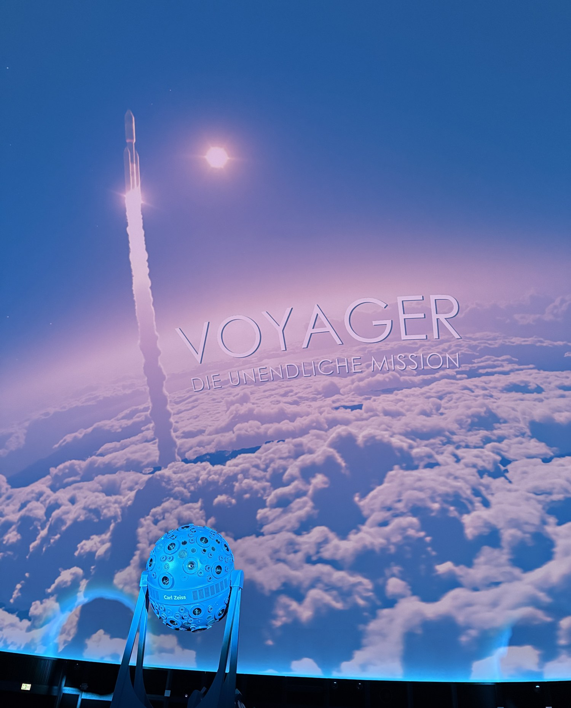

import Callout from '../../../components/Callout.astro';

<Callout type="error">Dieser Artikel ist noch nicht fertig. Der Inhalt wird noch ergänzt.</Callout>

## Worum es geht

Am 17. Oktober 2026 sind wir als Geburtstagsgeschenk für meine Oma nach Jena gefahren. Um 13:00 Uhr haben wir uns im [Zeiss-Planetarium Jena](https://planetarium-jena.de/programm/voyager/)[^1] die Vorstellung **Voyager** angesehen.

Die Vorstellung hat zwei Teile. Sie dauert zusammen etwa 50 Minuten.

## Der Sternhimmel

Der erste Teil ist ein Vortrag über den aktuellen Sternenhimmel und dauert rund 25 Minuten. Das Planetarium zeigt dabei den saisonalen Himmel mit Sternbildern, Planeten und der Milchstraße.

## Die Voyager-Sonden

Im zweiten Teil geht es um die beiden Voyager-Sonden. Er dauert ebenfalls etwa 25 Minuten und ist als Show mit dem Titel „Voyager – Die unendliche Mission" angekündigt.

Die Sonden sind 1977 gestartet. Ihr Ziel waren die äußeren Planeten Jupiter, Saturn, Uranus und Neptun. Inzwischen haben beide unser Sonnensystem verlassen. An Bord haben sie eine goldene Schallplatte mit Botschaften von der Erde.[^1]

## Das Planetarium

Die Vorstellung läuft unter einer Kuppel. Die Bilder werden auf die ganze Kuppel projiziert, nicht auf eine Leinwand. Man sitzt also mittendrin und schaut nach oben. In der Mitte des Saals steht ein Projektor von Carl Zeiss, der den Sternhimmel an die Kuppel wirft.

Der Teil über die Voyager-Sonden ist laut Programmseite eine mehrfach ausgezeichnete Show, die vor allem mit ihren Bildern beeindruckt. Sie zeigt zum Beispiel den großen roten Fleck auf dem Jupiter und fliegt durch die Schluchten des Eismondes Enceladus.[^1] Empfohlen ist sie ab 8 Jahren, und mit insgesamt 52 Minuten ist sie auch für ein Geburtstagsgeschenk gut zu planen.

Titelbild: [Foto von paulseling auf Pexels](https://www.pexels.com/photo/sky-stars-universe-nasa-12244842/), zugeschnitten.

[^1]: [Voyager – Zeiss-Planetarium Jena](https://planetarium-jena.de/programm/voyager/) (abgerufen am 05.11.2026)
