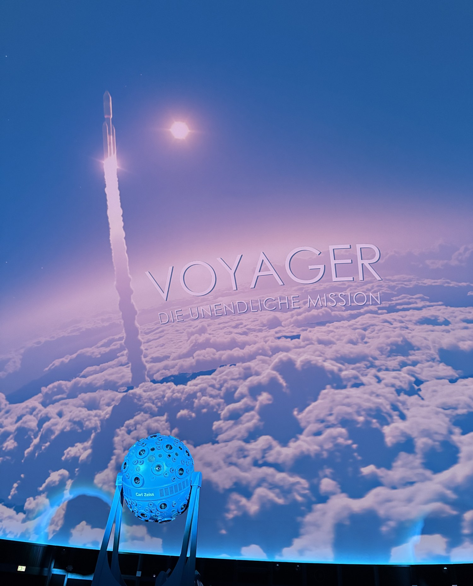

import Callout from '../../../components/Callout.astro';

<Callout type="error">Dieser Artikel ist noch nicht fertig. Der Inhalt wird noch ergänzt.</Callout>

## Worum es geht

## Die Voyager-Sonden

## Die Sternwarte Jena

## Was ich mitnehme

Titelbild: [Foto von paulseling auf Pexels](https://www.pexels.com/photo/sky-stars-universe-nasa-12244842/), zugeschnitten.
